# ux-sim run `sched-20261106-1915-diego-cold-start-hangout`

> **AI simulation — hypotheses, not measured user behaviour.** One simulated persona; nothing here is a rate or a measurement of real students.

| | |
|---|---|
| Persona | **Diego**, 21 — Junior (transfer from Laney College) · phone 390×844 · prefers en · tech medium (`diego-transfer-commuter`) |
| Scenario | **Brand-new account: find someone on campus to hang out with this week** — You just heard about this app and want someone on campus to hang out with this week. Make an account with your school e-mail, then use the app to find a person or plan you could join this week and tell them you're in. (`cold-start-hangout`) |
| Target | local · http://localhost:41649 · worktree commit `deedbfee6b32` |
| Outcome | **abandoned** · ended by persona |
| Account | signed out at start |
| Goal check (fixed, by harness) | not met — _Signed up during the run AND, as that new account, joined/requested a plan, hosted one, sent a friend request or sent a chat message._ |
| Patience | exhausted at step 28; 1 action(s) after — **overrodePatience** |
| Persona's reason | “Six onboarding screens to make an account, then Meetups says 'make the first plan' — nobody to join. 'Go together' on campus events isn't a person telling me they're in. I'm out, class starts.” |
| Effort | 19/32 actions · objective frustration 3.00/4 · 2 confused note(s) · ~77s simulated |
| Drop-off risk | **high** _(AI hypothesis, persona agent)_ — Spent ~19 taps mostly on onboarding, and the one place to find people this week was empty; as a commuter with minutes between classes he has no reason to reopen it · basis: steps 13, 15, 27, 28 |

Known environment limits (not UX findings)

- Dining menus and RSF gym crowd levels need live campus sources (the local stack runs with CAMPUS_LIVE=0) — empty or missing data there is not a UX bug.
- AI features (Ask Lumi, AI profile draft on /start, conversation starters) need an OpenAI key; none is configured locally.
- Course catalog is the real Berkeley Class Schedule (6619 courses, Fall 2026 + Spring 2027), fetched 2026-11-05 with the worker's adapter. Seat counts and very recent changes may differ from live.
- Campus events, free food, internships, hackathons and scholarships are a read-only snapshot of live (1268 real items, 114 events this week, taken 2026-11-06 19:15 UTC) plus the CSV calendar. Nothing new appears during the run; Q&A and reviews are empty.
- No e-mail is sent: the sign-up / sign-in code is shown on screen in the hint (live sends a real e-mail).
- Real-time updates (SSE) work locally; other people never reply unless the stack was started with --autoreply.

## Friction

| # | step | type | sev | persona says | screen | element | env-limited | evidence |
|---|---|---|---|---|---|---|---|---|
| f1 | 1 | Onboarding friction | 1 | “1 of 6? OK, six screens before I even make the account. Fine, quick taps, but don't drag it out.” _wish: let me make the account first, or keep it to 2-3 screens_ | `/start/goals` |  | no | [shot](shots/001-click.jpg) [marked](shots/001-click-som.jpg) |
| f2 | 13 | Onboarding friction | 2 | “Still no account. I'm hitting Skip. Nine taps in and I haven't seen a single person.” _wish: make the account and show me people first, ask interests later_ | `/start/discover` | Skip | no | [shot](shots/013-click.jpg) [marked](shots/013-click-som.jpg) |
| f3 | 27 | Missing / empty content | 3 | “Nobody's made a plan. I'm new, I'm not gonna be the first to host. There's a 'This week on campus' thing below, let me see.” _wish: show me at least a couple of plans by real students this week I could just join_ | `/social/meetups` | Create Meetup | no | [shot](shots/027-click.jpg) [marked](shots/027-click-som.jpg) |

Severity: 1 = Minor — noticed it, cosmetic or a small annoyance; did not slow me down. · 2 = Moderate — slowed me down or made me hesitate; I recovered on my own. · 3 = Major — real confusion, a wrong path or many extra steps; I nearly gave up or only got through by guessing. · 4 = Blocker — I could not continue, gave up, or would stop using the app here.

## Where it ended

Step 29 on `/social/meetups`.

## Timeline

| step | what | screen | ms | signals / notes | shot |
|---|---|---|---|---|---|
| 0 | start | `/welcome` | 1359 |  |  |
| 1 | click “Get Started” | `/start/goals` | 891 | expects: “sign-up form asking for school email” (0.8) **mismatch**: Goals questionnaire, '1 of 6' before any account ⚑ mismatch _neutral_: “1 of 6? OK, six screens before I even make the account. Fine, quick taps, but don't drag it out.” → f1 | <a href="shots/001-click-som.jpg">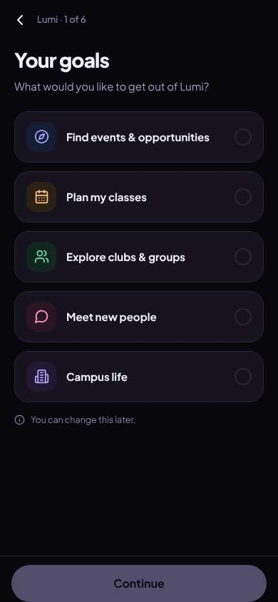</a> |
| 3 | click “Meet new people” | `/start/goals` | 841 |  | <a href="shots/003-click-som.jpg">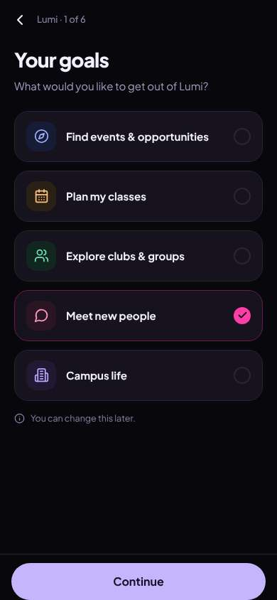</a> |
| 4 | click “Continue” | `/start/what` | 833 | expects: “next onboarding question” (0.8) **mismatch**: A feature tour with a sample week, not a question ⚑ mismatch _bored_: “It's a demo. I don't need a tour, I need to make the account. Skip.” | <a href="shots/004-click-som.jpg">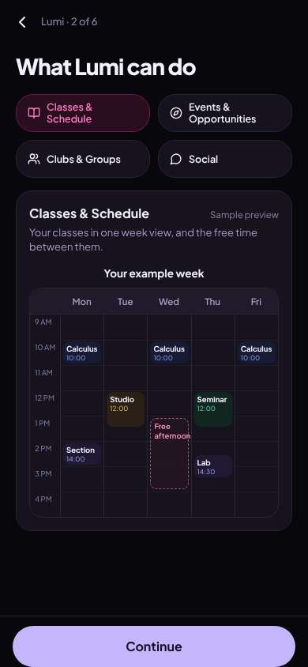</a> |
| 6 | click “Continue” | `/start/university` | 849 | expects: “account creation or next step” (0.5) as expected _neutral_: “OK, school. That makes sense.” | <a href="shots/006-click-som.jpg">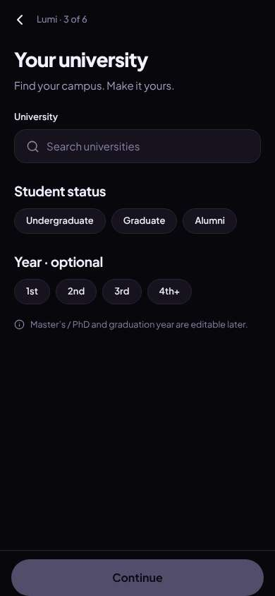</a> |
| 8 | type “Search universities” ← “Berkeley” | `/start/university` | 854 | expects: “UC Berkeley shows up in a list” (0.8) as expected _neutral_: “There it is.” | <a href="shots/008-type-som.jpg">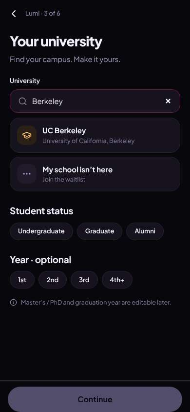</a> |
| 10 | click “UC Berkeley University of California, Be” | `/start/university` | 836 |  | <a href="shots/010-click-som.jpg">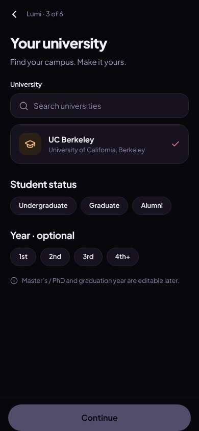</a> |
| 11 | click “Undergraduate” | `/start/university` | 826 |  | <a href="shots/011-click-som.jpg">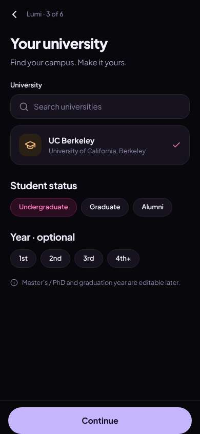</a> |
| 12 | click “3rd” | `/start/university` | 839 |  | <a href="shots/012-click-som.jpg">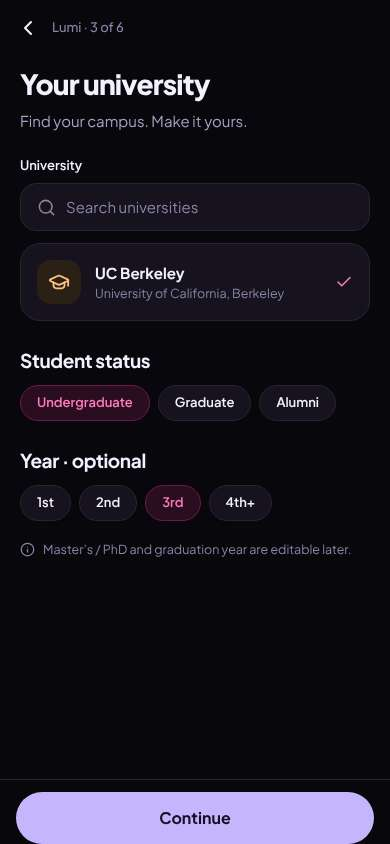</a> |
| 13 | click “Continue” | `/start/discover` | 845 | expects: “account / email step” (0.5) **mismatch**: Another optional interests screen, 4 of 6, still no account ⚑ mismatch _frustrated_: “Still no account. I'm hitting Skip. Nine taps in and I haven't seen a single person.” → f2 | <a href="shots/013-click-som.jpg">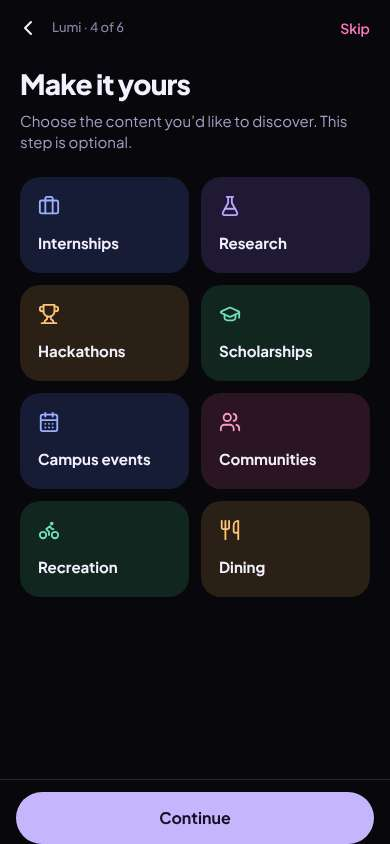</a> |
| 15 | click “Skip” | `/start/communities` | 844 | expects: “email / account step” (0.6) **mismatch**: Communities picker, 5 of 6 ⚑ mismatch _neutral_: “Skip again. One more and then it better be the account.” | <a href="shots/015-click-som.jpg">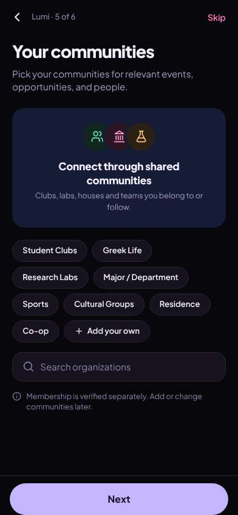</a> |
| 17 | click “Skip” | `/start/about` | 837 | expects: “account / email step (6 of 6)” (0.7) as expected _neutral_: “Finally. Name, year, email. Got it.” | <a href="shots/017-click-som.jpg">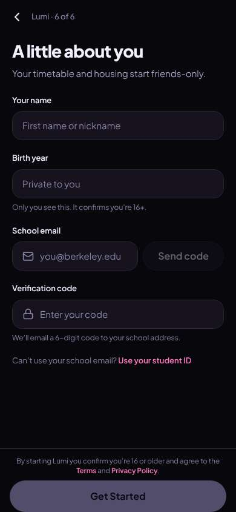</a> |
| 19 | type “First name or nickname” ← “Diego” | `/start/about` | 856 |  | <a href="shots/019-type-som.jpg">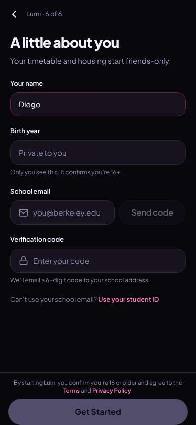</a> |
| 20 | type “Private to you” ← “2005” | `/start/about` | 857 |  | <a href="shots/020-type-som.jpg">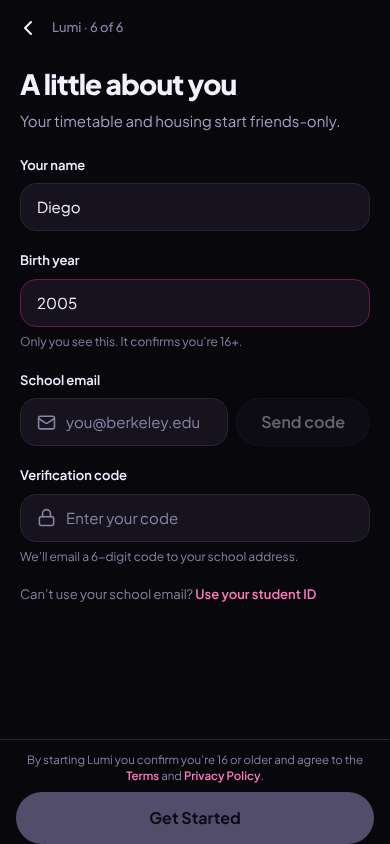</a> |
| 21 | type “you@berkeley.edu” ← “diego.ramirez@berkeley.edu” | `/start/about` | 849 |  | <a href="shots/021-type-som.jpg">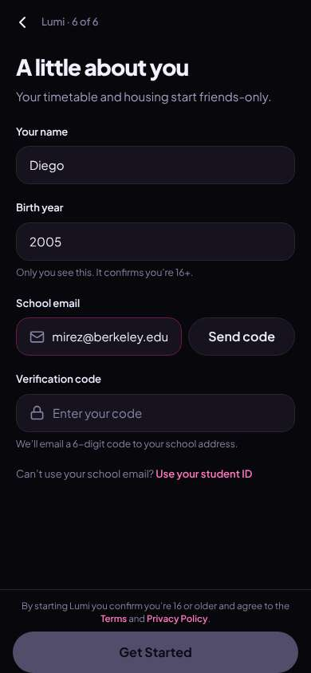</a> |
| 22 | click “Send code” | `/start/about` | 843 | expects: “code is sent, code field unlocks” (0.8) as expected _neutral_: “Good, code's here.” | <a href="shots/022-click-som.jpg">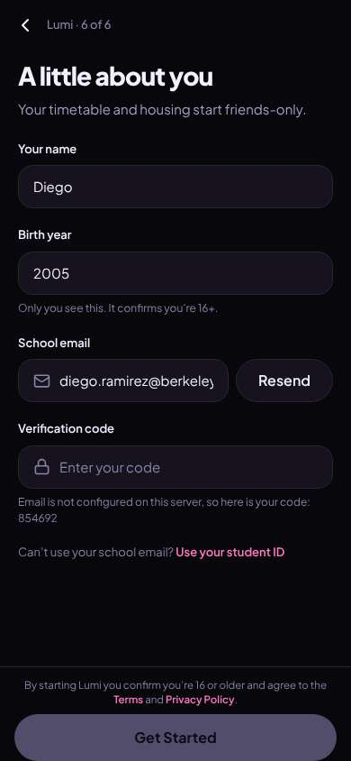</a> |
| 24 | type “Enter your code” ← “854692” | `/start/about` | 855 |  | <a href="shots/024-type-som.jpg">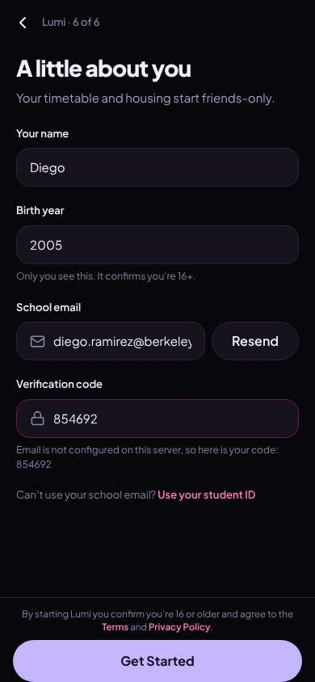</a> |
| 25 | click “Get Started” | `/` | 1444 | expects: “I land in the app with people or plans this week” (0.6) **mismatch**: Home with campus events feed; no people or plans on first screen ⚑ mismatch _neutral_: “OK, I'm in. Events are just campus stuff. 'Meetups' sounds like where people hang out.” | <a href="shots/025-click-som.jpg">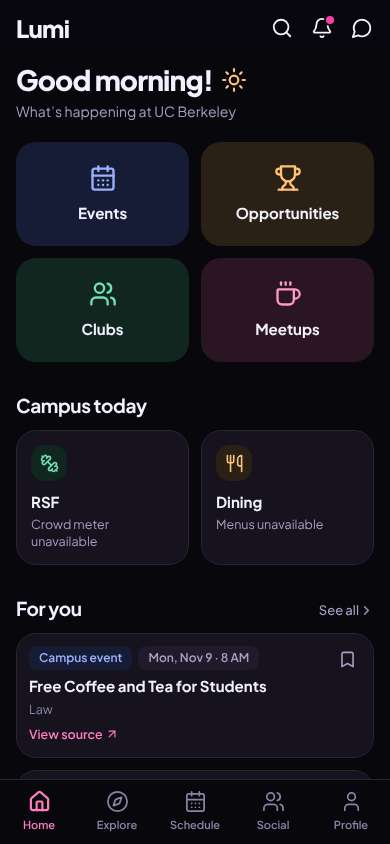</a> |
| 27 | click “Meetups” | `/social/meetups` | 841 | expects: “list of meetups with people this week I can join” (0.6) **mismatch**: Meetups is empty: 'Make the first plan'. No one's plans to join. ⚑ mismatch _frustrated_: “Nobody's made a plan. I'm new, I'm not gonna be the first to host. There's a 'This week on campus' thing below, let me see.” → f3 | <a href="shots/027-click-som.jpg">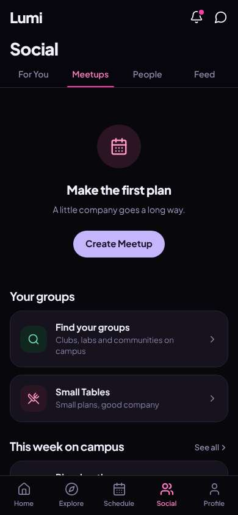</a> |
| 29 | scroll down | `/social/meetups` | 1322 |  | <a href="shots/029-scroll-som.jpg">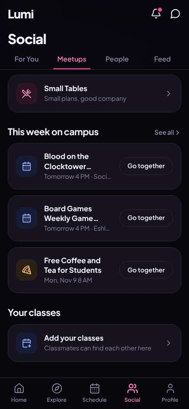</a> |
| 30 | finish | `/social/meetups` |  |  |  |

## Automatic checks (harness, not persona)

| screen | tap targets < 44px | sideways overflow | broken images |
|---|---|---|---|
| `/welcome` | 5 (English 44×20, Sign In 80×40, Look around first 136×36, Terms 34×15, Privacy 41×15) | — | — |
| `/start/goals` | 1 (Back 40×40) | — | — |
| `/start/what` | 1 (Back 40×40) | — | — |
| `/start/university` | 9 (Back 40×40, Search universities 287×23, Undergraduate 130×36, Graduate 94×36, Alumni 77×36) | — | — |
| `/start/discover` | 2 (Back 40×40, Skip 54×40) | — | — |
| `/start/communities` | 12 (Back 40×40, Skip 54×40, Student Clubs 123×36, Greek Life 98×36, Research Labs 125×36) | — | — |
| `/start/about` | 4 (Back 40×40, Use your student ID 121×18, Terms 33×15, Privacy Policy 77×15) | — | — |
| `/` | 6 (Search 40×40, Notifications 40×40, Messages 40×40, See all 55×20, View source 90×19) | — | — |
| `/social/meetups` | 12 (Notifications 40×40, Messages 40×40, See all 55×20) | — | — |

## Timing (harness)

- Full page load (navigation timing): 439 ms
