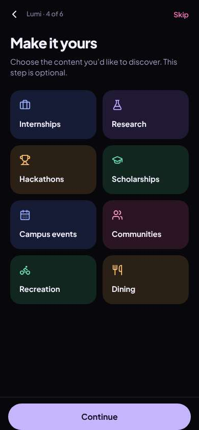
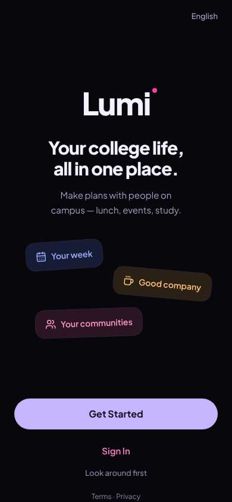
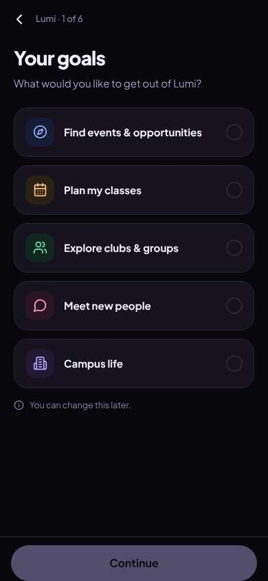
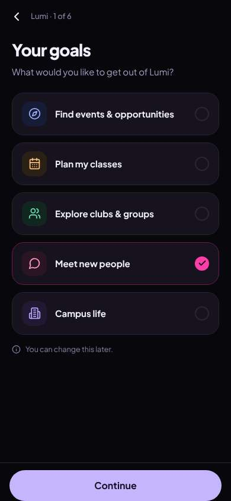
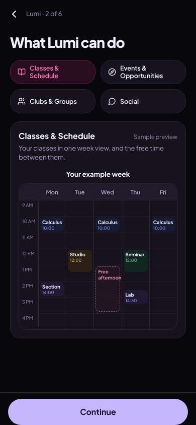
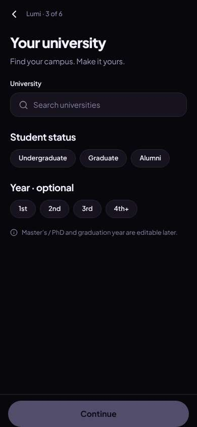
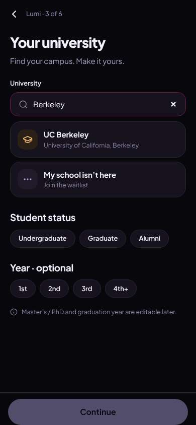
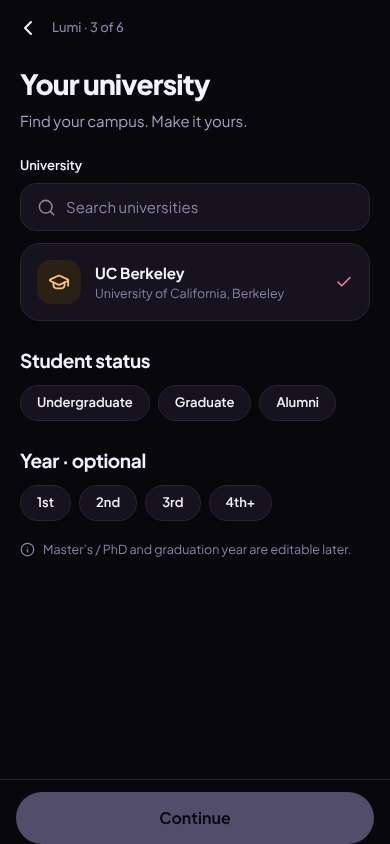
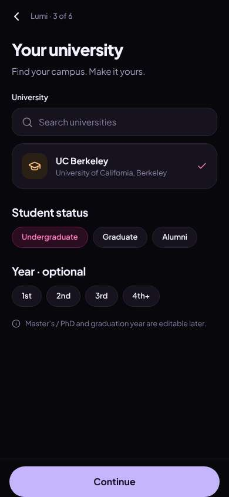
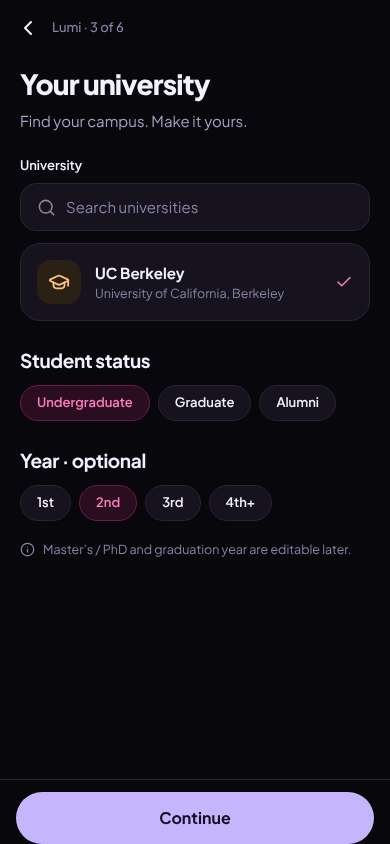

# ux-sim run `sched-20261106-1915-jordan-cold-start-hangout`

> **AI simulation — hypotheses, not measured user behaviour.** One simulated persona; nothing here is a rate or a measurement of real students.

| | |
|---|---|
| Persona | **Jordan**, 19 — Sophomore · phone 390×844 · prefers en · tech high (`jordan-sophomore-impatient`) |
| Scenario | **Brand-new account: find someone on campus to hang out with this week** — You just heard about this app and want someone on campus to hang out with this week. Make an account with your school e-mail, then use the app to find a person or plan you could join this week and tell them you're in. (`cold-start-hangout`) |
| Target | local · http://localhost:42077 · worktree commit `deedbfee6b32` |
| Outcome | **abandoned** · ended by persona |
| Account | signed out at start |
| Goal check (fixed, by harness) | not met — _Signed up during the run AND, as that new account, joined/requested a plan, hosted one, sent a friend request or sent a chat message._ |
| Patience | exhausted at step 13; 0 action(s) after |
| Persona's reason | “Four setup screens, a class-calendar tour and an interests picker, and I still don't have an account or see one person. I said meet people. Gone.” |
| Effort | 9/28 actions · objective frustration 2.00/3 · 2 confused note(s) · ~14s simulated |
| Drop-off risk | **high** _(AI hypothesis, persona agent)_ — Quit-trigger is >2 setup screens; the app showed 4 of 6 with no people or plans visible and no account yet, so Jordan never reached any value. · basis: steps 1, 4, 12 |

Known environment limits (not UX findings)

- Dining menus and RSF gym crowd levels need live campus sources (the local stack runs with CAMPUS_LIVE=0) — empty or missing data there is not a UX bug.
- AI features (Ask Lumi, AI profile draft on /start, conversation starters) need an OpenAI key; none is configured locally.
- Course catalog is the real Berkeley Class Schedule (6619 courses, Fall 2026 + Spring 2027), fetched 2026-11-05 with the worker's adapter. Seat counts and very recent changes may differ from live.
- Campus events, free food, internships, hackathons and scholarships are a read-only snapshot of live (1268 real items, 114 events this week, taken 2026-11-06 19:15 UTC) plus the CSV calendar. Nothing new appears during the run; Q&A and reviews are empty.
- No e-mail is sent: the sign-up / sign-in code is shown on screen in the hint (live sends a real e-mail).
- Real-time updates (SSE) work locally; other people never reply unless the stack was started with --autoreply.

## Friction

| # | step | type | sev | persona says | screen | element | env-limited | evidence |
|---|---|---|---|---|---|---|---|---|
| f1 | 1 | Onboarding friction | 3 | “1 of 6?? six screens before I even see anything. ugh.” _wish: let me sign up with my email and see people right away_ | `/start/goals` |  | no | [shot](shots/001-click.jpg) [marked](shots/001-click-som.jpg) |
| f2 | 4 | No reason to stay | 2 | “I said meet people. why are you showing me calculus. skip.” _wish: open on the Social preview since that's what I picked, or let me skip the tour_ | `/start/what` | Classes & Schedule | no | [shot](shots/004-click.jpg) [marked](shots/004-click-som.jpg) |
| f3 | 12 | Onboarding friction | 4 | “four screens in and I haven't seen a single human. this is the part where I delete it.” _wish: show me who's around / what's happening this week before asking me to configure stuff_ | `/start/discover` | Continue | no | [shot](shots/012-click.jpg) [marked](shots/012-click-som.jpg) |

Severity: 1 = Minor — noticed it, cosmetic or a small annoyance; did not slow me down. · 2 = Moderate — slowed me down or made me hesitate; I recovered on my own. · 3 = Major — real confusion, a wrong path or many extra steps; I nearly gave up or only got through by guessing. · 4 = Blocker — I could not continue, gave up, or would stop using the app here.

## Where it ended

Step 12 on `/start/discover`.

## Timeline

| step | what | screen | ms | signals / notes | shot |
|---|---|---|---|---|---|
| 0 | start | `/welcome` | 1464 |  |  |
| 1 | click “Get Started” | `/start/goals` | 906 | expects: “sign up form with email” (0.8) **mismatch**: goals quiz, '1 of 6' setup screens before any account ⚑ mismatch _frustrated_: “1 of 6?? six screens before I even see anything. ugh.” → f1 |  |
| 3 | click “Meet new people” | `/start/goals` | 844 |  |  |
| 4 | click “Continue” | `/start/what` | 858 | expects: “another setup question” (0.7) **mismatch**: a feature tour, opens on a sample class calendar even though I picked Meet new people ⚑ mismatch _bored_: “I said meet people. why are you showing me calculus. skip.” → f2 |  |
| 6 | click “Continue” | `/start/university` | 843 | expects: “next setup screen, hopefully sign up” (0.5) **mismatch**: university + year picker, 3 of 6, still no sign up ⚑ mismatch _neutral_: “fine, berkeley, sophomore. this better be the last one.” |  |
| 8 | type “Search universities” ← “Berkeley” | `/start/university` | 860 |  |  |
| 9 | click “UC Berkeley University of California, Be” | `/start/university` | 839 |  |  |
| 10 | click “Undergraduate” | `/start/university` | 845 |  |  |
| 11 | click “2nd” | `/start/university` | 842 |  |  |
| 12 | click “Continue” | `/start/discover` | 839 | expects: “email sign up finally” (0.5) **mismatch**: 4 of 6: another interests picker. still no account, still no people ⚑ mismatch _frustrated_: “four screens in and I haven't seen a single human. this is the part where I delete it.” → f3 |  |
| 14 | finish | `/start/discover` |  |  |  |

## Automatic checks (harness, not persona)

| screen | tap targets < 44px | sideways overflow | broken images |
|---|---|---|---|
| `/welcome` | 5 (English 44×20, Sign In 80×40, Look around first 136×36, Terms 34×15, Privacy 41×15) | — | — |
| `/start/goals` | 1 (Back 40×40) | — | — |
| `/start/what` | 1 (Back 40×40) | — | — |
| `/start/university` | 9 (Back 40×40, Search universities 287×23, Undergraduate 130×36, Graduate 94×36, Alumni 77×36) | — | — |
| `/start/discover` | 2 (Back 40×40, Skip 54×40) | — | — |

## Timing (harness)

- Full page load (navigation timing): 605 ms
