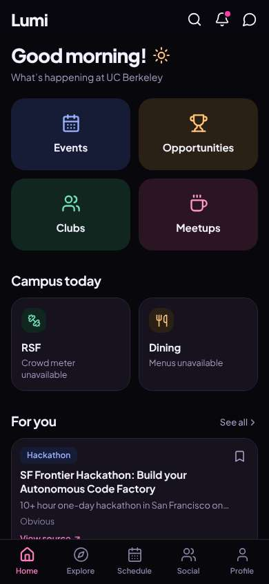
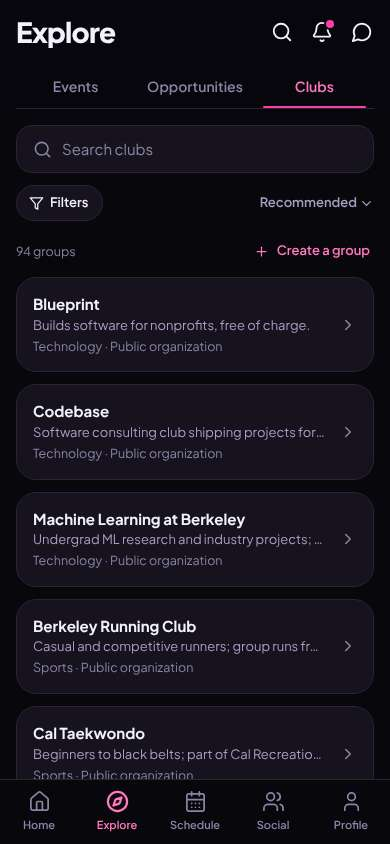
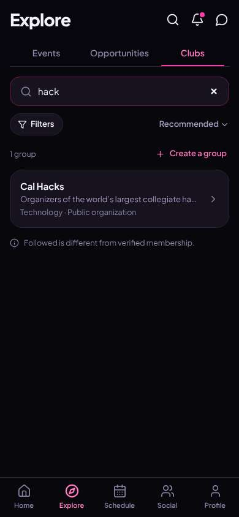
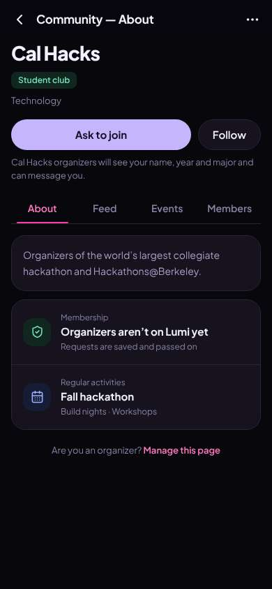
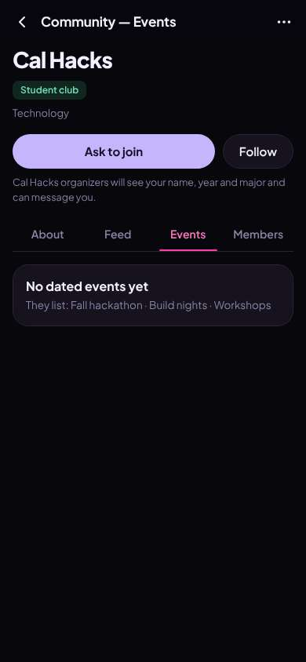

# ux-sim run `sched-20261106-1915-jordan-find-a-club`

> **AI simulation — hypotheses, not measured user behaviour.** One simulated persona; nothing here is a rate or a measurement of real students.

| | |
|---|---|
| Persona | **Jordan**, 19 — Sophomore · phone 390×844 · prefers en · tech high (`jordan-sophomore-impatient`) |
| Scenario | **Find a club I'd actually like** — You want to find one student club or group you'd actually enjoy and feel welcome in. Use the app to find one that fits you and open its page to see how to join. (`find-a-club`) |
| Target | local · http://localhost:46367 · worktree commit `deedbfee6b32` |
| Outcome | **success** · ended by persona |
| Account | fresh real account `jordan.clubu756@berkeley.edu` (Jordan, Computer Science, born 2007; sample: false) |
| Goal check (fixed, by harness) | met at step 5 after 3 action(s) — evidence: {"urlMatches":"^/orgs/[^/?]+"} — _A club / organization page is open (reached by the persona — the run starts on /)._ |
| Persona's reason | “Found Cal Hacks in like 3 taps and saw the Ask to join button. But no events listed and organizers aren't even on here, so idk if asking does anything.” |
| Effort | 4/28 actions · objective frustration 0.50/3 · 0 confused note(s) · ~12s simulated |
| Drop-off risk | **high** _(AI hypothesis, persona agent)_ — Getting to the club was fast, but the page is empty: no events, organizers not on the app. Nothing pulls me back. · basis: steps 5, 7 |

Known environment limits (not UX findings)

- Dining menus and RSF gym crowd levels need live campus sources (the local stack runs with CAMPUS_LIVE=0) — empty or missing data there is not a UX bug.
- AI features (Ask Lumi, AI profile draft on /start, conversation starters) need an OpenAI key; none is configured locally.
- Course catalog is the real Berkeley Class Schedule (6619 courses, Fall 2026 + Spring 2027), fetched 2026-11-05 with the worker's adapter. Seat counts and very recent changes may differ from live.
- Campus events, free food, internships, hackathons and scholarships are a read-only snapshot of live (1268 real items, 114 events this week, taken 2026-11-06 19:15 UTC) plus the CSV calendar. Nothing new appears during the run; Q&A and reviews are empty.
- No e-mail is sent: the sign-up / sign-in code is shown on screen in the hint (live sends a real e-mail).
- Real-time updates (SSE) work locally; other people never reply unless the stack was started with --autoreply.
- Signed in as a brand-new real (non-sample, e-mail-verified) account made for this run. Other students exist only if the scenario seeds peers (local fixtures); sample profiles are hidden from real accounts, as on live.

## Friction

| # | step | type | sev | persona says | screen | element | env-limited | evidence |
|---|---|---|---|---|---|---|---|---|
| f1 | 1 | No reason to stay | 2 | “ok it's a list. 94 groups. no pics, no 'meeting tonight'. kinda bulletin board. resume-padding consulting clubs on top.” _wish: show what's happening this week or a photo/vibe so I can tell which are fun_ | `/explore/clubs` | Blueprint Builds software for nonprofits, free of charge. Technology · Public organization | no | [shot](shots/001-click.jpg) [marked](shots/001-click-som.jpg) |
| f2 | 5 | Missing / empty content | 2 | “ok there's a join button. but organizers aren't even here? so I'm asking... nobody? 'saved and passed on' to who” _wish: tell me where the request actually goes or link their real signup/Discord_ | `/orgs/:id` | Ask to join | no | [shot](shots/005-click.jpg) [marked](shots/005-click-som.jpg) |
| f3 | 7 | Missing / empty content | 3 | “no events. for the biggest hackathon club. so nothing happening. this is the bulletin board thing” _wish: show the next build night or when the fall hackathon is_ | `/orgs/:id?tab=events` | Events | no | [shot](shots/007-click.jpg) [marked](shots/007-click-som.jpg) |

Severity: 1 = Minor — noticed it, cosmetic or a small annoyance; did not slow me down. · 2 = Moderate — slowed me down or made me hesitate; I recovered on my own. · 3 = Major — real confusion, a wrong path or many extra steps; I nearly gave up or only got through by guessing. · 4 = Blocker — I could not continue, gave up, or would stop using the app here.

## Timeline

| step | what | screen | ms | signals / notes | shot |
|---|---|---|---|---|---|
| 0 | start | `/` | 1021 |  |  |
| 1 | click “Clubs” | `/explore/clubs` | 898 | expects: “a list of clubs I can browse” (0.85) as expected _neutral_: “ok it's a list. 94 groups. no pics, no 'meeting tonight'. kinda bulletin board. resume-padding consulting clubs on top.” → f1 |  |
| 3 | type “Search clubs” ← “hack” | `/explore/clubs` | 913 | expects: “hackathon clubs show up” (0.6) as expected _curious_: “ok search is fast. Cal Hacks. that's actually cool. 'followed is different from verified membership' — ok and? who cares” |  |
| 5 | click “Cal Hacks Organizers of the world’s larg” | `/orgs/:id` | 851 | expects: “Cal Hacks page with how to join / next meeting” (0.7) as expected _neutral_: “ok there's a join button. but organizers aren't even here? so I'm asking... nobody? 'saved and passed on' to who” → f2 |  |
| 7 | click “Events” | `/orgs/:id?tab=events` | 846 | expects: “upcoming Cal Hacks events / build nights” (0.5) **mismatch**: 'No dated events yet' — empty events tab ⚑ mismatch _bored_: “no events. for the biggest hackathon club. so nothing happening. this is the bulletin board thing” → f3 |  |
| 9 | finish | `/orgs/:id?tab=events` |  |  |  |

## Automatic checks (harness, not persona)

| screen | tap targets < 44px | sideways overflow | broken images |
|---|---|---|---|
| `/` | 6 (Search 40×40, Notifications 40×40, Messages 40×40, See all 55×20, View source 90×19) | — | — |
| `/explore/clubs` | 7 (Search 40×40, Notifications 40×40, Messages 40×40, Search clubs 295×23, Filters 87×36) | — | — |
| `/orgs/:id` | 3 (Back 40×40, More 40×40, Are you an organizer? Manage this page 358×32) | — | — |
| `/orgs/:id?tab=events` | 2 (Back 40×40, More 40×40) | — | — |

## Timing (harness)

- Full page load (navigation timing): 207 ms
