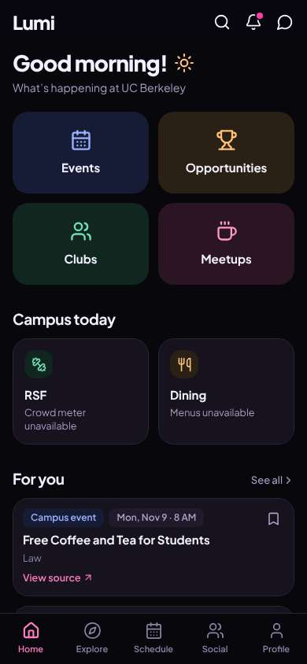
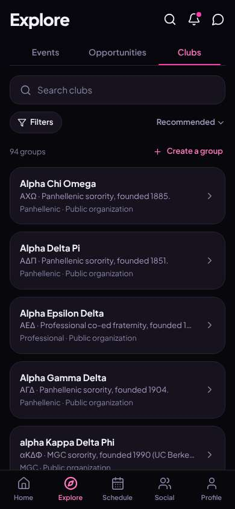
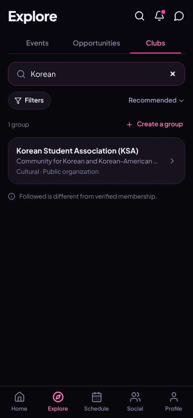
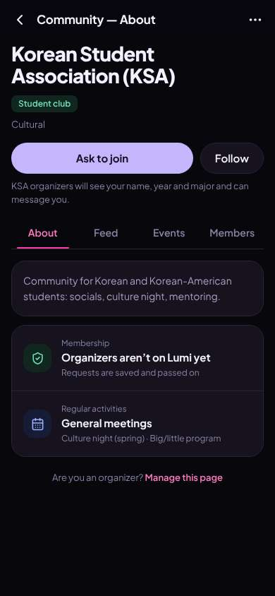
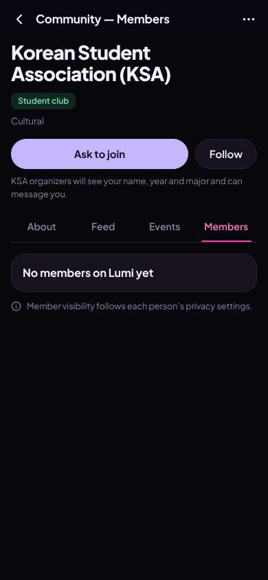
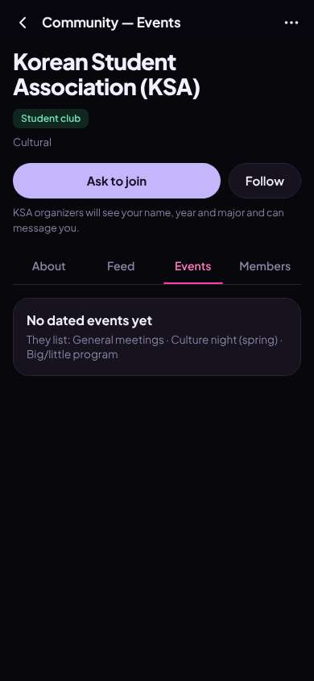
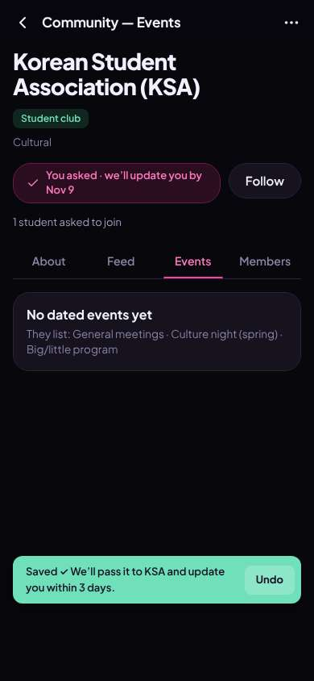
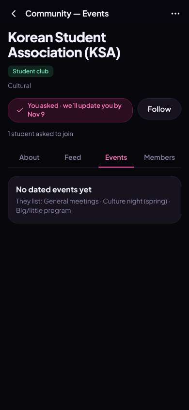

# ux-sim run `sched-20261106-1915-minji-find-a-club`

> **AI simulation — hypotheses, not measured user behaviour.** One simulated persona; nothing here is a rate or a measurement of real students.

| | |
|---|---|
| Persona | **Minji**, 17 — First-year (started college a year early) · phone 390×844 · prefers ko · tech high (`minji-freshman-17`) |
| Scenario | **Find a club I'd actually like** — You want to find one student club or group you'd actually enjoy and feel welcome in. Use the app to find one that fits you and open its page to see how to join. (`find-a-club`) |
| Target | local · http://localhost:32989 · worktree commit `deedbfee6b32` |
| Outcome | **success** · ended by persona |
| Account | fresh real account `minji.clubu77d@berkeley.edu` (Minji, Undeclared, born 2009; sample: false) |
| Goal check (fixed, by harness) | met at step 6 after 3 action(s) — evidence: {"urlMatches":"^/orgs/[^/?]+"} — _A club / organization page is open (reached by the persona — the run starts on /)._ |
| Persona's reason | “KSA 찾았고 page 열어서 Ask to join 눌렀어. They'll update me by Nov 9 — but I still don't know when or where they meet.” |
| Effort | 6/40 actions · objective frustration 1.00/4.5 · 2 confused note(s) · ~24s simulated |
| Drop-off risk | **medium** _(AI hypothesis, persona agent)_ — Found the club fast and the request felt safe, but members/events were empty and organizers aren't on Lumi, so she'd come back only if the Nov 9 update actually arrives · basis: steps 6, 8, 10, 12 |

Known environment limits (not UX findings)

- Dining menus and RSF gym crowd levels need live campus sources (the local stack runs with CAMPUS_LIVE=0) — empty or missing data there is not a UX bug.
- AI features (Ask Lumi, AI profile draft on /start, conversation starters) need an OpenAI key; none is configured locally.
- Course catalog is the real Berkeley Class Schedule (6619 courses, Fall 2026 + Spring 2027), fetched 2026-11-05 with the worker's adapter. Seat counts and very recent changes may differ from live.
- Campus events, free food, internships, hackathons and scholarships are a read-only snapshot of live (1268 real items, 114 events this week, taken 2026-11-06 19:15 UTC) plus the CSV calendar. Nothing new appears during the run; Q&A and reviews are empty.
- No e-mail is sent: the sign-up / sign-in code is shown on screen in the hint (live sends a real e-mail).
- Real-time updates (SSE) work locally; other people never reply unless the stack was started with --autoreply.
- Signed in as a brand-new real (non-sample, e-mail-verified) account made for this run. Other students exist only if the scenario seeds peers (local fixtures); sample profiles are hidden from real accounts, as on live.

## Friction

| # | step | type | sev | persona says | screen | element | env-limited | evidence |
|---|---|---|---|---|---|---|---|---|
| f1 | 2 | Confusing UI | 2 | “ok it's a list... but 'Recommended' is just alphabet sororities? 뭐지. I'm not rushing a sorority at 17” _wish: recommended should use something about me, or show friendly casual clubs first_ | `/explore/clubs` | Sort: Recommended | no | [shot](shots/002-click.jpg) [marked](shots/002-click-som.jpg) |
| f2 | 4 | Unclear wording | 1 | “KSA! socials + mentoring, 딱이다. 'Followed is different from verified membership' 이건 뭔 소리지 though” _wish: plain words, or explain only when I follow_ | `/explore/clubs` |  | no | [shot](shots/004-type.jpg) [marked](shots/004-type-som.jpg) |
| f3 | 6 | Missing / empty content | 2 | “Ask to join 있긴 한데... organizers aren't on Lumi? so who gets my request? and 'General meetings' — when? where?” _wish: when/where the next general meeting is, or their insta/link so I can just show up_ | `/orgs/:id` | Ask to join | no | [shot](shots/006-click.jpg) [marked](shots/006-click-som.jpg) |
| f4 | 8 | Missing / empty content | 2 | “아 아무도 없네. kinda expected. can't tell if anyone's my age” _wish: show at least how many people / that freshmen are welcome_ | `/orgs/:id?tab=members` | Members | no | [shot](shots/008-click.jpg) [marked](shots/008-click-som.jpg) |
| f5 | 10 | Missing / empty content | 2 | “3 tabs, 다 비었어. so the only real thing here is the Ask to join button” _wish: a next date, even 'every Thurs 7pm' or a link to their Instagram_ | `/orgs/:id?tab=events` | Events | no | [shot](shots/010-click.jpg) [marked](shots/010-click-som.jpg) |

Severity: 1 = Minor — noticed it, cosmetic or a small annoyance; did not slow me down. · 2 = Moderate — slowed me down or made me hesitate; I recovered on my own. · 3 = Major — real confusion, a wrong path or many extra steps; I nearly gave up or only got through by guessing. · 4 = Blocker — I could not continue, gave up, or would stop using the app here.

## Timeline

| step | what | screen | ms | signals / notes | shot |
|---|---|---|---|---|---|
| 0 | start | `/` | 1577 | _curious_: “오 Clubs 버튼 바로 있네. easy, no face photos. let's go” |  |
| 2 | click “Clubs” | `/explore/clubs` | 910 | expects: “a list of clubs I can browse” (0.85) as expected _neutral_: “ok it's a list... but 'Recommended' is just alphabet sororities? 뭐지. I'm not rushing a sorority at 17” → f1 |  |
| 4 | type “Search clubs” ← “Korean” | `/explore/clubs` | 876 | expects: “Korean student clubs show up” (0.7) as expected _curious_: “KSA! socials + mentoring, 딱이다. 'Followed is different from verified membership' 이건 뭔 소리지 though” → f2 |  |
| 6 | click “Korean Student Association (KSA) Communi” | `/orgs/:id` | 846 | expects: “KSA page with how to join and meetings” (0.75) **mismatch**: KSA page with Ask to join, but no meeting time/place, and organizers aren't on Lumi yet ⚑ mismatch _confused_: “Ask to join 있긴 한데... organizers aren't on Lumi? so who gets my request? and 'General meetings' — when? where?” → f3 |  |
| 8 | click “Members” | `/orgs/:id?tab=members` | 832 | expects: “see members, maybe someone from my dorm or age” (0.4) as expected _neutral_: “아 아무도 없네. kinda expected. can't tell if anyone's my age” → f4 |  |
| 10 | click “Events” | `/orgs/:id?tab=events` | 842 | expects: “upcoming KSA events, maybe a social” (0.4) **mismatch**: No dated events yet, just the same list ⚑ mismatch _frustrated_: “3 tabs, 다 비었어. so the only real thing here is the Ask to join button” → f5 |  |
| 12 | click “Ask to join” | `/orgs/:id?tab=events` | 852 | expects: “request sent to KSA, maybe a confirmation” (0.6) as expected _delighted_: “오 clear! a date and undo. 좋아. still, 3 days wait and I don't know when they meet” |  |
| 14 | finish | `/orgs/:id?tab=events` |  |  |  |

## Automatic checks (harness, not persona)

| screen | tap targets < 44px | sideways overflow | broken images |
|---|---|---|---|
| `/` | 6 (Search 40×40, Notifications 40×40, Messages 40×40, See all 55×20, View source 90×19) | — | — |
| `/explore/clubs` | 7 (Search 40×40, Notifications 40×40, Messages 40×40, Search clubs 295×23, Filters 87×36) | — | — |
| `/orgs/:id` | 3 (Back 40×40, More 40×40, Are you an organizer? Manage this page 358×32) | — | — |
| `/orgs/:id?tab=members` | 2 (Back 40×40, More 40×40) | — | — |
| `/orgs/:id?tab=events` | 3 (Back 40×40, More 40×40) | — | — |

## Timing (harness)

- Full page load (navigation timing): 260 ms
