# ux-sim run `sched-20261107-1915-aisha-first-open-decide`

> **AI simulation — hypotheses, not measured user behaviour.** One simulated persona; nothing here is a rate or a measurement of real students.

| | |
|---|---|
| Persona | **Aisha**, 18 — First-year (first in her family to go to college) · phone 390×844 · prefers en · tech medium (`aisha-firstgen-anxious`) |
| Scenario | **First open: what is this app, and is it worth signing up?** — A friend sent you a link to this app. You have never seen it before. Figure out what it is for, and decide whether you want to make an account. If it seems worth it, sign up with your school e-mail. (`first-open-decide`) |
| Target | local · http://localhost:42385 · worktree commit `7192afc82e1b` |
| Outcome | **success** · ended by persona |
| Account | signed out at start |
| Goal check (fixed, by harness) | met at step 53 after 33 action(s) — evidence: the account the browser is signed in to was created during this run; {"urlMatches":"^/(discover\|community\|profile)?(\\?.*)?$"} — _Signed up during the run (a new account exists and the browser is signed in to it) and landed inside the app (signed-in home or a main tab)._ |
| Persona's reason | “I figured out it's for finding campus events, clubs and small meetups with classmates, and the privacy bits ('friends-only', nickname, private birth year) made me comfortable enough to sign up with my Berkeley e-mail.” |
| Effort | 33/50 actions · objective frustration 3.00/6 · 3 confused note(s) · ~246s simulated |
| Drop-off risk | **medium** _(AI hypothesis, persona agent)_ — The small coffee-after-class meetups appeal to me, but club pages were thin (no how-to-join), searches for public health and first-gen found nothing, and my first 'For you' item was a career fair — if the next visit feels like résumé stuff I'd drift away. · basis: steps 7, 11, 21, 53 |

Known environment limits (not UX findings)

- Dining menus and RSF gym crowd levels need live campus sources (the local stack runs with CAMPUS_LIVE=0) — empty or missing data there is not a UX bug.
- AI features (Ask Lumi, AI profile draft on /start, conversation starters) need an OpenAI key; none is configured locally.
- Course catalog is the real Berkeley Class Schedule (6619 courses, Fall 2026 + Spring 2027), fetched 2026-11-05 with the worker's adapter. Seat counts and very recent changes may differ from live.
- Campus events, free food, internships, hackathons and scholarships are a read-only snapshot of live (1276 real items, 109 events this week, taken 2026-11-07 19:15 UTC) plus the CSV calendar. Nothing new appears during the run; Q&A and reviews are empty.
- No e-mail is sent: the sign-up / sign-in code is shown on screen in the hint (live sends a real e-mail).
- Real-time updates (SSE) work locally; other people never reply unless the stack was started with --autoreply.

## Friction

| # | step | type | sev | persona says | screen | element | env-limited | evidence |
|---|---|---|---|---|---|---|---|---|
| f1 | 2 | No reason to stay | 1 | “Wait, it's mostly faculty speaker series and seminars on top. Retirement Center talk first? That's not really for me. I came for clubs.” _wish: show student-friendly social stuff first for a new student_ | `/guest/explore/events` | Campus event Today · 11 AM UC Berkeley Emeriti Association (UCBEA) Speaker Series: Nichola | no | [shot](shots/002-click.jpg) [marked](shots/002-click-som.jpg) |
| f2 | 5 | Confusing UI | 2 | “It says 'Recommended' but it's just sororities and frats A to Z? Wait, do I have to rush to join anything here? I don't really know how Greek life works and this is kind of intimidating as the first thing.” _wish: if it's 'Recommended', show me something that fits a new student, not the alphabet starting with Greek letters_ | `/guest/explore/clubs` | Sort: Recommended | no | [shot](shots/005-click.jpg) [marked](shots/005-click-som.jpg) |
| f3 | 7 | Missing / empty content | 2 | “Nothing for public health? At Berkeley? That's literally my major. Maybe I typed it wrong… let me try just 'health'.” _wish: find related clubs (pre-health, health, community service) even if the exact phrase doesn't match_ | `/guest/explore/clubs` | Search clubs | no | [shot](shots/007-type.jpg) [marked](shots/007-type-som.jpg) |
| f4 | 11 | Missing / empty content | 3 | “That's it? Same sentence again. It doesn't tell me if I have to apply or if it's open, or when they meet. And 'Follow' — wait, does following mean they see me, or that I'm signing up for the fraternity? I don't want to accidentally look like I'm rushing.” _wish: tell me how to join (open vs. application), when they meet, and what Follow does / who sees it_ | `/guest/explore/clubs` | Follow | no | [shot](shots/011-click.jpg) [marked](shots/011-click-som.jpg) |
| f5 | 16 | Confusing UI | 1 | “No results?? Oh — probably because 'health' is still in the search box. It would help if it said that. I'll close this and clear the search.” _wish: say 'No results for "health" in Student Clubs — clear search?'_ | `/guest/explore/clubs` | No results | no | [shot](shots/016-click.jpg) [marked](shots/016-click-som.jpg) |
| f6 | 21 | Missing / empty content | 1 | “Okay, no first-gen group. Not shocking, but a little sad. Still, the board game nights and the community clubs looked friendly. The bottom keeps saying people and meetups are only for students who join — that's the part I actually want, finding people to go with.” _wish: a first-gen / transfer support group, or suggest the closest matches_ | `/guest/explore/clubs` | Search clubs | no | [shot](shots/021-type.jpg) [marked](shots/021-type-som.jpg) |
| f7 | 23 | Onboarding friction | 1 | “Oh, 6 steps before I even make the account? That's a lot, but 'You can change this later' makes me feel okay picking. Clubs and meeting people — that's exactly me.” _wish: tell me upfront what the 6 steps are and that nothing is public yet_ | `/start/goals` | Continue | no | [shot](shots/023-click.jpg) [marked](shots/023-click-som.jpg) |
| f8 | 29 | Trust / privacy worry | 2 | “Oh, 'coffee after class' with people from my classes — that's small and not scary. That's honestly what I want. I still don't know who can see me or message me though.” _wish: one line here: who can see my profile and who can message me_ | `/start/what` | Social | no | [shot](shots/029-click.jpg) [marked](shots/029-click-som.jpg) |
| f9 | 43 | Onboarding friction | 2 | “Still no e-mail — this is a long sign-up. 'Membership is verified separately'… I don't belong to anything yet and I don't want to look like I'm claiming to be in a club. I'll skip this one.” _wish: fewer steps before the account, and make clear that picking here is just 'interested', not claiming membership_ | `/start/communities` | Add your own | no | [shot](shots/043-click.jpg) [marked](shots/043-click-som.jpg) |
| f10 | 53 | No reason to stay | 2 | “I'm in! But the first 'For you' thing is career fairs — I picked clubs and meeting people, not résumé stuff. Hopefully the Clubs and Meetups tiles are where my people are.” _wish: 'For you' should start with the communities/social things I picked during sign-up_ | `/` | Campus event Berkeley Career Engagement — Career Fairs (Engineering & Tech, STEM, all-majo | no | [shot](shots/053-click.jpg) [marked](shots/053-click-som.jpg) |

Severity: 1 = Minor — noticed it, cosmetic or a small annoyance; did not slow me down. · 2 = Moderate — slowed me down or made me hesitate; I recovered on my own. · 3 = Major — real confusion, a wrong path or many extra steps; I nearly gave up or only got through by guessing. · 4 = Blocker — I could not continue, gave up, or would stop using the app here.

## Timeline

| step | what | screen | ms | signals / notes | shot |
|---|---|---|---|---|---|
| 0 | start | `/welcome` | 1564 | _curious_: “Okay, 'make plans with people on campus.' I like that there's a 'Look around first' — I don't want to make an account before I know what this is.” |  |
| 2 | click “Look around first” | `/guest/explore/events` | 1134 | expects: “I can browse what's on the app without signing up” (0.7) as expected _curious_: “Oh good, I can look without signing up. 'Read-only' is reassuring — I can't accidentally do anything. The board game night sounds kind of nice actually, 'build community'.” _neutral_: “Wait, it's mostly faculty speaker series and seminars on top. Retirement Center talk first? That's not really for me. I came for clubs.” → f1 | <a href="shots/002-click-som.jpg">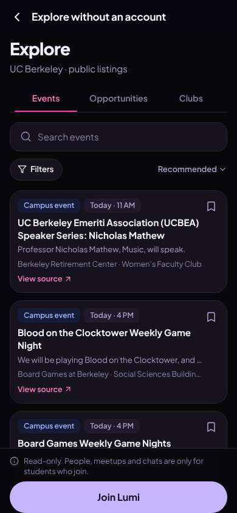</a> |
| 5 | click “Clubs” | `/guest/explore/clubs` | 860 | expects: “a list of clubs at Berkeley I could look through” (0.8) as expected _confused_: “It says 'Recommended' but it's just sororities and frats A to Z? Wait, do I have to rush to join anything here? I don't really know how Greek life works and this is kind of intimidating as the first thing.” → f2 | <a href="shots/005-click-som.jpg">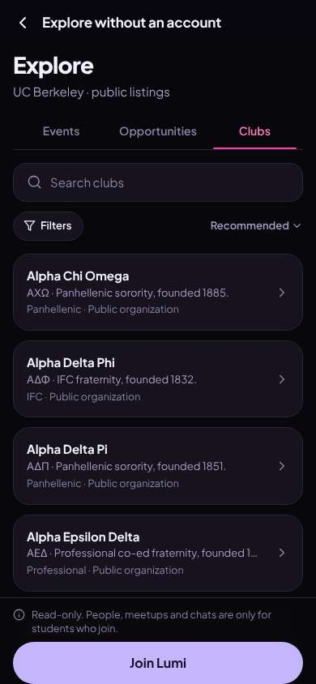</a> |
| 7 | type “Search clubs” ← “public health” | `/guest/explore/clubs` | 862 | expects: “clubs related to public health, maybe a pre-health or community club” (0.6) **mismatch**: Nothing matches 'public health' ⚑ mismatch _frustrated_: “Nothing for public health? At Berkeley? That's literally my major. Maybe I typed it wrong… let me try just 'health'.” → f3 |  |
| 9 | type “Search clubs” ← “health” | `/guest/explore/clubs` | 869 | expects: “at least the pre-health society I saw earlier” (0.7) as expected _neutral_: “Just one, and it's an 'honor society'… that sounds like you need grades or to apply. That's kind of the résumé thing I'm not looking for. Let me at least open it and see if it says how to join.” | <a href="shots/009-type-som.jpg">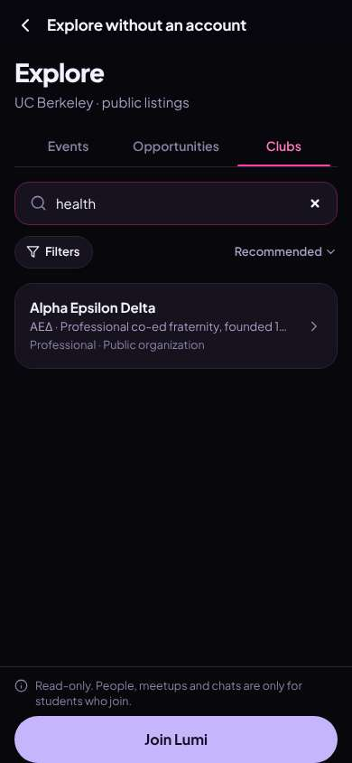</a> |
| 11 | click “Alpha Epsilon Delta ΑΕΔ · Professional c” | `/guest/explore/clubs` | 848 | expects: “a club page explaining what they do and whether you need to apply” (0.6) **mismatch**: A small sheet with the same one-line description and a Follow button — nothing about how to join, when they meet, or whether you apply ⚑ mismatch _confused_: “That's it? Same sentence again. It doesn't tell me if I have to apply or if it's open, or when they meet. And 'Follow' — wait, does following mean they see me, or that I'm signing up for the fraternity? I don't want to accidentally look like I'm rushing.” → f4 | <a href="shots/011-click-som.jpg">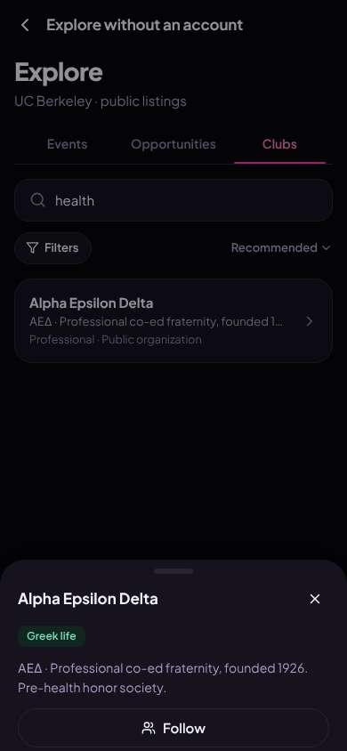</a> |
| 13 | click “Close” | `/guest/explore/clubs` | 839 |  |  |
| 14 | click “Filters” | `/guest/explore/clubs` | 848 | expects: “filter options like club type (cultural, service, hobby) or open-to-all” (0.6) as expected _neutral_: “Okay, 'Student Clubs' — that's separate from Greek life, good. Let me just look at those.” | <a href="shots/014-click-som.jpg">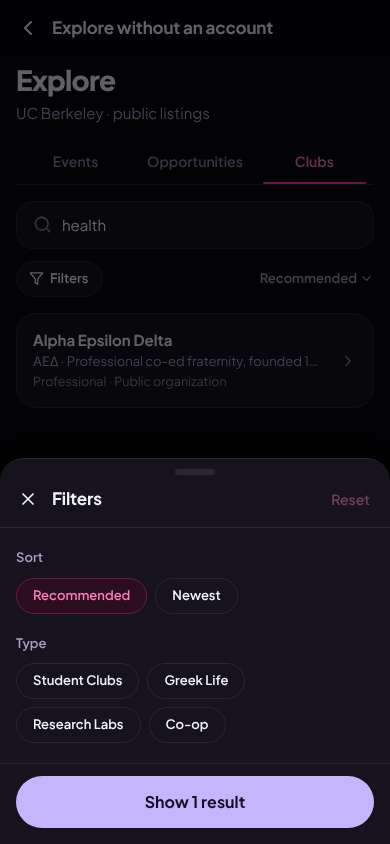</a> |
| 16 | click “Student Clubs” | `/guest/explore/clubs` | 848 | expects: “the result count updates to show regular student clubs” (0.6) **mismatch**: Button says 'No results' — the 'health' search is still applied behind the filter but the sheet doesn't mention it ⚑ mismatch _neutral_: “No results?? Oh — probably because 'health' is still in the search box. It would help if it said that. I'll close this and clear the search.” → f5 | <a href="shots/016-click-som.jpg">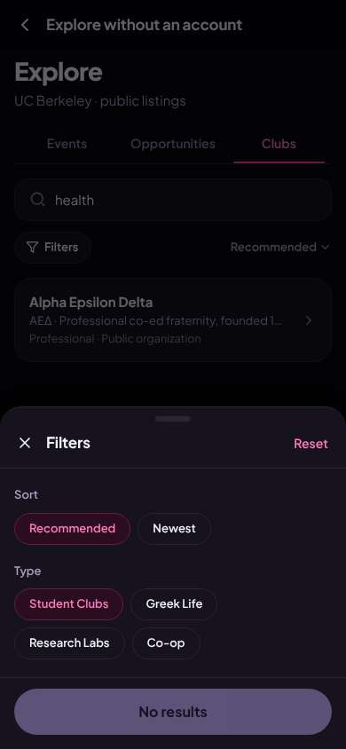</a> |
| 18 | click “Close” | `/guest/explore/clubs` | 836 |  | <a href="shots/018-click-som.jpg">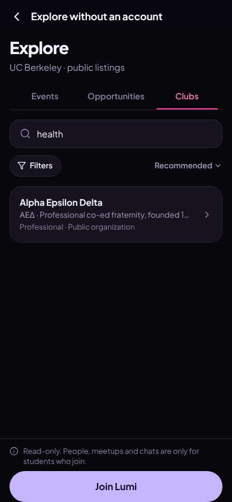</a> |
| 19 | type “Search clubs” ← “community” | `/guest/explore/clubs` | 862 | expects: “some community or cultural clubs where people just hang out” (0.5) as expected _curious_: “Okay, this is more like it — 'community', 'social and support network'. These feel like places people just belong, not apply. I wonder if there's anything for first-gen students.” | <a href="shots/019-type-som.jpg">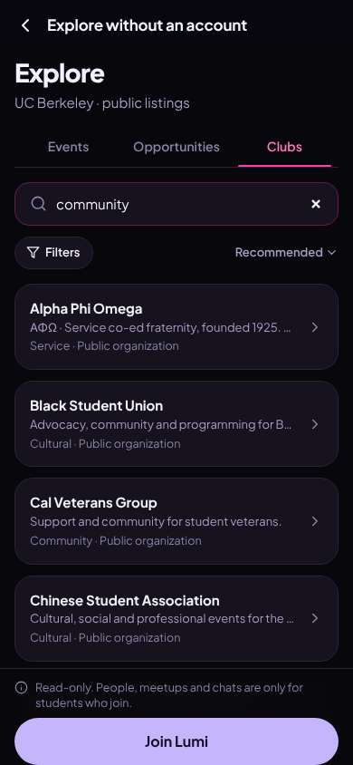</a> |
| 21 | type “Search clubs” ← “first-gen” | `/guest/explore/clubs` | 859 | expects: “maybe a first-generation student group” (0.4) **mismatch**: Nothing for 'first-gen' ⚑ mismatch _neutral_: “Okay, no first-gen group. Not shocking, but a little sad. Still, the board game nights and the community clubs looked friendly. The bottom keeps saying people and meetups are only for students who join — that's the part I actually want, finding people to go with.” → f6 |  |
| 23 | click “Join Lumi” | `/start/goals` | 843 | expects: “a sign-up screen asking for my school e-mail” (0.7) **mismatch**: Instead of e-mail, a '1 of 6' goals questionnaire ⚑ mismatch _neutral_: “Oh, 6 steps before I even make the account? That's a lot, but 'You can change this later' makes me feel okay picking. Clubs and meeting people — that's exactly me.” → f7 | <a href="shots/023-click-som.jpg">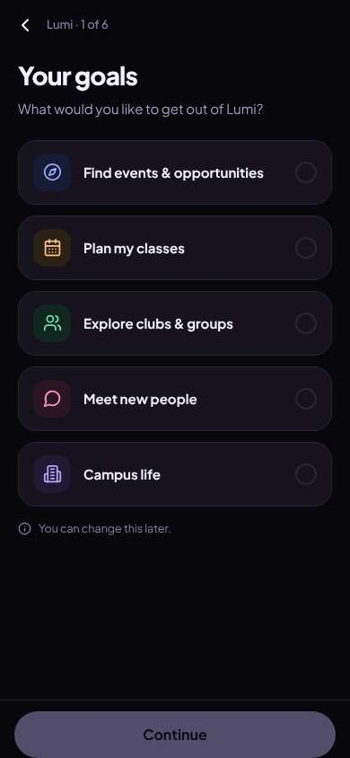</a> |
| 25 | click “Explore clubs & groups” | `/start/goals` | 826 |  | <a href="shots/025-click-som.jpg">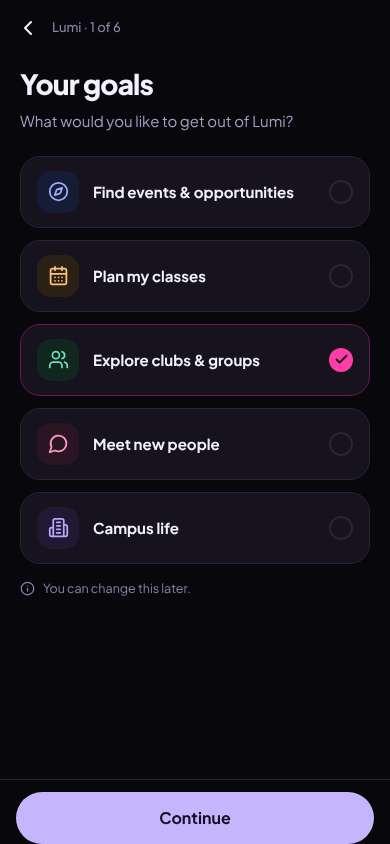</a> |
| 26 | click “Meet new people” | `/start/goals` | 833 |  | <a href="shots/026-click-som.jpg">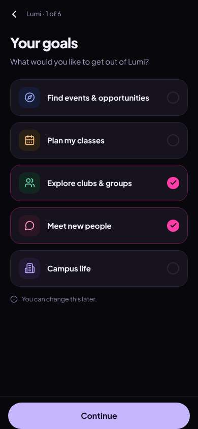</a> |
| 27 | click “Continue” | `/start/what` | 854 | expects: “the next question” (0.8) as expected _neutral_: “It opened on classes even though I picked clubs and meeting people. I want to see what 'Social' means — I need to know if strangers can message me.” | <a href="shots/027-click-som.jpg">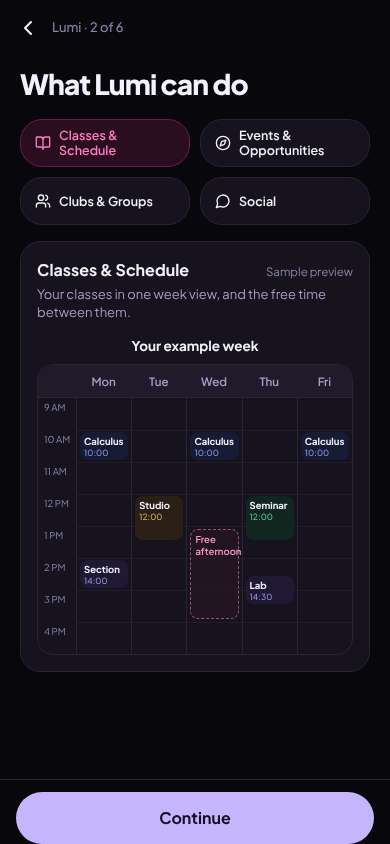</a> |
| 29 | click “Social” | `/start/what` | 832 | expects: “an explanation of the social part, hopefully who can see me” (0.5) as expected _delighted_: “Oh, 'coffee after class' with people from my classes — that's small and not scary. That's honestly what I want. I still don't know who can see me or message me though.” → f8 | <a href="shots/029-click-som.jpg">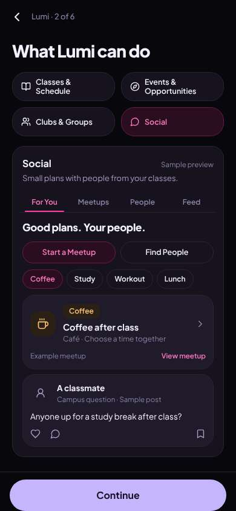</a> |
| 31 | click “Continue” | `/start/university` | 852 | expects: “step 3, maybe my school or e-mail” (0.5) as expected _neutral_: “Okay, school and year. That's fine, they need to know that.” | <a href="shots/031-click-som.jpg">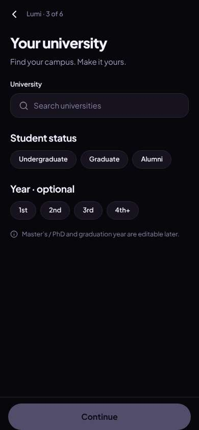</a> |
| 33 | type “Search universities” ← “Berkeley” | `/start/university` | 865 | expects: “UC Berkeley appears in a list” (0.85) as expected _neutral_: “There it is.” | <a href="shots/033-type-som.jpg">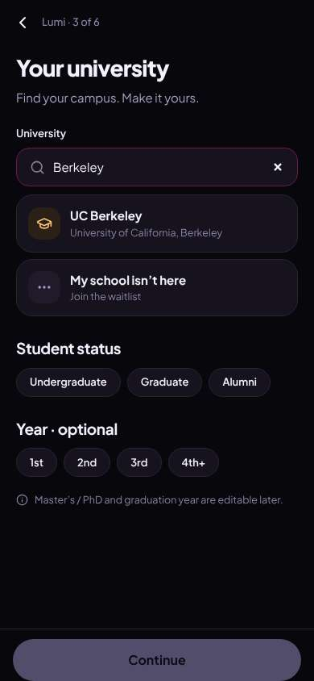</a> |
| 35 | click “UC Berkeley University of California, Be” | `/start/university` | 857 |  | <a href="shots/035-click-som.jpg">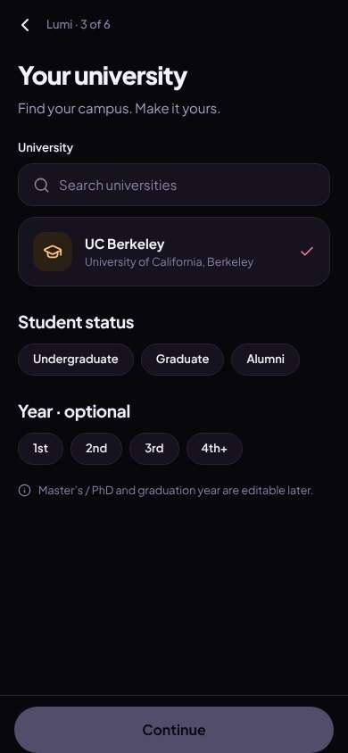</a> |
| 36 | click “Undergraduate” | `/start/university` | 835 |  | <a href="shots/036-click-som.jpg">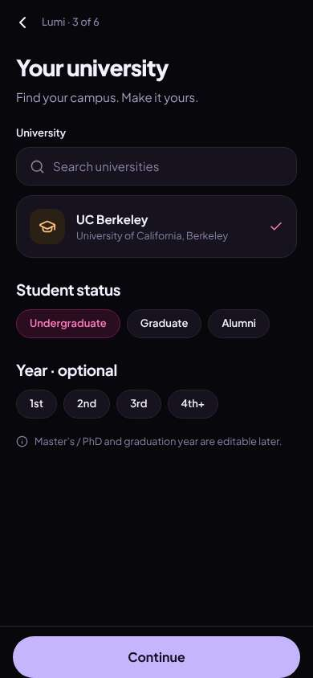</a> |
| 37 | click “1st” | `/start/university` | 845 |  | <a href="shots/037-click-som.jpg">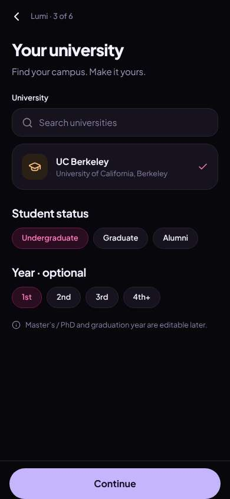</a> |
| 38 | click “Continue” | `/start/discover` | 844 | expects: “step 4, maybe interests or e-mail” (0.5) as expected _neutral_: “Optional, good. Communities, campus events, and scholarships — I definitely need to know about scholarships.” | <a href="shots/038-click-som.jpg">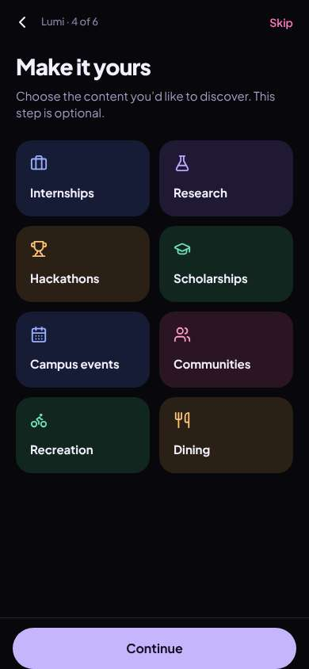</a> |
| 40 | click “Communities” | `/start/discover` | 841 |  |  |
| 41 | click “Campus events” | `/start/discover` | 846 |  | <a href="shots/041-click-som.jpg">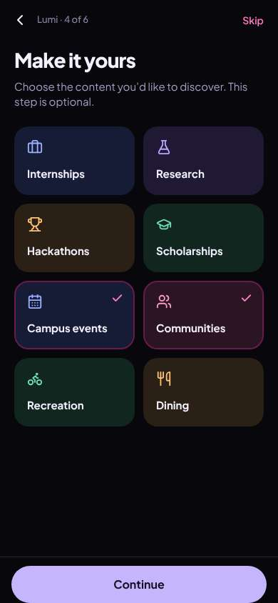</a> |
| 42 | click “Scholarships” | `/start/discover` | 829 |  |  |
| 43 | click “Continue” | `/start/communities` | 829 | expects: “step 5, probably the e-mail sign-up” (0.5) **mismatch**: Step 5 is 'Your communities' — pick clubs, labs, houses you belong to or follow; 'Membership is verified separately' ⚑ mismatch _neutral_: “Still no e-mail — this is a long sign-up. 'Membership is verified separately'… I don't belong to anything yet and I don't want to look like I'm claiming to be in a club. I'll skip this one.” → f9 | <a href="shots/043-click-som.jpg">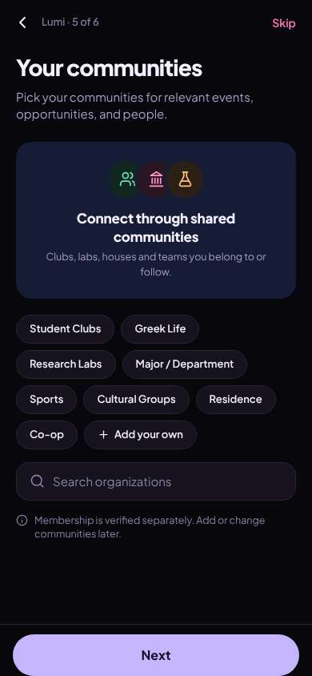</a> |
| 45 | click “Skip” | `/start/about` | 846 | expects: “step 6, the actual account part” (0.6) as expected _delighted_: “Oh this is reassuring — 'friends-only', 'Only you see this', and I can use a nickname. That's the privacy stuff I was worried about. Okay, I'll do it.” | <a href="shots/045-click-som.jpg">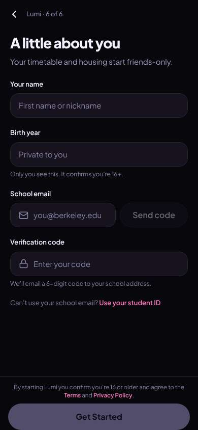</a> |
| 47 | type “First name or nickname” ← “Aisha” | `/start/about` | 844 |  | <a href="shots/047-type-som.jpg">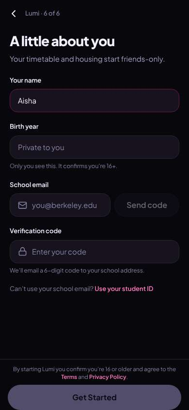</a> |
| 48 | type “Private to you” ← “2008” | `/start/about` | 854 |  | <a href="shots/048-type-som.jpg">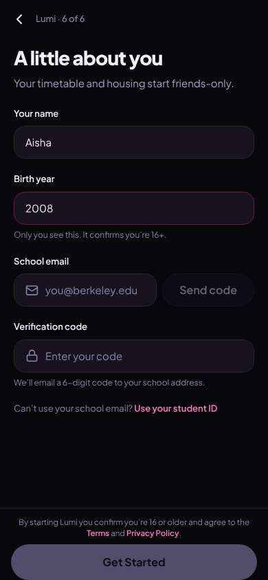</a> |
| 49 | type “you@berkeley.edu” ← “aisha.r@berkeley.edu” | `/start/about` | 896 |  | <a href="shots/049-type-som.jpg">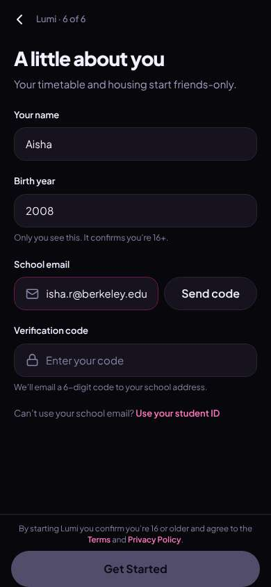</a> |
| 50 | click “Send code” | `/start/about` | 833 | expects: “a code gets sent (shown on screen in this test)” (0.7) as expected _neutral_: “Got the code.” | <a href="shots/050-click-som.jpg">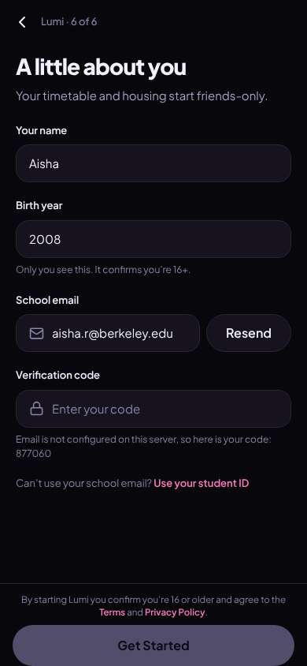</a> |
| 52 | type “Enter your code” ← “877060” | `/start/about` | 841 |  | <a href="shots/052-type-som.jpg">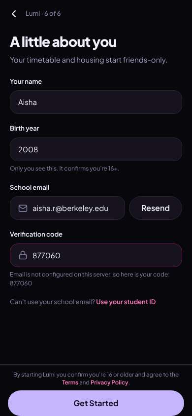</a> |
| 53 | click “Get Started” | `/` | 1327 | expects: “my account is created and I land in the app” (0.75) as expected _neutral_: “I'm in! But the first 'For you' thing is career fairs — I picked clubs and meeting people, not résumé stuff. Hopefully the Clubs and Meetups tiles are where my people are.” → f10 |  |
| 55 | finish | `/` |  |  | <a href="shots/055-finish-som.jpg">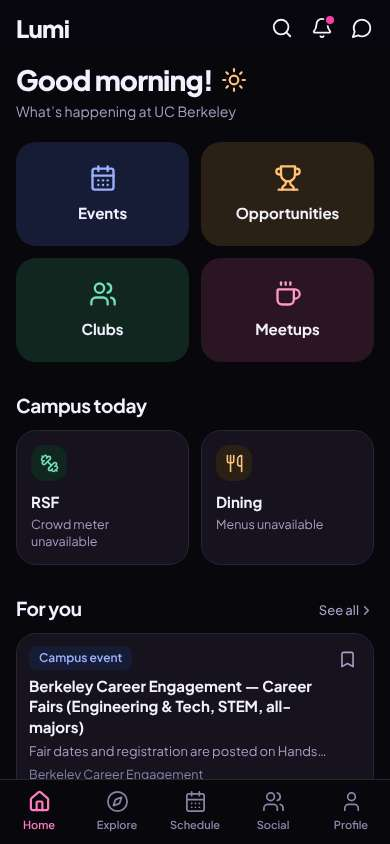</a> |

## Automatic checks (harness, not persona)

| screen | tap targets < 44px | sideways overflow | broken images |
|---|---|---|---|
| `/welcome` | 5 (English 44×20, Sign In 80×40, Look around first 136×36, Terms 34×15, Privacy 41×15) | — | — |
| `/guest/explore/events` | 9 (Back 40×40, Search events 295×23, Filters 87×36, Sort: Recommended 118×36, View source 90×19) | — | — |
| `/guest/explore/clubs` | 8 (Back 40×40, Search clubs 295×23, Filters 87×36, Sort: Recommended 118×36) | — | — |
| `/start/goals` | 1 (Back 40×40) | — | — |
| `/start/what` | 5 (Back 40×40) | — | — |
| `/start/university` | 9 (Back 40×40, Search universities 287×23, Undergraduate 130×36, Graduate 94×36, Alumni 77×36) | — | — |
| `/start/discover` | 2 (Back 40×40, Skip 54×40) | — | — |
| `/start/communities` | 12 (Back 40×40, Skip 54×40, Student Clubs 123×36, Greek Life 98×36, Research Labs 125×36) | — | — |
| `/start/about` | 4 (Back 40×40, Use your student ID 121×18, Terms 33×15, Privacy Policy 77×15) | — | — |
| `/` | 6 (Search 40×40, Notifications 40×40, Messages 40×40, See all 55×20, Save 36×36) | — | — |

## Timing (harness)

- Full page load (navigation timing): 603 ms
