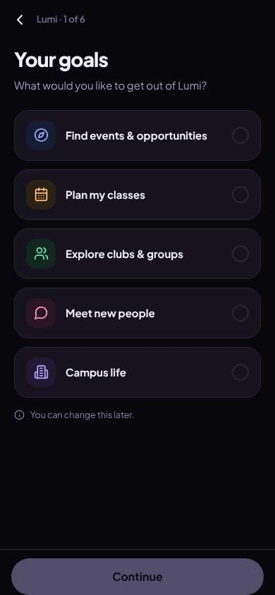
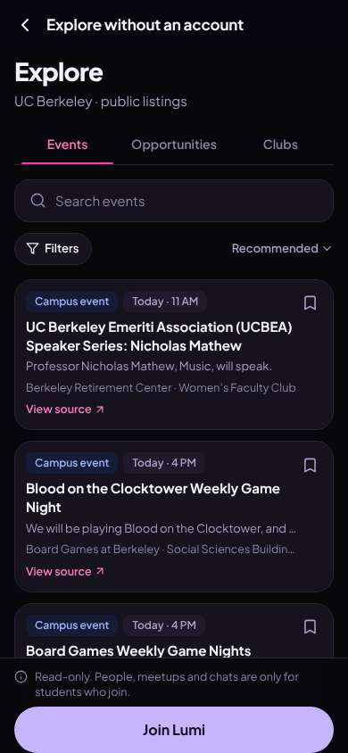
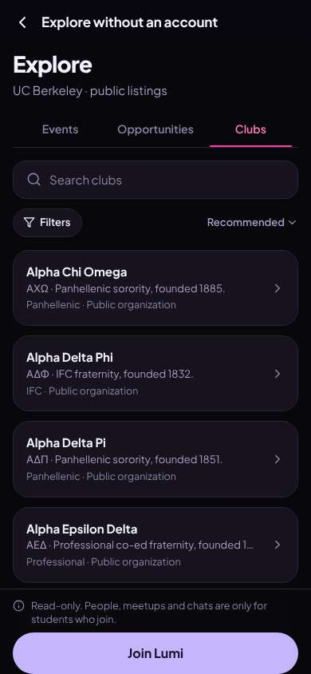
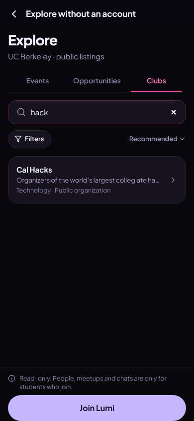
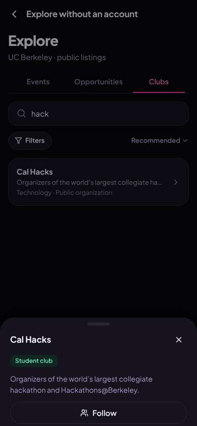
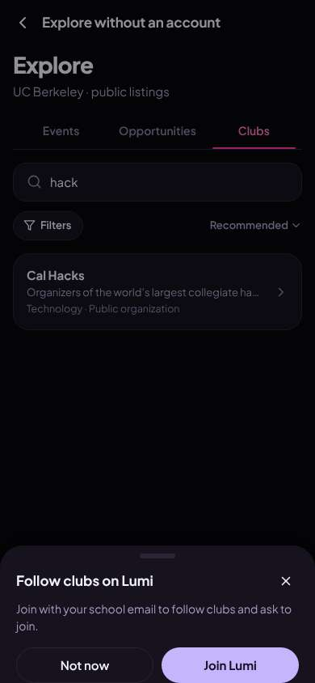

# ux-sim run `sched-20261107-1915-jordan-first-open-decide`

> **AI simulation — hypotheses, not measured user behaviour.** One simulated persona; nothing here is a rate or a measurement of real students.

| | |
|---|---|
| Persona | **Jordan**, 19 — Sophomore · phone 390×844 · prefers en · tech high (`jordan-sophomore-impatient`) |
| Scenario | **First open: what is this app, and is it worth signing up?** — A friend sent you a link to this app. You have never seen it before. Figure out what it is for, and decide whether you want to make an account. If it seems worth it, sign up with your school e-mail. (`first-open-decide`) |
| Target | local · http://localhost:46721 · worktree commit `7192afc82e1b` |
| Outcome | **abandoned** · ended by persona |
| Account | signed out at start |
| Goal check (fixed, by harness) | not met — _Signed up during the run (a new account exists and the browser is signed in to it) and landed inside the app (signed-in home or a main tab)._ |
| Patience | exhausted at step 14; 0 action(s) after |
| Persona's reason | “Browsed a bit, Cal Hacks page was just one sentence, then 'Join' threw me into a 6-step quiz before even asking my email. Not worth it, deleting.” |
| Effort | 6/28 actions · objective frustration 1.50/3 · 2 confused note(s) · ~15s simulated |
| Drop-off risk | **high** _(AI hypothesis, persona agent)_ — Guest preview showed a bulletin board (emeriti talks, A-Z Greek list, empty club sheet) and sign-up announced 6 screens of setup; nothing gave Jordan a reason to push through · basis: steps 5, 10, 14 |

Known environment limits (not UX findings)

- Dining menus and RSF gym crowd levels need live campus sources (the local stack runs with CAMPUS_LIVE=0) — empty or missing data there is not a UX bug.
- AI features (Ask Lumi, AI profile draft on /start, conversation starters) need an OpenAI key; none is configured locally.
- Course catalog is the real Berkeley Class Schedule (6619 courses, Fall 2026 + Spring 2027), fetched 2026-11-05 with the worker's adapter. Seat counts and very recent changes may differ from live.
- Campus events, free food, internships, hackathons and scholarships are a read-only snapshot of live (1276 real items, 109 events this week, taken 2026-11-07 19:15 UTC) plus the CSV calendar. Nothing new appears during the run; Q&A and reviews are empty.
- No e-mail is sent: the sign-up / sign-in code is shown on screen in the hint (live sends a real e-mail).
- Real-time updates (SSE) work locally; other people never reply unless the stack was started with --autoreply.

## Friction

| # | step | type | sev | persona says | screen | element | env-limited | evidence |
|---|---|---|---|---|---|---|---|---|
| f1 | 0 | No reason to stay | 1 | “'your college life all in one place'. every app says that. ok and? not signing up blind” _wish: show me something real happening on campus right on the first screen_ | `/welcome` |  | no | [shot](shots/000-start.jpg) [marked](shots/000-start-som.jpg) |
| f2 | 2 | Confusing UI | 1 | “ok it's a feed. first thing 'recommended' to me is a retired professors speaker series?? lol. game night is kinda fun tho” _wish: recommended should be stuff for students, not emeriti talks_ | `/guest/explore/events` | Campus event Today · 11 AM UC Berkeley Emeriti Association (UCBEA) Speaker Series: Nichola | no | [shot](shots/002-click.jpg) [marked](shots/002-click-som.jpg) |
| f3 | 2 | No reason to stay | 2 | “list of event cards with 'view source' links. this is giving bulletin board. where are the people” _wish: show who's going / something social, not a calendar dump_ | `/guest/explore/events` | Campus event Today · 11 AM UC Berkeley Emeriti Association (UCBEA) Speaker Series: Nichola | no | [shot](shots/002-click.jpg) [marked](shots/002-click-som.jpg) |
| f4 | 5 | Confusing UI | 2 | “lol 'recommended' is just A to Z. four sororities in a row. not what i'm here for” _wish: actually recommend stuff, or say it's A-Z_ | `/guest/explore/clubs` | Sort: Recommended | no | [shot](shots/005-click.jpg) [marked](shots/005-click-som.jpg) |
| f5 | 9 | Missing / empty content | 3 | “that's it? same sentence again. no people, no next hackathon date, nothing. ok and?” _wish: show upcoming events, how many people from Lumi follow it, people looking for teammates_ | `/guest/explore/clubs` | Follow | no | [shot](shots/009-click.jpg) [marked](shots/009-click-som.jpg) |
| f6 | 13 | Onboarding friction | 4 | “1 of 6?? i tapped join, not take a survey. six screens before i even see a person. nope” _wish: email first, one screen, ask goals later or never_ | `/start/goals` | Continue | no | [shot](shots/013-click.jpg) [marked](shots/013-click-som.jpg) |

Severity: 1 = Minor — noticed it, cosmetic or a small annoyance; did not slow me down. · 2 = Moderate — slowed me down or made me hesitate; I recovered on my own. · 3 = Major — real confusion, a wrong path or many extra steps; I nearly gave up or only got through by guessing. · 4 = Blocker — I could not continue, gave up, or would stop using the app here.

## Where it ended

Step 13 on `/start/goals`.

## Timeline

| step | what | screen | ms | signals / notes | shot |
|---|---|---|---|---|---|
| 0 | start | `/welcome` | 1596 | _bored_: “'your college life all in one place'. every app says that. ok and? not signing up blind” → f1 |  |
| 2 | click “Look around first” | `/guest/explore/events` | 1129 | expects: “see the app without an account, some feed of stuff” (0.7) as expected _neutral_: “ok it's a feed. first thing 'recommended' to me is a retired professors speaker series?? lol. game night is kinda fun tho” → f2 _neutral_: “list of event cards with 'view source' links. this is giving bulletin board. where are the people” → f3 |  |
| 5 | click “Clubs” | `/guest/explore/clubs` | 987 | expects: “list of clubs, maybe hackathon or coding clubs” (0.7) **mismatch**: wall of greek letters, sorted alphabetically even though it says Recommended ⚑ mismatch _frustrated_: “lol 'recommended' is just A to Z. four sororities in a row. not what i'm here for” → f4 |  |
| 7 | type “Search clubs” ← “hack” | `/guest/explore/clubs` | 867 | expects: “hackathon clubs show up” (0.6) as expected _curious_: “ok Cal Hacks. search works fast at least. let's see if there's anything in it” |  |
| 9 | click “Cal Hacks Organizers of the world’s larg” | `/guest/explore/clubs` | 842 | expects: “club page with members or upcoming stuff, maybe people looking for teams” (0.5) **mismatch**: bottom sheet with the same one-line description and a Follow button. no events, no members, no team-finding ⚑ mismatch _bored_: “that's it? same sentence again. no people, no next hackathon date, nothing. ok and?” → f5 |  |
| 11 | click “Follow” | `/guest/explore/clubs` | 783 | expects: “asks me to sign up to follow” (0.8) as expected _neutral_: “fine. it says people and meetups are behind the wall, that's the only interesting part. i'll give it one shot. if setup is long i'm out” |  |
| 13 | click “Join Lumi” | `/start/goals` | 840 | expects: “sign up screen asking for berkeley email” (0.8) **mismatch**: no email field — a goals quiz labelled '1 of 6' ⚑ mismatch _frustrated_: “1 of 6?? i tapped join, not take a survey. six screens before i even see a person. nope” → f6 |  |
| 15 | finish | `/start/goals` |  |  |  |

## Automatic checks (harness, not persona)

| screen | tap targets < 44px | sideways overflow | broken images |
|---|---|---|---|
| `/welcome` | 5 (English 44×20, Sign In 80×40, Look around first 136×36, Terms 34×15, Privacy 41×15) | — | — |
| `/guest/explore/events` | 9 (Back 40×40, Search events 295×23, Filters 87×36, Sort: Recommended 118×36, View source 90×19) | — | — |
| `/guest/explore/clubs` | 4 (Back 40×40, Search clubs 295×23, Filters 87×36, Sort: Recommended 118×36) | — | — |
| `/start/goals` | 1 (Back 40×40) | — | — |

## Timing (harness)

- Full page load (navigation timing): 642 ms
