# ux-sim run `sched-20261107-1915-minji-first-open-decide`

> **AI simulation — hypotheses, not measured user behaviour.** One simulated persona; nothing here is a rate or a measurement of real students.

| | |
|---|---|
| Persona | **Minji**, 17 — First-year (started college a year early) · phone 390×844 · prefers ko · tech high (`minji-freshman-17`) |
| Scenario | **First open: what is this app, and is it worth signing up?** — A friend sent you a link to this app. You have never seen it before. Figure out what it is for, and decide whether you want to make an account. If it seems worth it, sign up with your school e-mail. (`first-open-decide`) |
| Target | local · http://localhost:44889 · worktree commit `7192afc82e1b` |
| Outcome | **success** · ended by persona |
| Account | signed out at start |
| Goal check (fixed, by harness) | met at step 36 after 25 action(s) — evidence: the account the browser is signed in to was created during this run; {"urlMatches":"^/(discover\|community\|profile)?(\\?.*)?$"} — _Signed up during the run (a new account exists and the browser is signed in to it) and landed inside the app (signed-in home or a main tab)._ |
| Persona's reason | “Figured out it's for making small plans like lunch with people on campus, and the Korean option + no-face-photo example made it feel safe, so I signed up with my berkeley.edu email.” |
| Effort | 25/40 actions · objective frustration 3.50/4.5 · 1 confused note(s) · ~56s simulated |
| Drop-off risk | **medium** _(AI hypothesis, persona agent)_ — Signed up because the social preview promised lunch plans, but every real screen so far (guest explore, home) was English event lists; if Social is empty she won't come back. · basis: steps 3, 5, 10, 36 |

Known environment limits (not UX findings)

- Dining menus and RSF gym crowd levels need live campus sources (the local stack runs with CAMPUS_LIVE=0) — empty or missing data there is not a UX bug.
- AI features (Ask Lumi, AI profile draft on /start, conversation starters) need an OpenAI key; none is configured locally.
- Course catalog is the real Berkeley Class Schedule (6619 courses, Fall 2026 + Spring 2027), fetched 2026-11-05 with the worker's adapter. Seat counts and very recent changes may differ from live.
- Campus events, free food, internships, hackathons and scholarships are a read-only snapshot of live (1276 real items, 109 events this week, taken 2026-11-07 19:15 UTC) plus the CSV calendar. Nothing new appears during the run; Q&A and reviews are empty.
- No e-mail is sent: the sign-up / sign-in code is shown on screen in the hint (live sends a real e-mail).
- Real-time updates (SSE) work locally; other people never reply unless the stack was started with --autoreply.

## Friction

| # | step | type | sev | persona says | screen | element | env-limited | evidence |
|---|---|---|---|---|---|---|---|---|
| f1 | 1 | Hard to find | 1 | “오 바로 한국어 됐다! 좋아. 근데 tiny 'English' 글씨라 거의 못 볼 뻔” _wish: bigger language toggle, like 🌐 icon_ | `/welcome` | 한국어 | no | [shot](shots/001-click.jpg) [marked](shots/001-click-som.jpg) |
| f2 | 3 | No reason to stay | 2 | “음… 그냥 학교 행사 리스트네. 첫번째가 은퇴 교수 강연ㅋㅋ 나랑 상관없음. 사람은 가입해야 보인대” _wish: show me a peek of plans/people like lunch groups, even blurred_ | `/guest/explore/events` | 학교 행사 오늘 · 오전 11시 UC Berkeley Emeriti Association (UCBEA) Speaker Series: Nicholas Mathew  | no | [shot](shots/003-click.jpg) [marked](shots/003-click-som.jpg) |
| f3 | 5 | No reason to stay | 2 | “헐 frat sorority만… 이건 내 스타일 아님. '추천'이라면서 그냥 알파벳순?” _wish: recommend clubs for freshmen / international students first_ | `/guest/explore/clubs` | Alpha Chi Omega ΑΧΩ · Panhellenic sorority, founded 1885. Panhellenic · 공개 단체 | no | [shot](shots/005-click.jpg) [marked](shots/005-click-som.jpg) |
| f4 | 9 | Missing / empty content | 2 | “이게 다야? 아까 본 거랑 똑같은 한 줄. 몇 명 있는지라도 알려주지” _wish: show how many students / freshmen follow it or upcoming KSA events_ | `/guest/explore/clubs` | 팔로우 | no | [shot](shots/009-click.jpg) [marked](shots/009-click-som.jpg) |
| f5 | 13 | Onboarding friction | 2 | “1/6?? 6단계나… 아 귀찮아. 그래도 목표 고르는 건 쉬우니까” _wish: tell me upfront how long, or email first_ | `/start/goals` | 계속 | no | [shot](shots/013-click.jpg) [marked](shots/013-click-som.jpg) |
| f6 | 26 | Confusing UI | 2 | “뭐지? 그냥 '기숙사' 체크만 됨. 내 기숙사는 어디서 고르는 거야?” _wish: after tapping 기숙사, show the dorm list so I pick mine_ | `/start/communities` | 기숙사 | no | [shot](shots/026-click.jpg) [marked](shots/026-click-som.jpg) |
| f7 | 36 | No reason to stay | 2 | “가입은 됐는데… '새 사람 만나기' 골랐는데 또 행사 리스트네. 점심 모임은 소셜 탭 가야 하나 봐” _wish: since I picked 'meet new people', open on lunch plans / people in my year_ | `/` | 소셜 | no | [shot](shots/036-click.jpg) [marked](shots/036-click-som.jpg) |

Severity: 1 = Minor — noticed it, cosmetic or a small annoyance; did not slow me down. · 2 = Moderate — slowed me down or made me hesitate; I recovered on my own. · 3 = Major — real confusion, a wrong path or many extra steps; I nearly gave up or only got through by guessing. · 4 = Blocker — I could not continue, gave up, or would stop using the app here.

## Timeline

| step | what | screen | ms | signals / notes | shot |
|---|---|---|---|---|---|
| 0 | start | `/welcome` | 1187 |  |  |
| 1 | click “English” | `/welcome` | 1231 | expects: “language picker, maybe 한국어” (0.6) **mismatch**: No picker — one tap flipped the whole screen to Korean right away ⚑ mismatch _delighted_: “오 바로 한국어 됐다! 좋아. 근데 tiny 'English' 글씨라 거의 못 볼 뻔” → f1 | <a href="shots/001-click-som.jpg">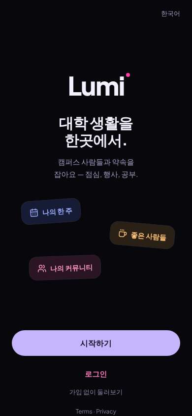</a> |
| 3 | click “가입 없이 둘러보기” | `/guest/explore/events` | 1339 | expects: “see what people post, plans on campus, without account” (0.7) **mismatch**: Only a list of official campus events (in English), no people or plans — banner says people/groups/chats are for members only ⚑ mismatch _neutral_: “음… 그냥 학교 행사 리스트네. 첫번째가 은퇴 교수 강연ㅋㅋ 나랑 상관없음. 사람은 가입해야 보인대” → f2 | <a href="shots/003-click-som.jpg">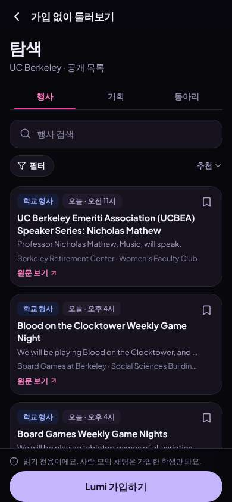</a> |
| 5 | click “동아리” | `/guest/explore/clubs` | 837 | expects: “list of clubs, maybe Korean student club” (0.6) **mismatch**: Clubs list starts with sororities/fraternities alphabetically, Greek letters ⚑ mismatch _bored_: “헐 frat sorority만… 이건 내 스타일 아님. '추천'이라면서 그냥 알파벳순?” → f3 | <a href="shots/005-click-som.jpg">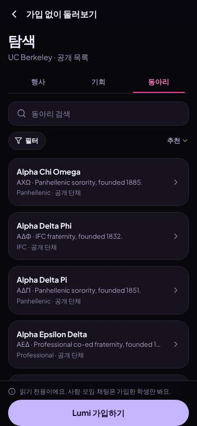</a> |
| 7 | type “동아리 검색” ← “Korean” | `/guest/explore/clubs` | 884 | expects: “Korean student clubs show up” (0.7) as expected _curious_: “오 KSA 있다! 근데 여기서 누가 있는지 볼 수 있나?” | <a href="shots/007-type-som.jpg">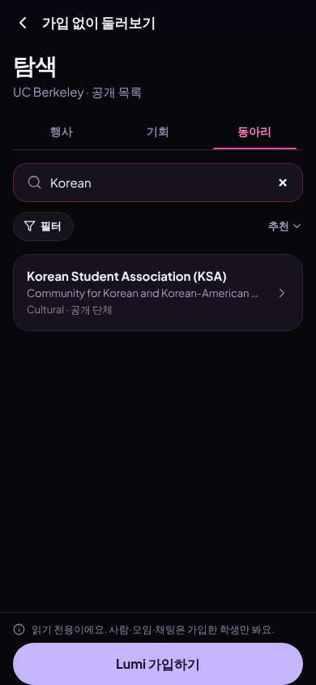</a> |
| 9 | click “Korean Student Association (KSA) Communi” | `/guest/explore/clubs` | 840 | expects: “KSA page, maybe members or events” (0.5) **mismatch**: Just a small sheet with the same one-line description and a Follow button — no members, no events, no Lumi users ⚑ mismatch _neutral_: “이게 다야? 아까 본 거랑 똑같은 한 줄. 몇 명 있는지라도 알려주지” → f4 | <a href="shots/009-click-som.jpg">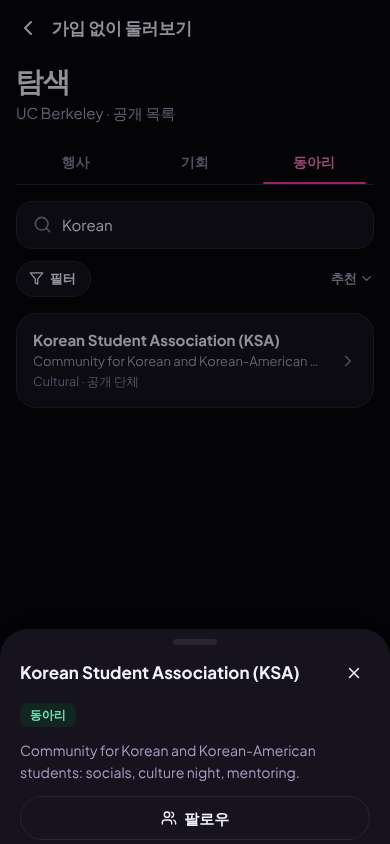</a> |
| 11 | click “팔로우” | `/guest/explore/clubs` | 858 | expects: “asks me to sign up first” (0.8) as expected _neutral_: “ㅇㅋ 학교 이메일이면 괜찮아. 해보자” | <a href="shots/011-click-som.jpg">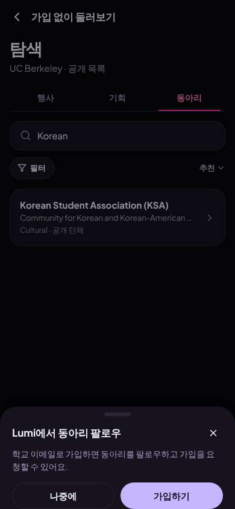</a> |
| 13 | click “가입하기” | `/start/goals` | 848 | expects: “sign-up form asking for school email” (0.8) **mismatch**: Not email — a goals quiz, step 1 of 6 ⚑ mismatch _neutral_: “1/6?? 6단계나… 아 귀찮아. 그래도 목표 고르는 건 쉬우니까” → f5 | <a href="shots/013-click-som.jpg">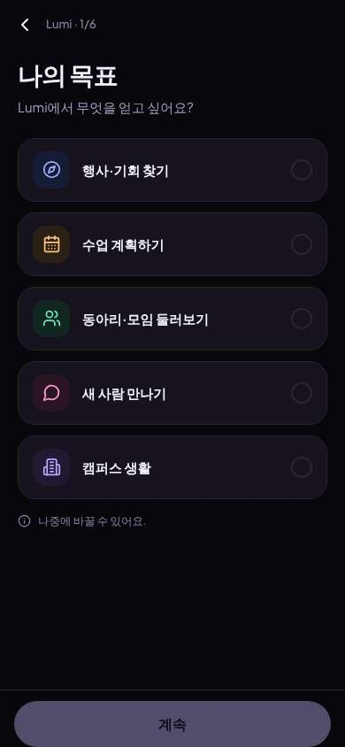</a> |
| 15 | click “새 사람 만나기” | `/start/goals` | 846 | expects: “selects 새 사람 만나기” (0.9) | <a href="shots/015-click-som.jpg">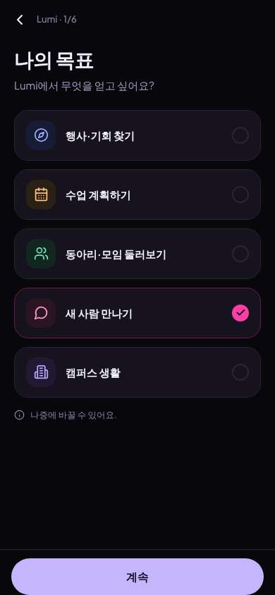</a> |
| 16 | click “계속” | `/start/what` | 839 | expects: “next step 2/6” (0.8) | <a href="shots/016-click-som.jpg">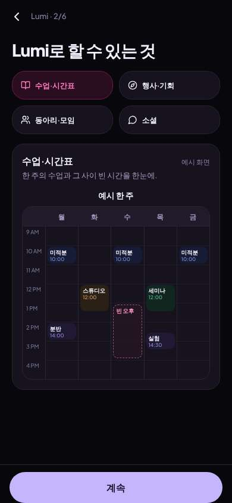</a> |
| 17 | click “소셜” | `/start/what` | 846 | expects: “example of meeting people / lunch plans” (0.7) as expected _curious_: “오 이거다. 점심 같이 먹을 사람 찾는 거. 큰 얼굴 사진 없어서 데이팅앱 느낌 안 나서 좋음” | <a href="shots/017-click-som.jpg">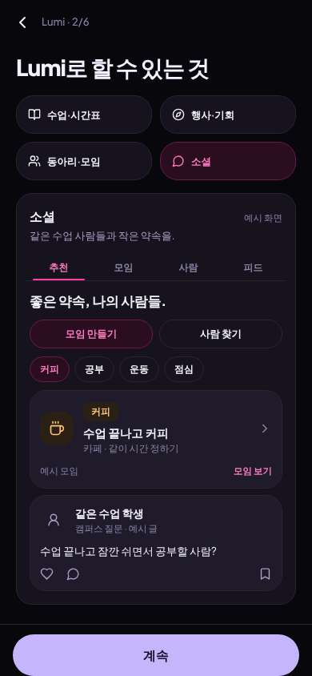</a> |
| 19 | click “계속” | `/start/university` | 834 | expects: “step 3/6, maybe email now” (0.5) | <a href="shots/019-click-som.jpg">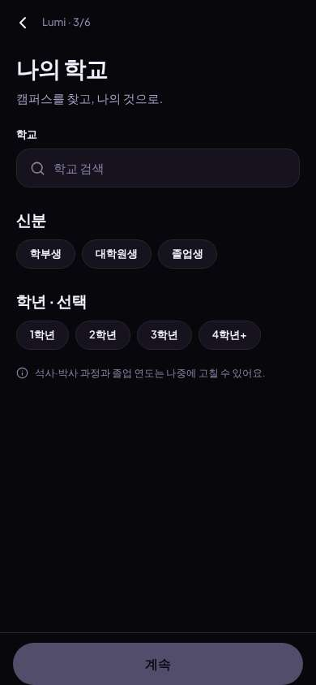</a> |
| 20 | type “학교 검색” ← “Berkeley” | `/start/university` | 849 | expects: “UC Berkeley suggestion” (0.8) | <a href="shots/020-type-som.jpg">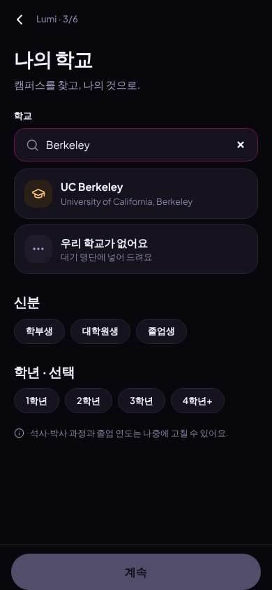</a> |
| 21 | click “UC Berkeley University of California, Be” | `/start/university` | 849 |  | <a href="shots/021-click-som.jpg">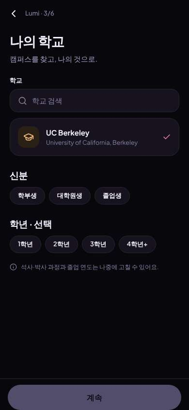</a> |
| 22 | click “학부생” | `/start/university` | 828 |  | <a href="shots/022-click-som.jpg">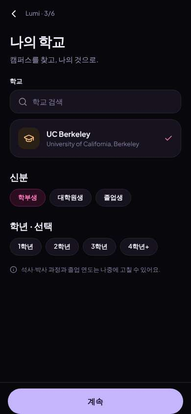</a> |
| 23 | click “1학년” | `/start/university` | 836 |  | <a href="shots/023-click-som.jpg">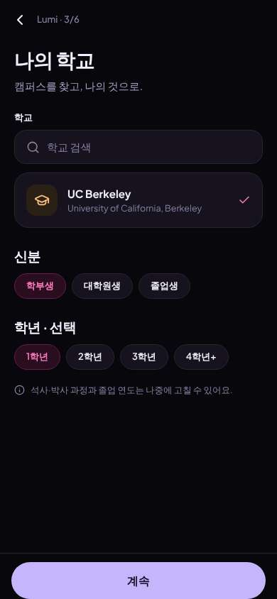</a> |
| 24 | click “계속” | `/start/discover` | 850 | expects: “4/6, hopefully email” (0.5) | <a href="shots/024-click-som.jpg">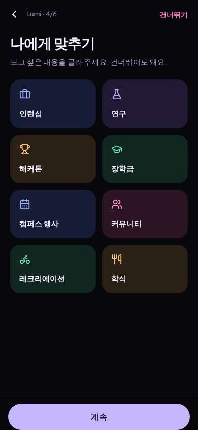</a> |
| 25 | click “건너뛰기” | `/start/communities` | 854 | expects: “5/6, email please” (0.5) | <a href="shots/025-click-som.jpg">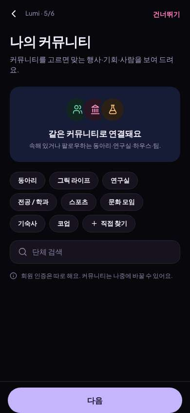</a> |
| 26 | click “기숙사” | `/start/communities` | 845 | expects: “list of dorms to pick mine” (0.6) **mismatch**: Chip just turned selected — no list of actual dorms appeared ⚑ mismatch _confused_: “뭐지? 그냥 '기숙사' 체크만 됨. 내 기숙사는 어디서 고르는 거야?” → f6 | <a href="shots/026-click-som.jpg">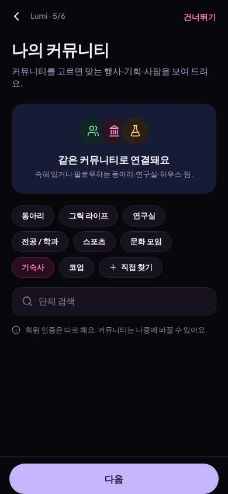</a> |
| 28 | click “다음” | `/start/about` | 849 | expects: “6/6, maybe email finally” (0.5) as expected _curious_: “생년 나만 보인대, 16세 이상이면 OK — 다행. 나이 다른 사람한테 안 보이는 거 좋아” | <a href="shots/028-click-som.jpg">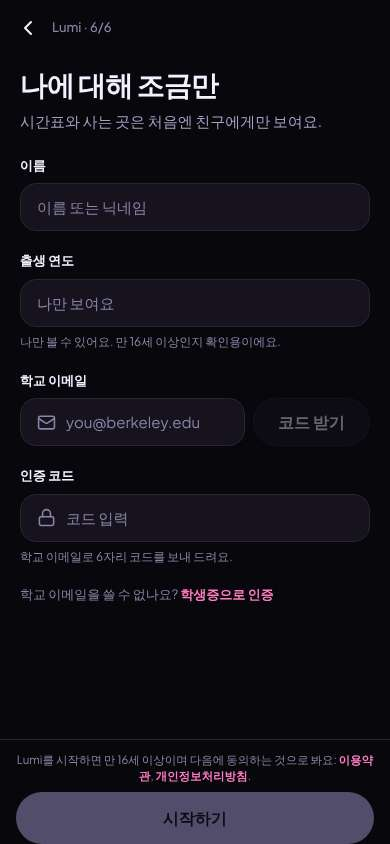</a> |
| 30 | type “이름 또는 닉네임” ← “Minji” | `/start/about` | 848 |  | <a href="shots/030-type-som.jpg">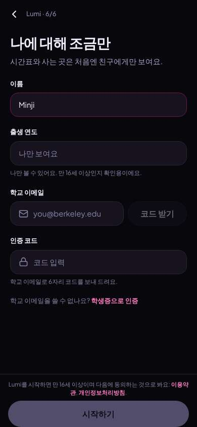</a> |
| 31 | type “나만 보여요” ← “2009” | `/start/about` | 847 |  | <a href="shots/031-type-som.jpg">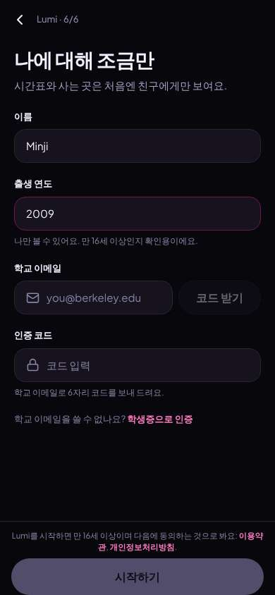</a> |
| 32 | type “you@berkeley.edu” ← “minji.kim@berkeley.edu” | `/start/about` | 854 |  | <a href="shots/032-type-som.jpg">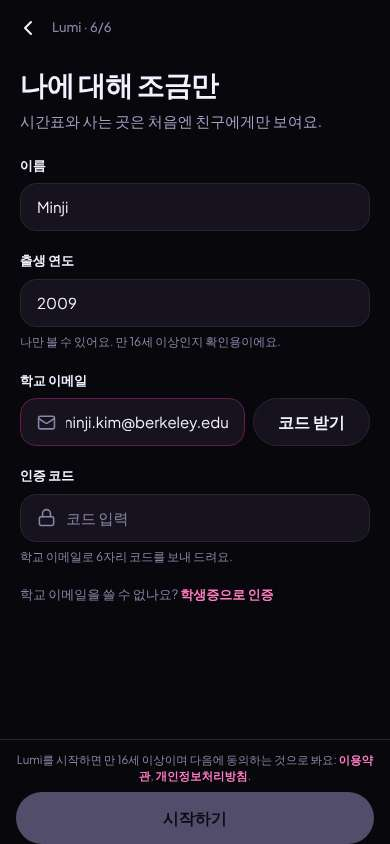</a> |
| 33 | click “코드 받기” | `/start/about` | 851 | expects: “code sent, shown on screen” (0.7) as expected _neutral_: “ㅇㅋ 코드 받음” | <a href="shots/033-click-som.jpg">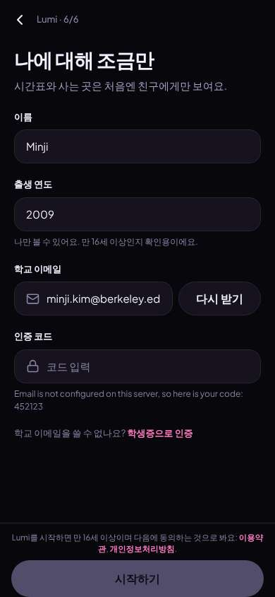</a> |
| 35 | type “코드 입력” ← “452123” | `/start/about` | 876 |  | <a href="shots/035-type-som.jpg">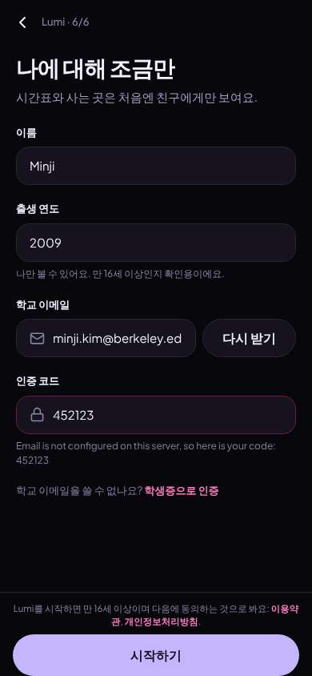</a> |
| 36 | click “시작하기” | `/` | 1135 | expects: “account made, home with lunch plans/people” (0.7) **mismatch**: Account made, but home leads with gym/dining 'can't read' tiles and English law/policy events, not people or lunch plans ⚑ mismatch _bored_: “가입은 됐는데… '새 사람 만나기' 골랐는데 또 행사 리스트네. 점심 모임은 소셜 탭 가야 하나 봐” → f7 |  |
| 38 | finish | `/` |  |  | <a href="shots/038-finish-som.jpg">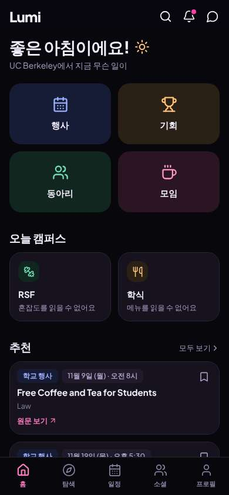</a> |

## Automatic checks (harness, not persona)

| screen | tap targets < 44px | sideways overflow | broken images |
|---|---|---|---|
| `/welcome` | 5 (English 44×20, Sign In 80×40, Look around first 136×36, Terms 34×15, Privacy 41×15) | — | — |
| `/guest/explore/events` | 9 (뒤로 40×40, 행사 검색 295×23, 필터 75×36, 정렬: 추천 47×36, 원문 보기 68×19) | — | — |
| `/guest/explore/clubs` | 4 (뒤로 40×40, 동아리 검색 295×23, 필터 75×36, 정렬: 추천 47×36) | — | — |
| `/start/goals` | 1 (뒤로 40×40) | — | — |
| `/start/what` | 5 (뒤로 40×40) | — | — |
| `/start/university` | 9 (뒤로 40×40, 학교 검색 287×23, 학부생 73×36, 대학원생 86×36, 졸업생 73×36) | — | — |
| `/start/discover` | 2 (뒤로 40×40, 건너뛰기 80×40) | — | — |
| `/start/communities` | 12 (뒤로 40×40, 건너뛰기 80×40, 동아리 73×36, 그릭 라이프 101×36, 연구실 73×36) | — | — |
| `/start/about` | 4 (뒤로 40×40, 학생증으로 인증 93×18, 이용약관 234×31, 개인정보처리방침 92×15) | — | — |
| `/` | 7 (검색 40×40, 알림 40×40, 메시지 40×40, 모두 보기 69×20, 원문 보기 68×19) | — | — |

## Timing (harness)

- Full page load (navigation timing): 371 ms, 161 ms
