# ux-sim run `sched-20261107-1915-seoyeon-first-open-decide`

> **AI simulation — hypotheses, not measured user behaviour.** One simulated persona; nothing here is a rate or a measurement of real students.

| | |
|---|---|
| Persona | **Seoyeon**, 20 — Exchange student (one semester, from Yonsei) · phone 390×844 · prefers ko · tech medium (`seoyeon-exchange-korean`) |
| Scenario | **First open: what is this app, and is it worth signing up?** — A friend sent you a link to this app. You have never seen it before. Figure out what it is for, and decide whether you want to make an account. If it seems worth it, sign up with your school e-mail. (`first-open-decide`) |
| Target | local · http://localhost:33139 · worktree commit `7192afc82e1b` |
| Outcome | **success** · ended by persona |
| Account | signed out at start |
| Goal check (fixed, by harness) | met at step 41 after 27 action(s) — evidence: the account the browser is signed in to was created during this run; {"urlMatches":"^/(discover\|community\|profile)?(\\?.*)?$"} — _Signed up during the run (a new account exists and the browser is signed in to it) and landed inside the app (signed-in home or a main tab)._ |
| Persona's reason | “한국어로 바꿀 수 있었고, KSA도 있고 모임/피드로 공항 같이 갈 사람을 찾을 수 있을 것 같아서 학교 이메일로 가입했어요.” |
| Effort | 27/45 actions · objective frustration 2.50/5 · 1 confused note(s) · ~164s simulated |
| Drop-off risk | **medium** _(AI hypothesis, persona agent)_ — Korean UI and KSA kept me, but I never saw anything about rides/travel, and the guest preview and club sheet showed no people — if 모임 has no SFO plans I may go back to KakaoTalk groups · basis: steps 5, 11, 18, 41 |

Known environment limits (not UX findings)

- Dining menus and RSF gym crowd levels need live campus sources (the local stack runs with CAMPUS_LIVE=0) — empty or missing data there is not a UX bug.
- AI features (Ask Lumi, AI profile draft on /start, conversation starters) need an OpenAI key; none is configured locally.
- Course catalog is the real Berkeley Class Schedule (6619 courses, Fall 2026 + Spring 2027), fetched 2026-11-05 with the worker's adapter. Seat counts and very recent changes may differ from live.
- Campus events, free food, internships, hackathons and scholarships are a read-only snapshot of live (1276 real items, 109 events this week, taken 2026-11-07 19:15 UTC) plus the CSV calendar. Nothing new appears during the run; Q&A and reviews are empty.
- No e-mail is sent: the sign-up / sign-in code is shown on screen in the hint (live sends a real e-mail).
- Real-time updates (SSE) work locally; other people never reply unless the stack was started with --autoreply.

## Friction

| # | step | type | sev | persona says | screen | element | env-limited | evidence |
|---|---|---|---|---|---|---|---|---|
| f1 | 1 | Hard to find | 1 | “와 한국어! 바로 바뀌네. 리스트는 안 나왔지만 더 좋아요. 근데 버튼이 너무 작아서 잘 안 보였어요.” _wish: make the language toggle bigger, like a 🌐 icon_ | `/welcome` | 한국어 | no | [shot](shots/001-click.jpg) [marked](shots/001-click-som.jpg) |
| f2 | 5 | Confusing UI | 2 | “어... SFO 검색했는데 요가? 왜 이게 나오지? 공항이랑 상관없는데.” _wish: if nothing matches, say 'no results' instead of random events_ | `/guest/explore/events` | 행사 검색 | no | [shot](shots/005-type.jpg) [marked](shots/005-type-som.jpg) |
| f3 | 11 | No reason to stay | 2 | “설명 한 줄이랑 팔로우 버튼만... 사람이 있는지, 공항 가는 사람이 있는지 모르겠어요. 아무것도 안 보여서 가입해야 알 수 있나봐요.” _wish: show a peek of what's inside (how many students, recent plans) so I know it's worth signing up_ | `/guest/explore/clubs` | 팔로우 | no | [shot](shots/011-click.jpg) [marked](shots/011-click-som.jpg) |
| f4 | 25 | Unclear wording | 1 | “저는 교환학생인데 '교환학생' 선택이 없네요. 그냥 학부생 할게요. 학년은 선택이라 건너뛰어요.” _wish: an 'exchange / visiting student' option_ | `/start/university` | 학부생 | no | [shot](shots/025-observe.jpg) [marked](shots/025-observe-som.jpg) |

Severity: 1 = Minor — noticed it, cosmetic or a small annoyance; did not slow me down. · 2 = Moderate — slowed me down or made me hesitate; I recovered on my own. · 3 = Major — real confusion, a wrong path or many extra steps; I nearly gave up or only got through by guessing. · 4 = Blocker — I could not continue, gave up, or would stop using the app here.

## Timeline

| step | what | screen | ms | signals / notes | shot |
|---|---|---|---|---|---|
| 0 | start | `/welcome` | 1062 |  |  |
| 1 | click “English” | `/welcome` | 1103 | expects: “language list appears, I can choose 한국어” (0.6) **mismatch**: No list — tapping it switched everything straight to Korean ⚑ mismatch _delighted_: “와 한국어! 바로 바뀌네. 리스트는 안 나왔지만 더 좋아요. 근데 버튼이 너무 작아서 잘 안 보였어요.” → f1 | <a href="shots/001-click-som.jpg">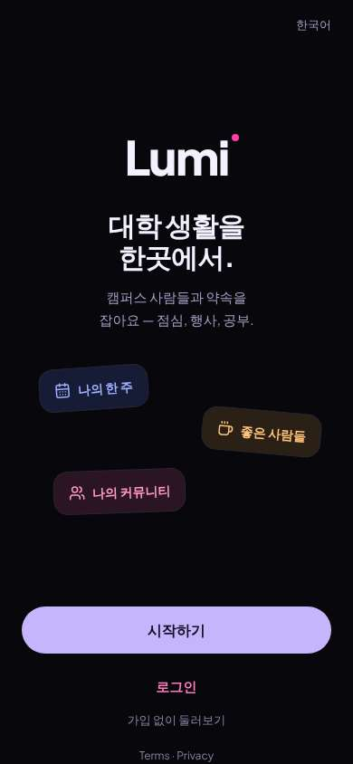</a> |
| 3 | click “가입 없이 둘러보기” | `/guest/explore/events` | 1323 | expects: “I can see what the app has without signing up, maybe rides or posts” (0.6) **mismatch**: Korean UI kept, but it is a list of campus events (seminars, game nights) — no rides or posts ⚑ mismatch _neutral_: “음... 학교 행사 목록이네요. 메뉴는 한국어인데 행사 내용은 다 영어. 저는 공항 가는 사람 찾고 싶은데. 아래에 '사람·모임·채팅은 가입한 학생만' 이라고 하네.” | <a href="shots/003-click-som.jpg">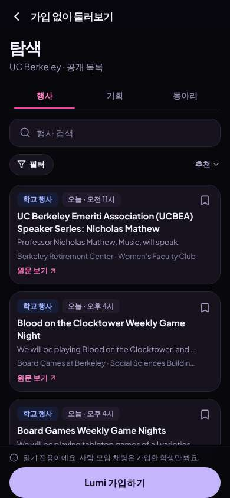</a> |
| 5 | type “행사 검색” ← “SFO” | `/guest/explore/events` | 864 | expects: “maybe some ride or airport thing shows up” (0.3) **mismatch**: Search 'SFO' showed a Black Studies talk and a yoga class — nothing about the airport ⚑ mismatch _confused_: “어... SFO 검색했는데 요가? 왜 이게 나오지? 공항이랑 상관없는데.” → f2 | <a href="shots/005-type-som.jpg">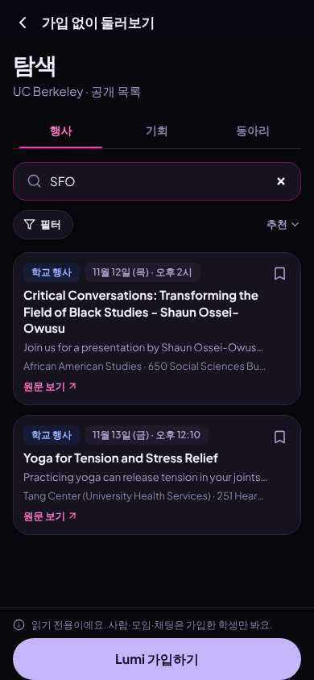</a> |
| 7 | click “동아리” | `/guest/explore/clubs` | 851 | expects: “list of clubs, maybe a Korean student club” (0.5) as expected _neutral_: “동아리 목록은 맞는데... Alpha, Alpha, Alpha. 그리스 문자 너무 많아요. 한국 학생 동아리 찾아볼게요.” | <a href="shots/007-click-som.jpg">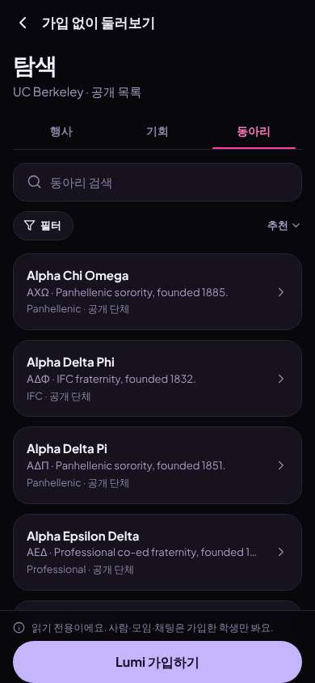</a> |
| 9 | type “동아리 검색” ← “Korean” | `/guest/explore/clubs` | 859 | expects: “Korean student association shows” (0.5) as expected _curious_: “오 KSA 있네요! 한국 학생들이 여기 있으면 공항 같이 갈 사람도 찾을 수 있을 것 같아요.” | <a href="shots/009-type-som.jpg">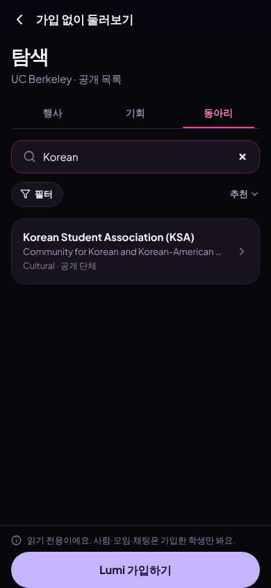</a> |
| 11 | click “Korean Student Association (KSA) Communi” | `/guest/explore/clubs` | 830 | expects: “KSA page with members or posts” (0.5) **mismatch**: Only a small sheet with the one-line description and Follow — no members, no posts ⚑ mismatch _neutral_: “설명 한 줄이랑 팔로우 버튼만... 사람이 있는지, 공항 가는 사람이 있는지 모르겠어요. 아무것도 안 보여서 가입해야 알 수 있나봐요.” → f3 | <a href="shots/011-click-som.jpg">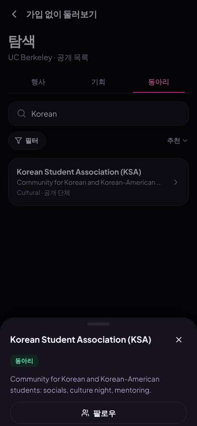</a> |
| 13 | click “닫기” | `/guest/explore/clubs` | 847 |  | <a href="shots/013-click-som.jpg">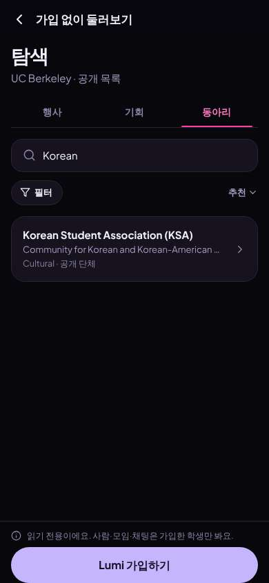</a> |
| 14 | click “Lumi 가입하기” | `/start/goals` | 850 | expects: “sign-up screen in Korean asking for school e-mail” (0.7) **mismatch**: Not e-mail first — a goals question, step 1 of 6 ⚑ mismatch _neutral_: “1/6... 여섯 단계나? 그래도 한국어라서 괜찮아요. '같이 이동하기' 같은 건 없네요. 새 사람 만나기로 할게요.” | <a href="shots/014-click-som.jpg">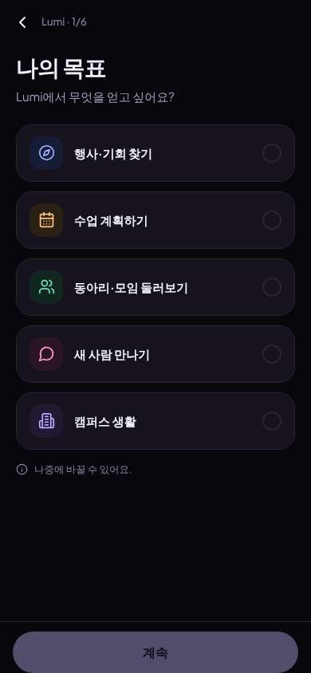</a> |
| 16 | click “새 사람 만나기” | `/start/goals` | 847 |  | <a href="shots/016-click-som.jpg">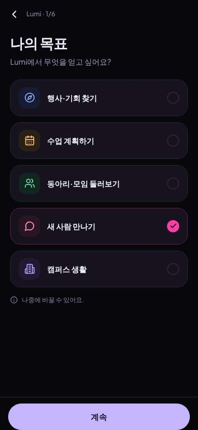</a> |
| 17 | click “계속” | `/start/what` | 852 |  | <a href="shots/017-click-som.jpg">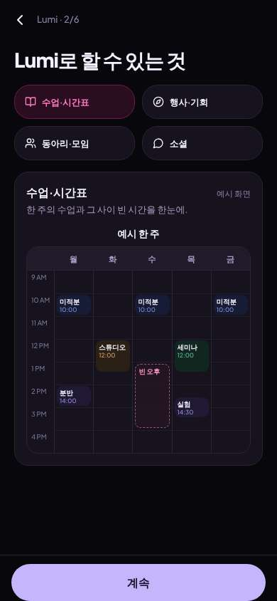</a> |
| 18 | click “소셜” | `/start/what` | 852 | expects: “shows how I meet people / make plans with others” (0.6) as expected _curious_: “아 이거 에브리타임 같은 느낌! 피드에 글 쓸 수 있고 모임도 만들 수 있네요. 'SFO 같이 갈 사람?' 이렇게 올릴 수 있을 것 같아요. 근데 '이동/카풀' 같은 건 직접 안 보여요.” | <a href="shots/018-click-som.jpg">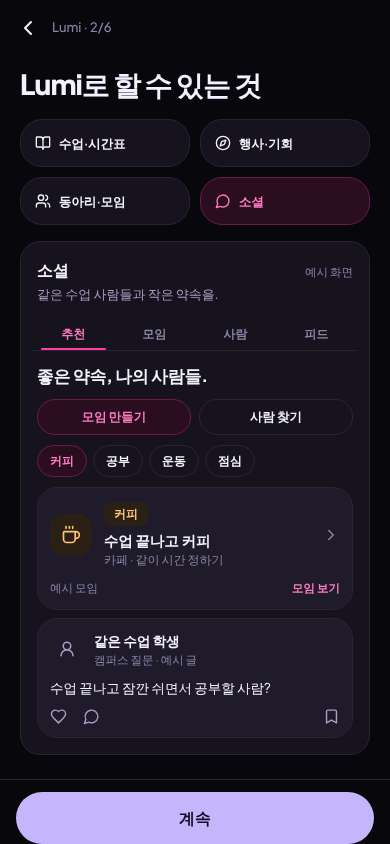</a> |
| 20 | click “계속” | `/start/university` | 843 |  | <a href="shots/020-click-som.jpg">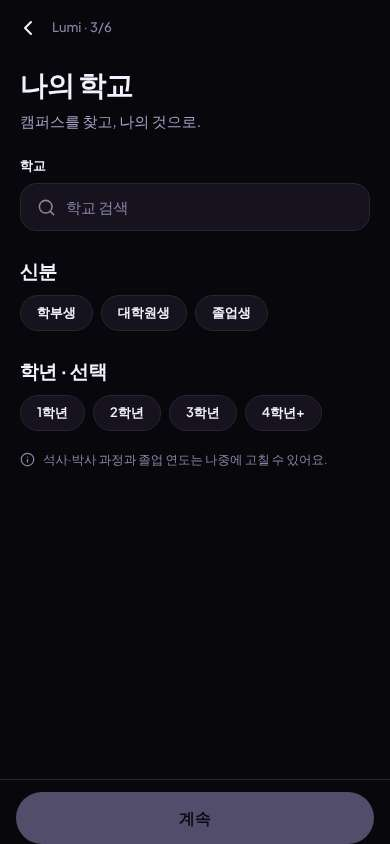</a> |
| 21 | type “학교 검색” ← “Berkeley” | `/start/university` | 853 | expects: “UC Berkeley appears in list” (0.8) as expected _neutral_: “네 UC Berkeley 있어요.” | <a href="shots/021-type-som.jpg">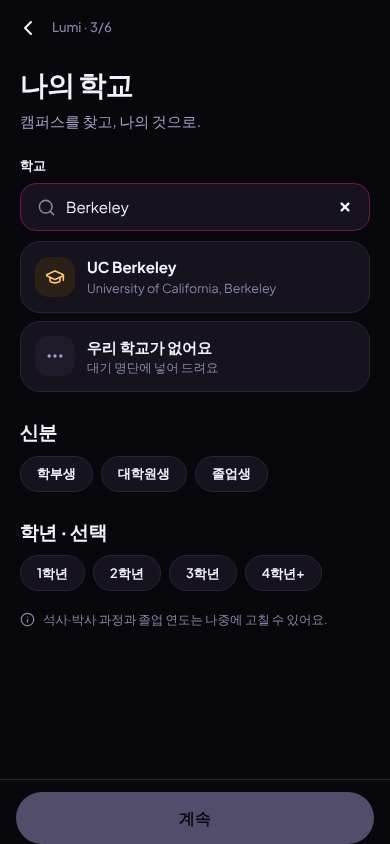</a> |
| 23 | click “UC Berkeley University of California, Be” | `/start/university` | 856 |  | <a href="shots/023-click-som.jpg">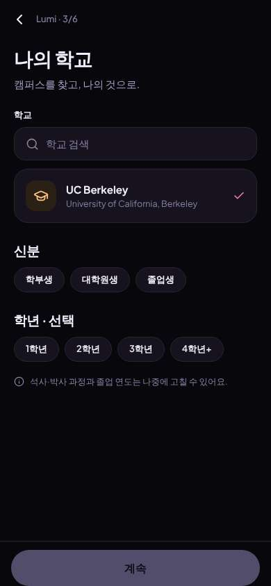</a> |
| 24 | click “학부생” | `/start/university` | 855 |  |  |
| 25 | observe | `/start/university` |  | _neutral_: “저는 교환학생인데 '교환학생' 선택이 없네요. 그냥 학부생 할게요. 학년은 선택이라 건너뛰어요.” → f4 | <a href="shots/025-observe-som.jpg">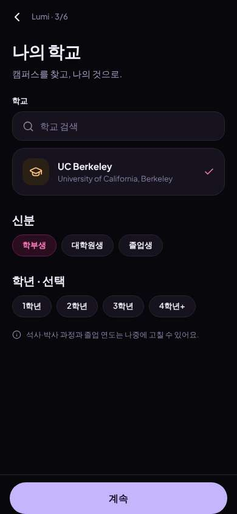</a> |
| 27 | click “계속” | `/start/discover` | 839 |  |  |
| 28 | click “커뮤니티” | `/start/discover` | 844 |  | <a href="shots/028-click-som.jpg">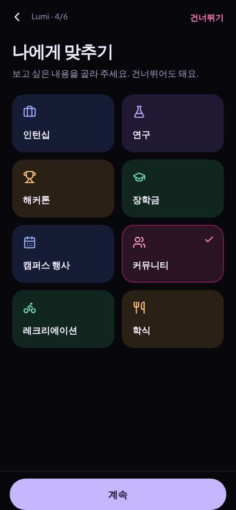</a> |
| 29 | click “계속” | `/start/communities` | 847 |  | <a href="shots/029-click-som.jpg">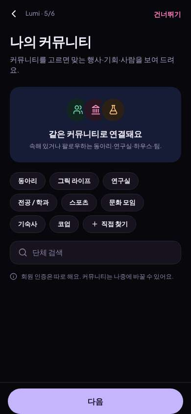</a> |
| 30 | type “단체 검색” ← “Korean” | `/start/communities` | 858 | expects: “KSA appears to add” (0.7) as expected _delighted_: “KSA 다시 나왔어요! 팔로우할게요.” | <a href="shots/030-type-som.jpg">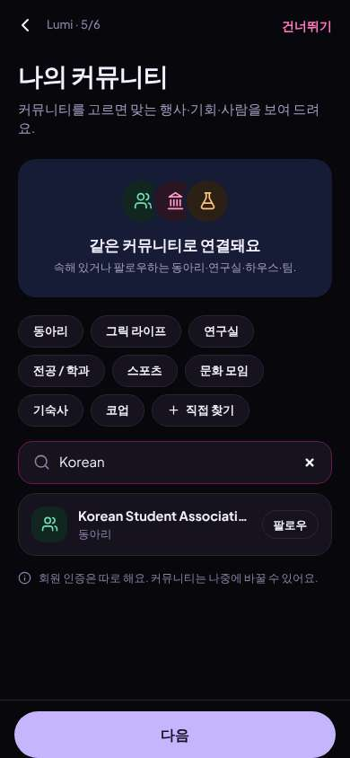</a> |
| 32 | click “Korean Student Association (KSA) 동아리 팔로우” | `/start/communities` | 860 |  | <a href="shots/032-click-som.jpg">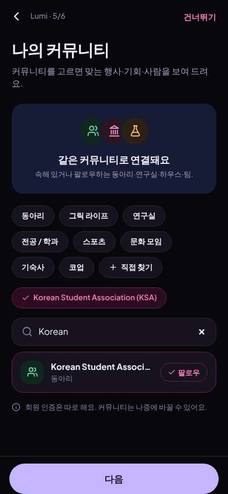</a> |
| 33 | click “다음” | `/start/about` | 837 | _curious_: “'나만 보여요', '친구에게만 보여요' — 안심돼요. 전화번호나 주소 안 물어봐서 좋아요. 근데 '사는 곳'은 언제 물어보는 거지?” | <a href="shots/033-click-som.jpg">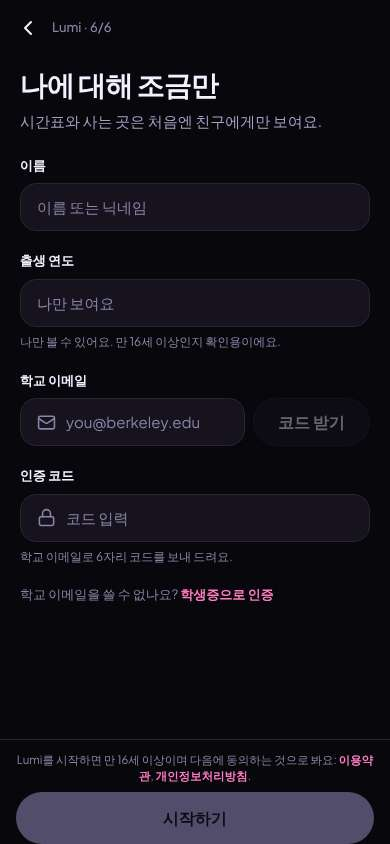</a> |
| 35 | type “이름 또는 닉네임” ← “Seoyeon” | `/start/about` | 847 |  | <a href="shots/035-type-som.jpg">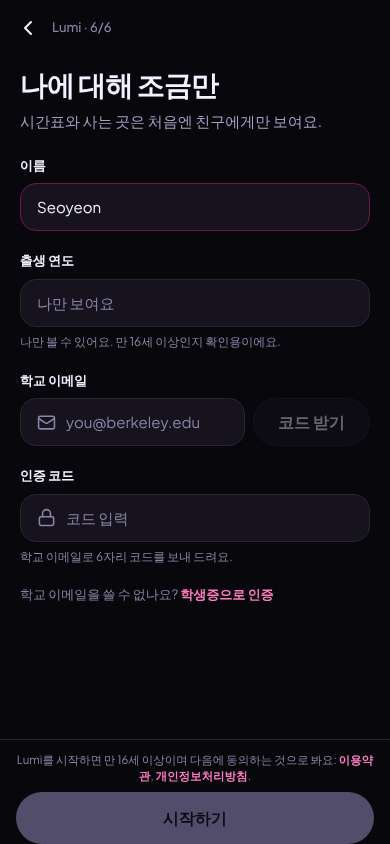</a> |
| 36 | type “나만 보여요” ← “2006” | `/start/about` | 843 |  | <a href="shots/036-type-som.jpg">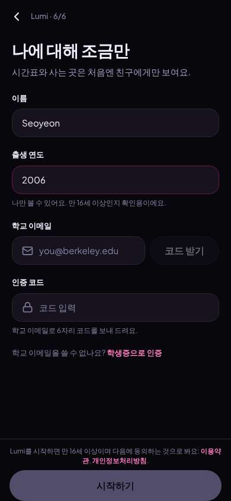</a> |
| 37 | type “you@berkeley.edu” ← “seoyeon.kim@berkeley.edu” | `/start/about` | 858 |  | <a href="shots/037-type-som.jpg">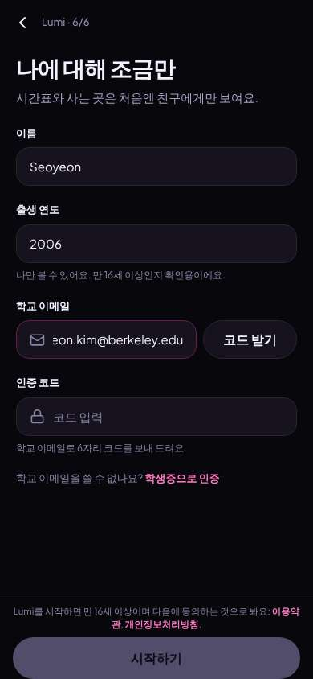</a> |
| 38 | click “코드 받기” | `/start/about` | 850 | expects: “a 6-digit code is sent to my school e-mail” (0.8) as expected _neutral_: “코드 537167. 이 문장만 영어네요, 하지만 테스트 환경이라 그런 것 같아요.” | <a href="shots/038-click-som.jpg">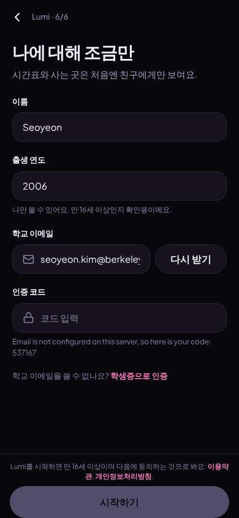</a> |
| 40 | type “코드 입력” ← “537167” | `/start/about` | 861 |  | <a href="shots/040-type-som.jpg">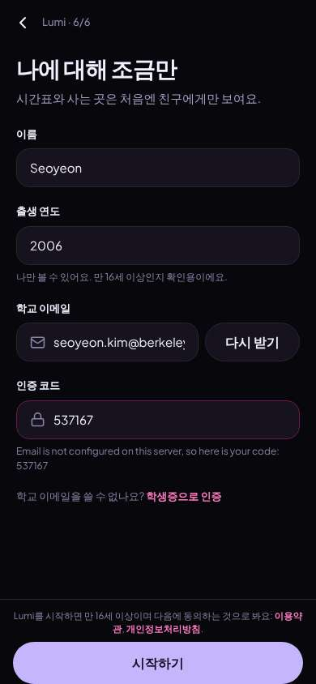</a> |
| 41 | click “시작하기” | `/` | 1142 | expects: “account is created and I land in the app home, still in Korean” (0.7) as expected _delighted_: “가입 완료! 다 한국어라서 좋아요. '모임'에서 SFO 같이 갈 사람 찾아볼 수 있을 것 같아요. 행사 제목은 영어지만 괜찮아요.” |  |
| 43 | finish | `/` |  |  | <a href="shots/043-finish-som.jpg">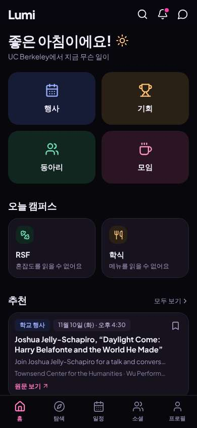</a> |

## Automatic checks (harness, not persona)

| screen | tap targets < 44px | sideways overflow | broken images |
|---|---|---|---|
| `/welcome` | 5 (English 44×20, Sign In 80×40, Look around first 136×36, Terms 34×15, Privacy 41×15) | — | — |
| `/guest/explore/events` | 9 (뒤로 40×40, 행사 검색 295×23, 필터 75×36, 정렬: 추천 47×36, 원문 보기 68×19) | — | — |
| `/guest/explore/clubs` | 4 (뒤로 40×40, 동아리 검색 295×23, 필터 75×36, 정렬: 추천 47×36) | — | — |
| `/start/goals` | 1 (뒤로 40×40) | — | — |
| `/start/what` | 5 (뒤로 40×40) | — | — |
| `/start/university` | 9 (뒤로 40×40, 학교 검색 287×23, 학부생 73×36, 대학원생 86×36, 졸업생 73×36) | — | — |
| `/start/discover` | 2 (뒤로 40×40, 건너뛰기 80×40) | — | — |
| `/start/communities` | 13 (뒤로 40×40, 건너뛰기 80×40, 동아리 73×36, 그릭 라이프 101×36, 연구실 73×36) | — | — |
| `/start/about` | 4 (뒤로 40×40, 학생증으로 인증 93×18, 이용약관 234×31, 개인정보처리방침 92×15) | — | — |
| `/` | 6 (검색 40×40, 알림 40×40, 메시지 40×40, 모두 보기 69×20, 원문 보기 68×19) | — | — |

## Timing (harness)

- Full page load (navigation timing): 247 ms, 132 ms
