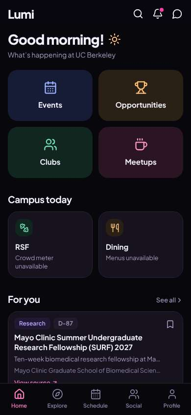
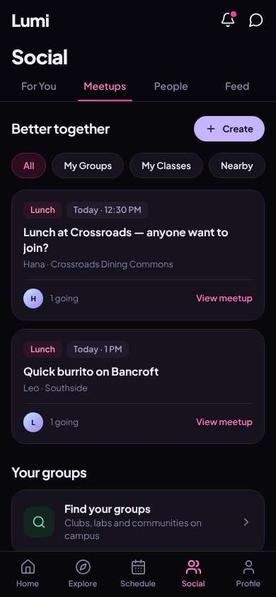
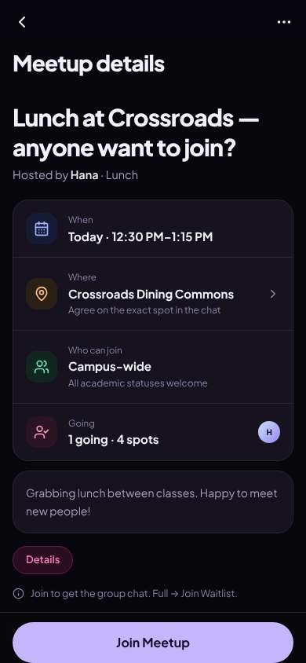
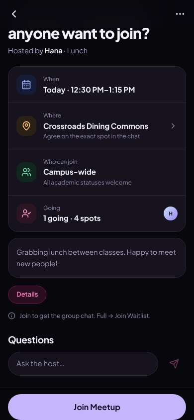
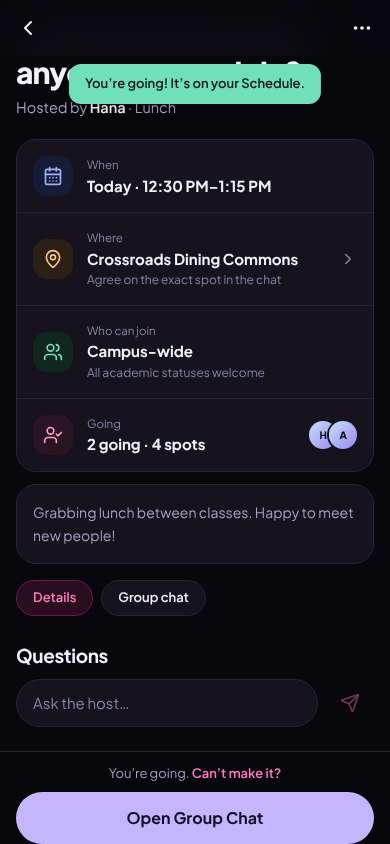
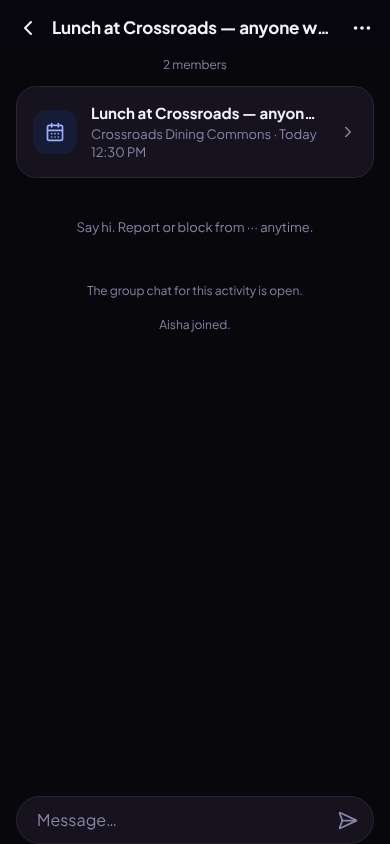
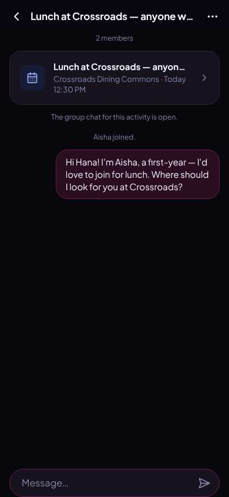

# ux-sim run `sched-20261108-1915-aisha-lunch-today`

> **AI simulation — hypotheses, not measured user behaviour.** One simulated persona; nothing here is a rate or a measurement of real students.

| | |
|---|---|
| Persona | **Aisha**, 18 — First-year (first in her family to go to college) · phone 390×844 · prefers en · tech medium (`aisha-firstgen-anxious`) |
| Scenario | **Find someone to get lunch with today** — It's a weekday and you'd rather not eat lunch alone again. Use the app to find someone (or a group) to get lunch with today, and let them know you're in. (`lunch-today`) |
| Target | local · http://localhost:45717 · worktree commit `0782bc0c765c` |
| Outcome | **success** · ended by persona |
| Account | fresh real account `aisha.odayq0wp@berkeley.edu` (Aisha, Public Health, born 2008; sample: false) · peers seeded: Hana, Leo |
| Goal check (fixed, by harness) | met at step 6 after 4 action(s) — evidence: joined or asked to join a peer's lunch plan; joined or asked to join a plan — _During the run the persona's own account joined/requested one of today's lunch plans, posted its own meal plan for today, or messaged in a lunch plan's chat._ |
| Persona's reason | “I joined Hana's 12:30 lunch at Crossroads, it's on my schedule, and I said hi in the group chat so she knows I'm coming.” |
| Effort | 6/50 actions · objective frustration 0.00/6 · 0 confused note(s) · ~73s simulated |
| Drop-off risk | **low** _(AI hypothesis, persona agent)_ — Every step told me what would happen before I tapped, nothing was posted publicly without warning, and 'Can't make it?' plus report/block made me feel safe; I'd come back to find more small plans. · basis: steps 3, 6, 8 |

Known environment limits (not UX findings)

- Dining menus and RSF gym crowd levels need live campus sources (the local stack runs with CAMPUS_LIVE=0) — empty or missing data there is not a UX bug.
- AI features (Ask Lumi, AI profile draft on /start, conversation starters) need an OpenAI key; none is configured locally.
- Course catalog is the real Berkeley Class Schedule (6619 courses, Fall 2026 + Spring 2027), fetched 2026-11-05 with the worker's adapter. Seat counts and very recent changes may differ from live.
- Campus events, free food, internships, hackathons and scholarships are a read-only snapshot of live (1272 real items, 106 events this week, taken 2026-11-08 19:15 UTC) plus the CSV calendar. Nothing new appears during the run; Q&A and reviews are empty.
- No e-mail is sent: the sign-up / sign-in code is shown on screen in the hint (live sends a real e-mail).
- Real-time updates (SSE) work locally; other people never reply unless the stack was started with --autoreply.
- Signed in as a brand-new real (non-sample, e-mail-verified) account made for this run. Other students exist only if the scenario seeds peers (local fixtures); sample profiles are hidden from real accounts, as on live.

## Friction

| # | step | type | sev | persona says | screen | element | env-limited | evidence |
|---|---|---|---|---|---|---|---|---|
| f1 | 3 | Unclear wording | 1 | “This is really clear — today 12:30, Crossroads, and 'happy to meet new people' makes me feel less weird about it. Wait, 'Full → Join Waitlist' — is it full? It says 4 spots, so I think that's just explaining what happens if it fills? The arrow is a bit cryptic.” _wish: say 'If it fills up, you can join a waitlist' in words_ | `/activities/:id` | Details | no | [shot](shots/003-click.jpg) [marked](shots/003-click-som.jpg) |
| f2 | 10 | Confusing UI | 1 | “It's there. I can't tell if Hana's seen it or when I sent it, which makes me a little nervous, but it's fine — the chat says I joined and the plan is on my schedule.” _wish: a small 'sent' / time under my message so I know it went through_ | `/chats/:id` | Message | no | [shot](shots/010-type.jpg) [marked](shots/010-type-som.jpg) |

Severity: 1 = Minor — noticed it, cosmetic or a small annoyance; did not slow me down. · 2 = Moderate — slowed me down or made me hesitate; I recovered on my own. · 3 = Major — real confusion, a wrong path or many extra steps; I nearly gave up or only got through by guessing. · 4 = Blocker — I could not continue, gave up, or would stop using the app here.

## Timeline

| step | what | screen | ms | signals / notes | shot |
|---|---|---|---|---|---|
| 0 | start | `/` | 1264 |  |  |
| 1 | click “Meetups” | `/social/meetups` | 915 | expects: “a list of casual meetups like lunch or coffee with other students” (0.6) as expected _curious_: “Oh good, these are exactly lunch plans for today. Crossroads is a dining hall I actually know. 'View meetup' sounds safe — it doesn't sound like it'll sign me up yet.” |  |
| 3 | click “Lunch Today · 12:30 PM Lunch at Crossroa” | `/activities/:id` | 841 | expects: “details of Hana's lunch, who's going, and a way to join” (0.7) as expected _curious_: “This is really clear — today 12:30, Crossroads, and 'happy to meet new people' makes me feel less weird about it. Wait, 'Full → Join Waitlist' — is it full? It says 4 spots, so I think that's just explaining what happens if it fills? The arrow is a bit cryptic.” → f1 |  |
| 5 | scroll down | `/activities/:id` | 1309 |  |  |
| 6 | click “Join Meetup” | `/activities/:id` | 834 | expects: “I'm added to the lunch as going, and I get access to a group chat with Hana” (0.7) as expected _delighted_: “Oh that was easy and it didn't post anything weird. I like that 'Can't make it?' is right there so I'm not trapped. I should probably say hi in the chat so Hana knows a real person is coming.” |  |
| 8 | click “Open Group Chat” | `/chats/:id` | 945 | expects: “a group chat with Hana where I can type a message” (0.8) as expected _curious_: “Okay, it already says 'Aisha joined' so Hana will see it. The report/block note makes me feel safer. I'll say a short hi so it's not awkward when I show up.” |  |
| 10 | type “Message” ← “Hi Hana! I'm Aisha, a first-year — I'd love to join for lunch. Where should I look for you at Crossroads?” | `/chats/:id` | 870 | expects: “my message appears in the chat” (0.8) as expected _neutral_: “It's there. I can't tell if Hana's seen it or when I sent it, which makes me a little nervous, but it's fine — the chat says I joined and the plan is on my schedule.” → f2 |  |
| 12 | finish | `/chats/:id` |  |  |  |

## Automatic checks (harness, not persona)

| screen | tap targets < 44px | sideways overflow | broken images |
|---|---|---|---|
| `/` | 6 (Search 40×40, Notifications 40×40, Messages 40×40, See all 55×20, View source 90×19) | — | — |
| `/social/meetups` | 7 (Notifications 40×40, Messages 40×40, Create 100×36, All 49×36, My Groups 102×36) | — | — |
| `/activities/:id` | 6 (Back 40×40, More 40×40, Hosted by Hana · Lunch 160×22, Details 77×36) | — | — |
| `/chats/:id` | 2 (Back 40×40, More 40×40) | — | — |

## Timing (harness)

- Full page load (navigation timing): 345 ms
