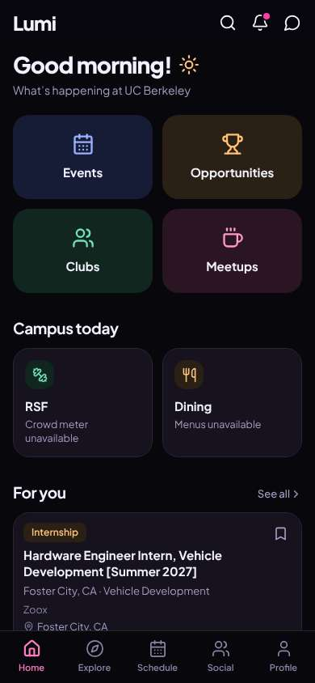
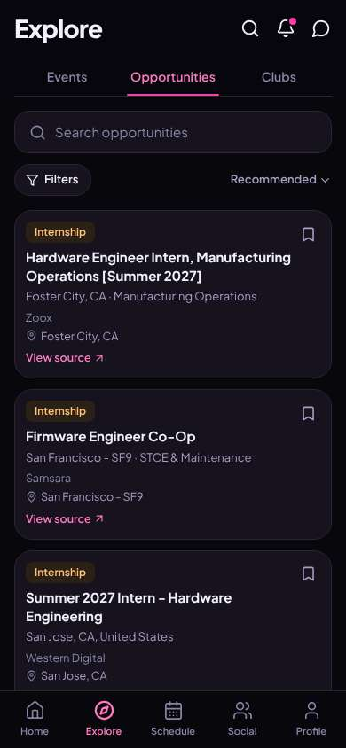
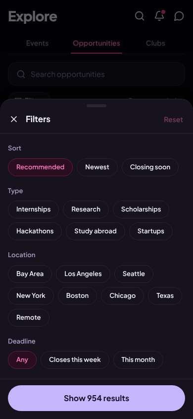
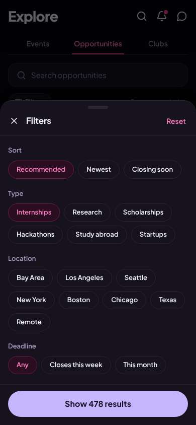
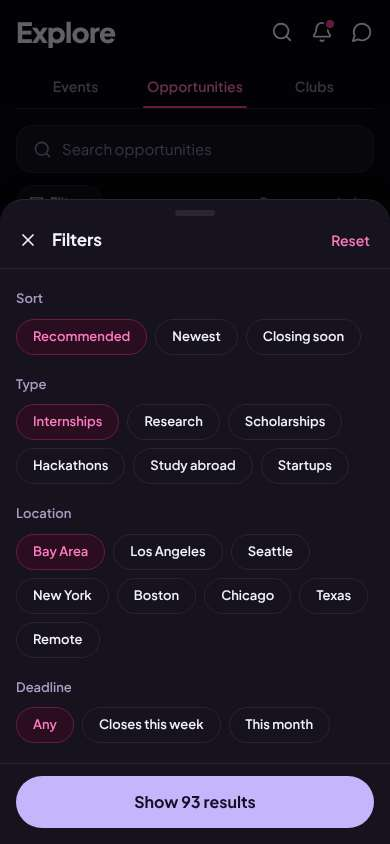
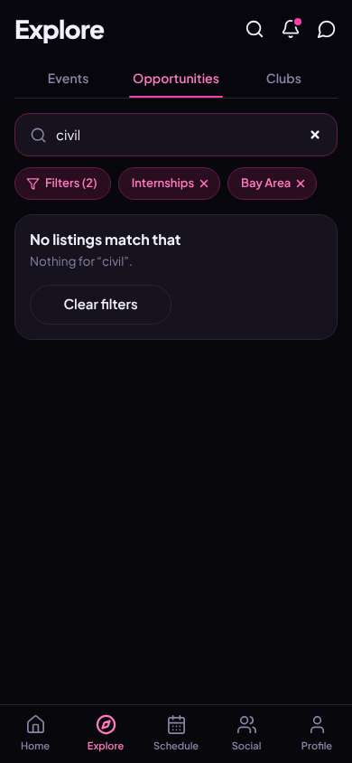
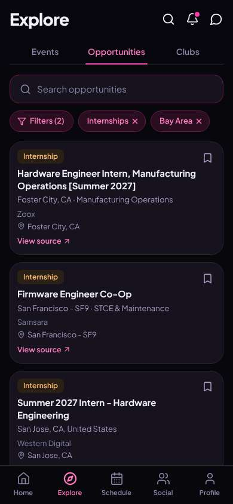
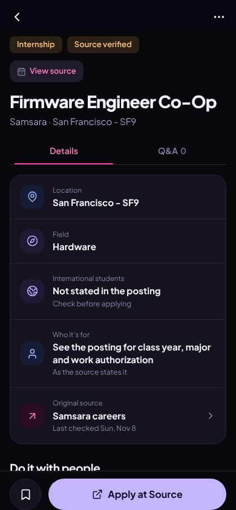
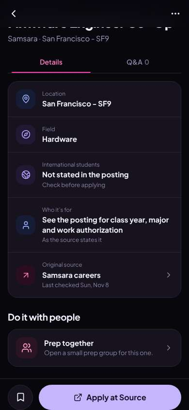

# ux-sim run `sched-20261108-1915-diego-internship-near-berkeley`

> **AI simulation — hypotheses, not measured user behaviour.** One simulated persona; nothing here is a rate or a measurement of real students.

| | |
|---|---|
| Persona | **Diego**, 21 — Junior (transfer from Laney College) · phone 390×844 · prefers en · tech medium (`diego-transfer-commuter`) |
| Scenario | **Find an internship near Berkeley** — You need a paid internship (summer or part-time) somewhere near Berkeley / the Bay Area. Use the app to find one that looks real and open, and open its details so you know how to apply. (`internship-near-berkeley`) |
| Target | local · http://localhost:45399 · worktree commit `0782bc0c765c` |
| Outcome | **success** · ended by persona |
| Account | fresh real account `diego.eleyq0xq@berkeley.edu` (Diego, Civil Engineering, born 2005; sample: false) |
| Goal check (fixed, by harness) | met at step 13 after 8 action(s) — evidence: {"urlMatches":"^/opportunities/[^/?]+"}; {"textMatches":"\\bintern(ship)?s?\\b"} — _An internship listing's detail page is open (reached by the persona — the run starts on /)._ |
| Persona's reason | “Found a Samsara co-op in SF I can BART to, it says source verified and checked today, and the Apply at Source button tells me how to apply. Still had to guess it's paid.” |
| Effort | 9/32 actions · objective frustration 1.50/4 · 1 confused note(s) · ~53s simulated |
| Drop-off risk | **medium** _(AI hypothesis, persona agent)_ — Filters were fast and the listing felt legit, but no civil roles and no pay/deadline info means I'd still have to go elsewhere; prep groups might bring me back. · basis: steps 9, 13, 15 |

Known environment limits (not UX findings)

- Dining menus and RSF gym crowd levels need live campus sources (the local stack runs with CAMPUS_LIVE=0) — empty or missing data there is not a UX bug.
- AI features (Ask Lumi, AI profile draft on /start, conversation starters) need an OpenAI key; none is configured locally.
- Course catalog is the real Berkeley Class Schedule (6619 courses, Fall 2026 + Spring 2027), fetched 2026-11-05 with the worker's adapter. Seat counts and very recent changes may differ from live.
- Campus events, free food, internships, hackathons and scholarships are a read-only snapshot of live (1272 real items, 106 events this week, taken 2026-11-08 19:15 UTC) plus the CSV calendar. Nothing new appears during the run; Q&A and reviews are empty.
- No e-mail is sent: the sign-up / sign-in code is shown on screen in the hint (live sends a real e-mail).
- Real-time updates (SSE) work locally; other people never reply unless the stack was started with --autoreply.
- Signed in as a brand-new real (non-sample, e-mail-verified) account made for this run. Other students exist only if the scenario seeds peers (local fixtures); sample profiles are hidden from real accounts, as on live.

## Friction

| # | step | type | sev | persona says | screen | element | env-limited | evidence |
|---|---|---|---|---|---|---|---|---|
| f1 | 3 | Hard to find | 1 | “Bay Area chip, nice. But no 'paid' option and nothing for civil engineering — I'll have to check each one.” _wish: a Paid filter and a major/field filter_ | `/explore/opportunities` | Internships | no | [shot](shots/003-click.jpg) [marked](shots/003-click-som.jpg) |
| f2 | 9 | Missing / empty content | 2 | “Zero civil internships in the whole Bay Area? Come on. Fine, I'll take any engineering one that pays.” _wish: show civil/structural/transportation roles, or suggest close matches instead of a dead end_ | `/explore/opportunities` | Search opportunities | yes — local stack listings are a sample/deadline calendar, not a live feed | [shot](shots/009-type.jpg) [marked](shots/009-type-som.jpg) |
| f3 | 13 | Missing / empty content | 2 | “OK, it's real and checked today, and I know how to apply. But is it paid? When does it close? Nothing up top says.” _wish: show pay (or 'paid') and the application deadline right in the details_ | `/opportunities/:id` | Details | no | [shot](shots/013-click.jpg) [marked](shots/013-click-som.jpg) |

Severity: 1 = Minor — noticed it, cosmetic or a small annoyance; did not slow me down. · 2 = Moderate — slowed me down or made me hesitate; I recovered on my own. · 3 = Major — real confusion, a wrong path or many extra steps; I nearly gave up or only got through by guessing. · 4 = Blocker — I could not continue, gave up, or would stop using the app here.

## Timeline

| step | what | screen | ms | signals / notes | shot |
|---|---|---|---|---|---|
| 0 | start | `/` | 1201 |  |  |
| 1 | click “Opportunities” | `/explore/opportunities` | 920 | expects: “list of internships and jobs I can filter by location” (0.8) as expected _curious_: “OK, this is real stuff — Zoox, Samsara. Bay Area at the top. But it's all hardware/EE, nothing civil, and I can't tell which are paid.” |  |
| 3 | click “Filters” | `/explore/opportunities` | 865 | expects: “filter options like location, paid, field” (0.6) as expected _neutral_: “Bay Area chip, nice. But no 'paid' option and nothing for civil engineering — I'll have to check each one.” → f1 |  |
| 5 | click “Internships” | `/explore/opportunities` | 851 |  |  |
| 6 | click “Bay Area” | `/explore/opportunities` | 830 |  |  |
| 7 | click “Show 93 results” | `/explore/opportunities` | 840 | expects: “93 Bay Area internships” (0.85) as expected _neutral_: “Good, filters stuck. Still all hardware stuff up top though. Let me search civil.” |  |
| 9 | type “Search opportunities” ← “civil” | `/explore/opportunities` | 858 | expects: “civil engineering internships in the Bay Area” (0.5) **mismatch**: No listings match 'civil' in Bay Area internships ⚑ mismatch _frustrated_: “Zero civil internships in the whole Bay Area? Come on. Fine, I'll take any engineering one that pays.” → f2 |  |
| 11 | type “Search opportunities” | `/explore/opportunities` | 883 | expects: “back to the 93 Bay Area internships” (0.7) as expected ⚑ backtrack _neutral_: “OK. Samsara in SF — I can BART there. Let me open it.” |  |
| 13 | click “Internship Firmware Engineer Co-Op San F” | `/opportunities/:id` | 847 | expects: “details page: pay, deadline, how to apply” (0.65) **mismatch**: Details page with location, field, 'Source verified', last checked today, and a big Apply at Source button — but no pay and no deadline shown ⚑ mismatch _neutral_: “OK, it's real and checked today, and I know how to apply. But is it paid? When does it close? Nothing up top says.” → f3 |  |
| 15 | scroll down | `/opportunities/:id` | 1315 | _curious_: “'Prep together — open a small prep group.' Huh, that's actually something I'd want, I don't know anyone here.” |  |
| 17 | finish | `/opportunities/:id` |  |  |  |

## Automatic checks (harness, not persona)

| screen | tap targets < 44px | sideways overflow | broken images |
|---|---|---|---|
| `/` | 6 (Search 40×40, Notifications 40×40, Messages 40×40, See all 55×20, Save 36×36) | — | — |
| `/explore/opportunities` | 22 (Search 40×40, Notifications 40×40, Messages 40×40, Search opportunities 295×23, Filters 87×36) | — | — |
| `/opportunities/:id` | 3 (Back 40×40, More 40×40, View source 77×20) | — | — |

## Timing (harness)

- Full page load (navigation timing): 267 ms
