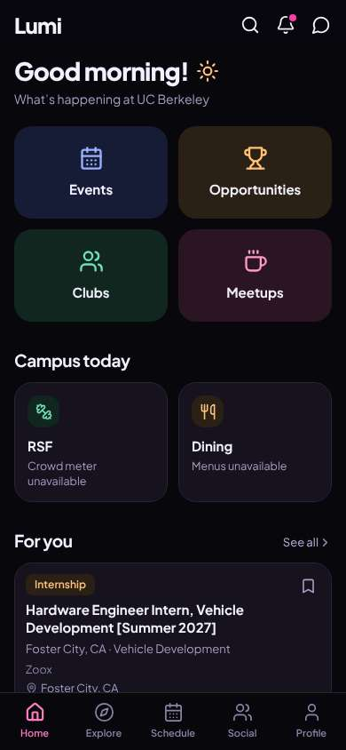
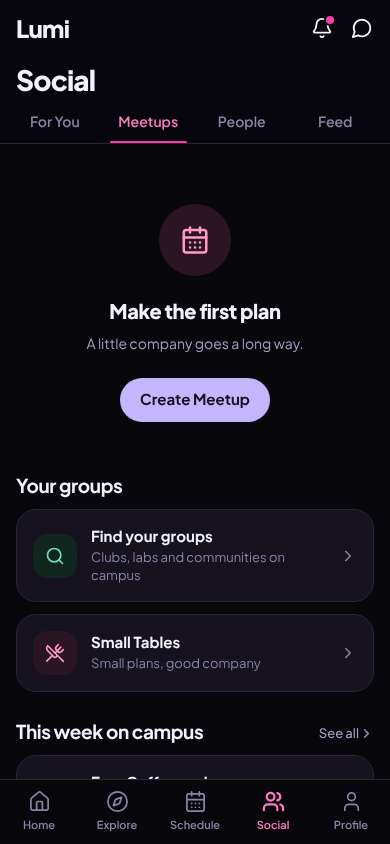
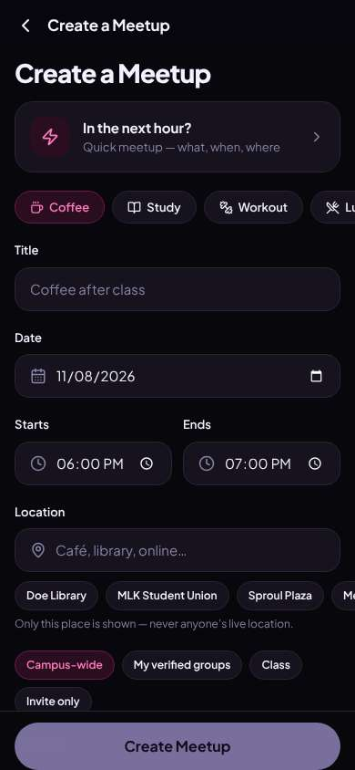
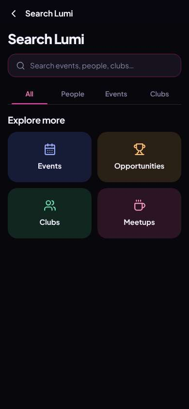
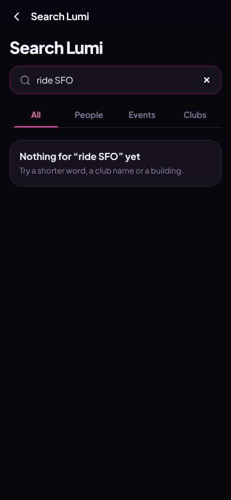
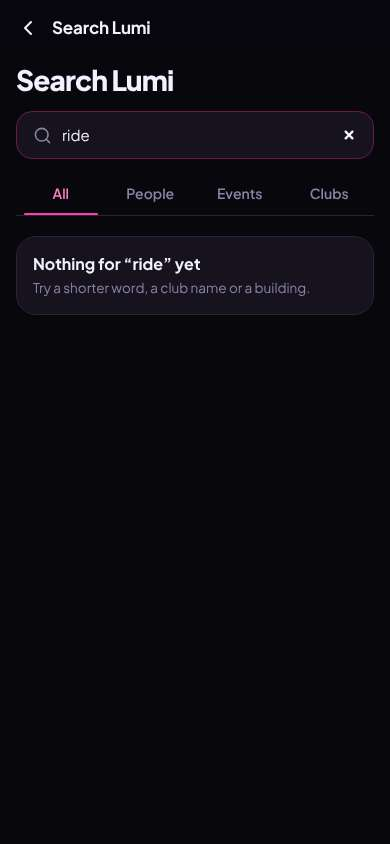
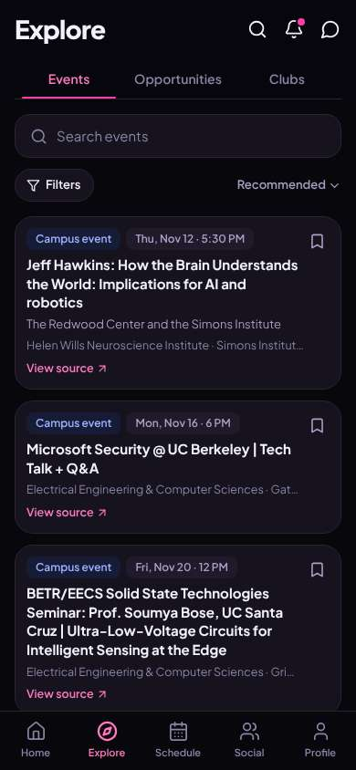

# ux-sim run `sched-20261108-1915-diego-ride-sfo-thanksgiving`

> **AI simulation — hypotheses, not measured user behaviour.** One simulated persona; nothing here is a rate or a measurement of real students.

| | |
|---|---|
| Persona | **Diego**, 21 — Junior (transfer from Laney College) · phone 390×844 · prefers en · tech medium (`diego-transfer-commuter`) |
| Scenario | **Share a ride to SFO for Thanksgiving** — You fly out of SFO the Wednesday before Thanksgiving (Nov 25) in the morning. Find other students to split a ride to the airport with — join one, or post yours so others can find you. (`ride-sfo-thanksgiving`) |
| Target | local · http://localhost:43161 · worktree commit `0782bc0c765c` |
| Outcome | **abandoned** · ended by persona |
| Account | fresh real account `diego.vingq0xm@berkeley.edu` (Diego, Civil Engineering, born 2005; sample: false) · peers seeded: Jun |
| Goal check (fixed, by harness) | not met — _During the run the persona posted an SFO ride on Nov 25, or joined/requested someone's SFO ride (server-side)._ |
| Patience | exhausted at step 15; 1 action(s) after — **overrodePatience** |
| Persona's reason | “I looked in Meetups, Explore and search for 'ride' and there's nothing about rides or the airport anywhere. Meetup types are coffee and study — I'm not hacking that into a carpool. I'll just text people or take BART.” |
| Effort | 8/32 actions · objective frustration 3.00/4 · 2 confused note(s) · ~68s simulated |
| Drop-off risk | **high** _(AI hypothesis, persona agent)_ — Came with one concrete need (SFO ride); nav, meetup form and search gave no sign rides exist, and Explore is grad seminars — nothing tells a transfer commuter this app is for him · basis: steps 4, 8, 12, 14 |

Known environment limits (not UX findings)

- Dining menus and RSF gym crowd levels need live campus sources (the local stack runs with CAMPUS_LIVE=0) — empty or missing data there is not a UX bug.
- AI features (Ask Lumi, AI profile draft on /start, conversation starters) need an OpenAI key; none is configured locally.
- Course catalog is the real Berkeley Class Schedule (6619 courses, Fall 2026 + Spring 2027), fetched 2026-11-05 with the worker's adapter. Seat counts and very recent changes may differ from live.
- Campus events, free food, internships, hackathons and scholarships are a read-only snapshot of live (1272 real items, 106 events this week, taken 2026-11-08 19:15 UTC) plus the CSV calendar. Nothing new appears during the run; Q&A and reviews are empty.
- No e-mail is sent: the sign-up / sign-in code is shown on screen in the hint (live sends a real e-mail).
- Real-time updates (SSE) work locally; other people never reply unless the stack was started with --autoreply.
- Signed in as a brand-new real (non-sample, e-mail-verified) account made for this run. Other students exist only if the scenario seeds peers (local fixtures); sample profiles are hidden from real accounts, as on live.

## Friction

| # | step | type | sev | persona says | screen | element | env-limited | evidence |
|---|---|---|---|---|---|---|---|---|
| f1 | 0 | Hard to find | 2 | “OK, where's rides? Nothing says ride or carpool. Internship card isn't what I need. Meetups maybe?” _wish: a Rides / carpool entry on home_ | `/` |  | no | [shot](shots/000-start.jpg) [marked](shots/000-start-som.jpg) |
| f2 | 2 | Missing / empty content | 2 | “Empty. Nobody's posted a ride. Fine, I'll post mine — maybe Create Meetup lets me pick a ride.” | `/social/meetups` | Create Meetup | no | [shot](shots/002-click.jpg) [marked](shots/002-click-som.jpg) |
| f3 | 4 | Hard to find | 2 | “Coffee, study, workout... no 'ride'. Locations are Doe and Sproul, not SFO. This isn't for carpools. Let me check Explore before I hack this.” _wish: a Ride / carpool type, or a separate rides section_ | `/meetups/new` | Coffee | no | [shot](shots/004-click.jpg) [marked](shots/004-click-som.jpg) |
| f4 | 8 | Hard to find | 3 | “Seminars. Not what I need. I'm burning my break. Let me just search 'ride'.” _wish: rides should be findable from the main nav_ | `/explore/events` | Explore | no | [shot](shots/008-click.jpg) [marked](shots/008-click-som.jpg) |
| f5 | 14 | Hard to find | 3 | “Search doesn't know rides exist. Does this app even do rides? Last try — Social, For You.” _wish: search for 'ride' should point me to rides/carpools or at least suggest posting one_ | `/search` | Search events, people, clubs… | no | [shot](shots/014-type.jpg) [marked](shots/014-type-som.jpg) |

Severity: 1 = Minor — noticed it, cosmetic or a small annoyance; did not slow me down. · 2 = Moderate — slowed me down or made me hesitate; I recovered on my own. · 3 = Major — real confusion, a wrong path or many extra steps; I nearly gave up or only got through by guessing. · 4 = Blocker — I could not continue, gave up, or would stop using the app here.

## Where it ended

Step 16 on `/explore/events`.

## Timeline

| step | what | screen | ms | signals / notes | shot |
|---|---|---|---|---|---|
| 0 | start | `/` | 1245 | _neutral_: “OK, where's rides? Nothing says ride or carpool. Internship card isn't what I need. Meetups maybe?” → f1 |  |
| 2 | click “Meetups” | `/social/meetups` | 910 | expects: “list of meetups, maybe rides or carpools among them” (0.4) **mismatch**: No meetups at all, empty state 'Make the first plan'. Nothing about rides. ⚑ mismatch _neutral_: “Empty. Nobody's posted a ride. Fine, I'll post mine — maybe Create Meetup lets me pick a ride.” → f2 |  |
| 4 | click “Create Meetup” | `/meetups/new` | 856 | expects: “form to create a plan, hopefully with a ride/carpool option” (0.5) **mismatch**: Meetup form with Coffee/Study/Workout/Lunch types and campus locations — no ride or airport option ⚑ mismatch _neutral_: “Coffee, study, workout... no 'ride'. Locations are Doe and Sproul, not SFO. This isn't for carpools. Let me check Explore before I hack this.” → f3 |  |
| 6 | click “Back” | `/social/meetups` | 830 | expects: “back to Social/meetups” (0.8) as expected ⚑ backtrack _neutral_: “OK.” |  |
| 8 | click “Explore” | `/explore/events` | 829 | expects: “Explore page, maybe rides/transport category” (0.35) **mismatch**: Explore is events/opportunities/clubs — seminars, no rides ⚑ mismatch _frustrated_: “Seminars. Not what I need. I'm burning my break. Let me just search 'ride'.” → f4 |  |
| 10 | click “Search” | `/search` | 839 | expects: “app-wide search box” (0.7) as expected _neutral_: “Search. OK.” |  |
| 12 | type “Search events, people, clubs…” ← “ride SFO” | `/search` | 900 | expects: “results with rides to SFO, or a way to post one” (0.3) **mismatch**: Nothing for 'ride SFO' yet — try a shorter word ⚑ mismatch _neutral_: “Nothing. It says shorter word, fine: 'ride'.” |  |
| 14 | type “Search events, people, clubs…” ← “ride” | `/search` | 882 | expects: “something about rides or carpool” (0.3) **mismatch**: Nothing for 'ride' either ⚑ mismatch _frustrated_: “Search doesn't know rides exist. Does this app even do rides? Last try — Social, For You.” → f5 |  |
| 16 | click “Back” | `/explore/events` | 837 | expects: “go back” (0.8) |  |
| 17 | finish | `/explore/events` |  |  |  |

## Automatic checks (harness, not persona)

| screen | tap targets < 44px | sideways overflow | broken images |
|---|---|---|---|
| `/` | 6 (Search 40×40, Notifications 40×40, Messages 40×40, See all 55×20, Save 36×36) | — | — |
| `/social/meetups` | 3 (Notifications 40×40, Messages 40×40, See all 55×20) | — | — |
| `/meetups/new` | 13 (Back 40×40, Coffee 99×36, Study 92×36, Workout 109×36, Lunch 93×36) | — | — |
| `/explore/events` | 12 (Search 40×40, Notifications 40×40, Messages 40×40, Search events 295×23, Filters 87×36) | — | — |
| `/search` | 2 (Back 40×40, Search events, people, clubs… 295×23) | — | — |

## Timing (harness)

- Full page load (navigation timing): 311 ms
