# ux-sim run `sched-20261108-1915-marcus-internship-near-berkeley`

> **AI simulation — hypotheses, not measured user behaviour.** One simulated persona; nothing here is a rate or a measurement of real students.

| | |
|---|---|
| Persona | **Marcus**, 22 — Senior · phone 390×844 · prefers en · tech low (`marcus-senior-lowtech`) |
| Scenario | **Find an internship near Berkeley** — You need a paid internship (summer or part-time) somewhere near Berkeley / the Bay Area. Use the app to find one that looks real and open, and open its details so you know how to apply. (`internship-near-berkeley`) |
| Target | local · http://localhost:40597 · worktree commit `0782bc0c765c` |
| Outcome | **success** · ended by persona |
| Account | fresh real account `marcus.eleyq0yg@berkeley.edu` (Marcus, History, born 2004; sample: false) |
| Goal check (fixed, by harness) | met at step 21 after 12 action(s) — evidence: {"urlMatches":"^/opportunities/[^/?]+"}; {"textMatches":"\\bintern(ship)?s?\\b"} — _An internship listing's detail page is open (reached by the persona — the run starts on /)._ |
| Persona's reason | “Found a real-looking Pinterest Strategy & Operations internship in SF with a verified source and an Apply button. Never saw pay listed, so I'm guessing it's paid.” |
| Effort | 19/36 actions · objective frustration 3.00/4 · 1 confused note(s) · ~310s simulated |
| Drop-off risk | **medium** _(AI hypothesis, persona agent)_ — Filters with plain words worked once I figured them out, but the 'No results' scare from my search word and no pay info anywhere make me think I'd just go back to Handshake. · basis: steps 9, 21, 32 |

Known environment limits (not UX findings)

- Dining menus and RSF gym crowd levels need live campus sources (the local stack runs with CAMPUS_LIVE=0) — empty or missing data there is not a UX bug.
- AI features (Ask Lumi, AI profile draft on /start, conversation starters) need an OpenAI key; none is configured locally.
- Course catalog is the real Berkeley Class Schedule (6619 courses, Fall 2026 + Spring 2027), fetched 2026-11-05 with the worker's adapter. Seat counts and very recent changes may differ from live.
- Campus events, free food, internships, hackathons and scholarships are a read-only snapshot of live (1272 real items, 106 events this week, taken 2026-11-08 19:15 UTC) plus the CSV calendar. Nothing new appears during the run; Q&A and reviews are empty.
- No e-mail is sent: the sign-up / sign-in code is shown on screen in the hint (live sends a real e-mail).
- Real-time updates (SSE) work locally; other people never reply unless the stack was started with --autoreply.
- Signed in as a brand-new real (non-sample, e-mail-verified) account made for this run. Other students exist only if the scenario seeds peers (local fixtures); sample profiles are hidden from real accounts, as on live.

## Friction

| # | step | type | sev | persona says | screen | element | env-limited | evidence |
|---|---|---|---|---|---|---|---|---|
| f1 | 2 | Unclear wording | 1 | “OK, these are internships. But Department of Defense, Air Force, Rangeland... none of it says Berkeley. And what's D-4, D-1?” _wish: Say what D-4 means, like 'closes in 4 days'_ | `/explore/opportunities` | Internship D-4 GENERAL STUDENT TRAINEE (TECHNICAL) Department of Defense · Paid · $58,884– | no | [shot](shots/002-click.jpg) [marked](shots/002-click-som.jpg) |
| f2 | 4 | Confusing UI | 2 | “Hm. It just found anything with 'Berkeley' in it. Tokyo isn't near Berkeley. The first one, city government internship, might be local but doesn't say paid.” _wish: A way to say 'near me' / Bay Area and only internships_ | `/explore/opportunities` | Search opportunities | no | [shot](shots/004-type.jpg) [marked](shots/004-type-som.jpg) |
| f3 | 6 | Hard to find | 1 | “Now we're talking. Internships, Bay Area — plain words. I wish there was a 'paid only' button but this is close.” _wish: A 'Paid only' filter_ | `/explore/opportunities` | Internships | no | [shot](shots/006-click.jpg) [marked](shots/006-click-som.jpg) |
| f4 | 9 | Confusing UI | 3 | “No internships in the Bay Area? At Berkeley? That can't be right. Maybe it's because I typed 'Berkeley' up top earlier... I don't know. It doesn't tell me why.” _wish: Tell me my search word is also being used, or offer to clear it_ | `/explore/opportunities` | No results | no | [shot](shots/009-click.jpg) [marked](shots/009-click-som.jpg) |
| f5 | 11 | Confusing UI | 1 | “OK, I'll erase 'Berkeley' and try the filters again.” | `/explore/opportunities` | Filters | no | [shot](shots/011-click.jpg) [marked](shots/011-click-som.jpg) |
| f6 | 19 | Missing / empty content | 1 | “Sierra Club, Oakland. That's a real organization and it's right next door. Most of these are engineering, but that one could fit a History guy. Doesn't say if it's paid though.” _wish: Show 'Paid' on every card, like the government ones do_ | `/explore/opportunities` | Internship Legal Intern Oakland, CA / Washington, DC · Environmental Law Program Sierra Cl | no | [shot](shots/019-click.jpg) [marked](shots/019-click-som.jpg) |
| f7 | 21 | Missing / empty content | 2 | “'Source verified' and 'Last checked Sun, Nov 8' — OK, that makes it feel legit. Apply at Source is clear. But is it paid? It doesn't say.” _wish: Show pay (or 'pay not stated') and whether it's still open_ | `/opportunities/:id` | Details | no | [shot](shots/021-click.jpg) [marked](shots/021-click-som.jpg) |
| f8 | 28 | No reason to stay | 2 | “Software engineer, software engineer, software engineer... I'm a History major. There's no way to say 'non-tech' and none of the cards say if they pay.” _wish: Filter by field (like Policy, Business, Humanities) and show pay on the card_ | `/explore/opportunities` | Filters, 2 applied | no | [shot](shots/028-scroll.jpg) [marked](shots/028-scroll-som.jpg) |
| f9 | 32 | Missing / empty content | 2 | “Pinterest, San Francisco, not engineering, and it says verified and checked today. A company like that pays interns, I'd guess, but the app never actually told me. I'll hit Apply at Source on the real site. Good enough for today.” _wish: Pay and deadline right on the details page_ | `/opportunities/:id` | Details | no | [shot](shots/032-click.jpg) [marked](shots/032-click-som.jpg) |

Severity: 1 = Minor — noticed it, cosmetic or a small annoyance; did not slow me down. · 2 = Moderate — slowed me down or made me hesitate; I recovered on my own. · 3 = Major — real confusion, a wrong path or many extra steps; I nearly gave up or only got through by guessing. · 4 = Blocker — I could not continue, gave up, or would stop using the app here.

## Timeline

| step | what | screen | ms | signals / notes | shot |
|---|---|---|---|---|---|
| 0 | start | `/` | 1233 | _curious_: “OK, there's a box that says Opportunities with words on it. That's probably where the internships are. Good that it's labeled.” | <a href="shots/000-start-som.jpg">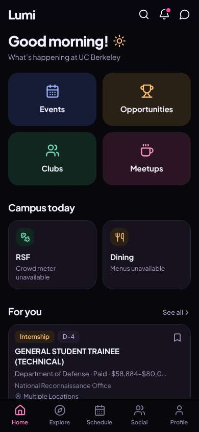</a> |
| 2 | click “Opportunities” | `/explore/opportunities` | 911 | expects: “a list of internships and jobs” (0.7) as expected _neutral_: “OK, these are internships. But Department of Defense, Air Force, Rangeland... none of it says Berkeley. And what's D-4, D-1?” → f1 |  |
| 4 | type “Search opportunities” ← “Berkeley” | `/explore/opportunities` | 896 | expects: “only internships in or near Berkeley” (0.6) **mismatch**: Search matched the word Berkeley — I got scholarships, hackathons, study abroad in Tokyo, a DC program. Not internships near Berkeley. ⚑ mismatch _neutral_: “Hm. It just found anything with 'Berkeley' in it. Tokyo isn't near Berkeley. The first one, city government internship, might be local but doesn't say paid.” → f2 | <a href="shots/004-type-som.jpg">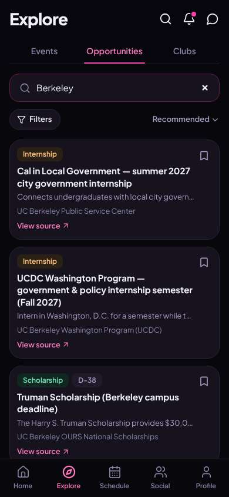</a> |
| 6 | click “Filters” | `/explore/opportunities` | 871 | expects: “options to pick paid, internship, and location” (0.6) as expected _delighted_: “Now we're talking. Internships, Bay Area — plain words. I wish there was a 'paid only' button but this is close.” → f3 |  |
| 8 | click “Internships” | `/explore/opportunities` | 857 |  |  |
| 9 | click “Bay Area” | `/explore/opportunities` | 844 | expects: “Bay Area gets selected and results narrow” (0.8) **mismatch**: Internships + Bay Area says 'No results'. The button is greyed out. ⚑ mismatch _confused_: “No internships in the Bay Area? At Berkeley? That can't be right. Maybe it's because I typed 'Berkeley' up top earlier... I don't know. It doesn't tell me why.” → f4 | <a href="shots/009-click-som.jpg">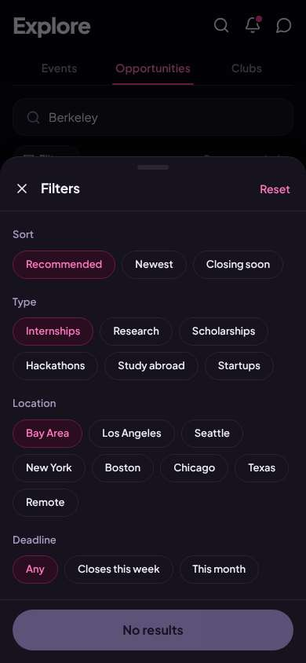</a> |
| 11 | click “Close” | `/explore/opportunities` | 849 | expects: “filter panel closes and I see the search box again” (0.8) as expected _neutral_: “OK, I'll erase 'Berkeley' and try the filters again.” → f5 | <a href="shots/011-click-som.jpg">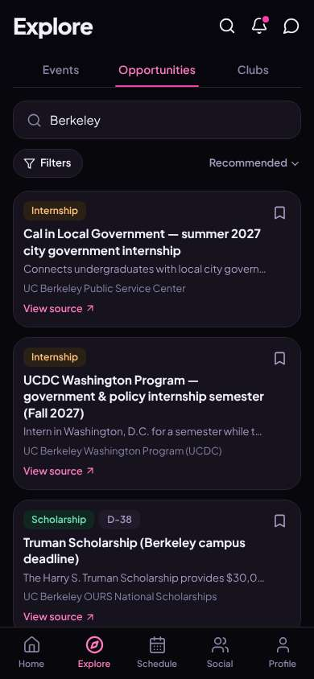</a> |
| 13 | type “Search opportunities” | `/explore/opportunities` | 863 | expects: “search cleared, full list back” (0.7) as expected _neutral_: “Fine. Filters again.” | <a href="shots/013-type-som.jpg">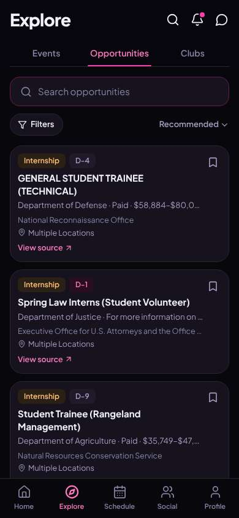</a> |
| 15 | click “Filters” | `/explore/opportunities` | 840 |  | <a href="shots/015-click-som.jpg">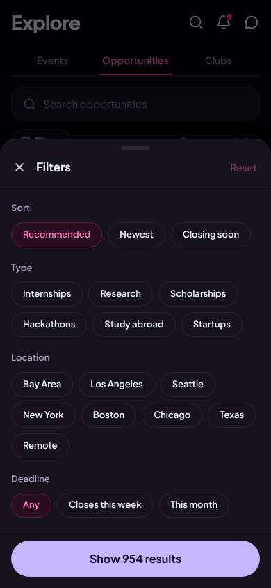</a> |
| 16 | click “Internships” | `/explore/opportunities` | 842 |  | <a href="shots/016-click-som.jpg">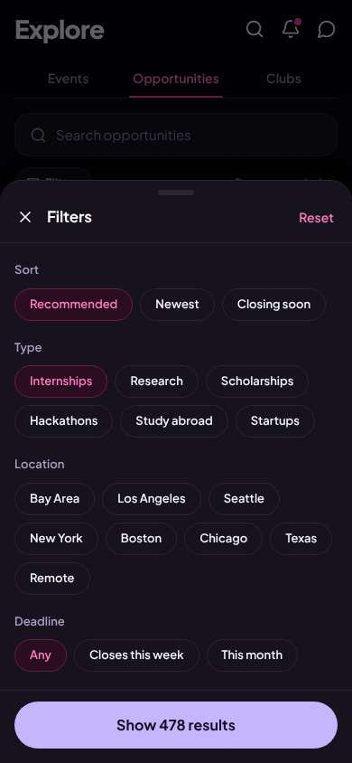</a> |
| 17 | click “Bay Area” | `/explore/opportunities` | 850 | expects: “some results count for Bay Area internships” (0.6) as expected _curious_: “93. OK, that's more like it. Annoying that the search word was quietly in the way before.” | <a href="shots/017-click-som.jpg">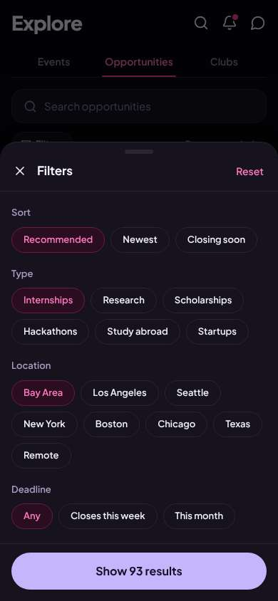</a> |
| 19 | click “Show 93 results” | `/explore/opportunities` | 846 | expects: “list of Bay Area internships” (0.8) as expected _delighted_: “Sierra Club, Oakland. That's a real organization and it's right next door. Most of these are engineering, but that one could fit a History guy. Doesn't say if it's paid though.” → f6 | <a href="shots/019-click-som.jpg">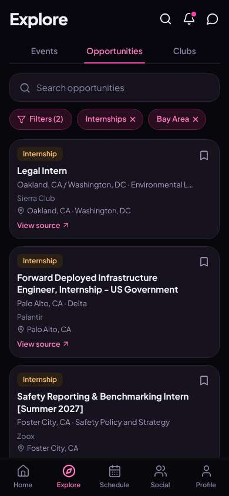</a> |
| 21 | click “Internship Legal Intern Oakland, CA / Wa” | `/opportunities/:id` | 863 | expects: “details on the Sierra Club internship: pay, how to apply” (0.7) **mismatch**: Details page with location, 'Source verified', 'Apply at Source' button, last checked today. But nothing about pay or a deadline. ⚑ mismatch _neutral_: “'Source verified' and 'Last checked Sun, Nov 8' — OK, that makes it feel legit. Apply at Source is clear. But is it paid? It doesn't say.” → f7 | <a href="shots/021-click-som.jpg">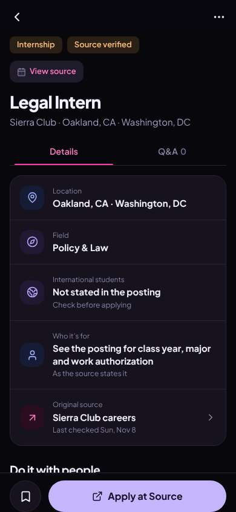</a> |
| 23 | scroll down | `/opportunities/:id` | 1315 | expects: “maybe pay or deadline further down” (0.4) **mismatch**: Bottom of page is just 'Prep together' — no pay, no deadline. ⚑ mismatch _neutral_: “Nope. I'll go back and look for one that actually says paid.” | <a href="shots/023-scroll-som.jpg">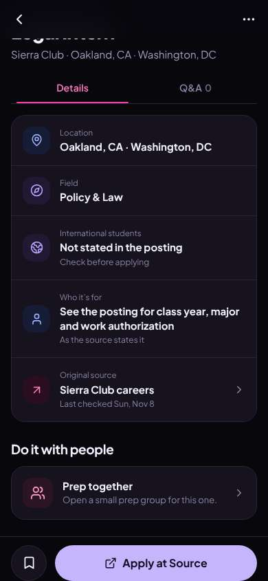</a> |
| 25 | back | `/explore/opportunities` | 1143 | expects: “back to the Bay Area internship list with filters still on” (0.7) as expected ⚑ backtrack _neutral_: “Good, it kept my filters. Mostly software engineering. Let me scroll for something a History major could do.” | <a href="shots/025-back-som.jpg">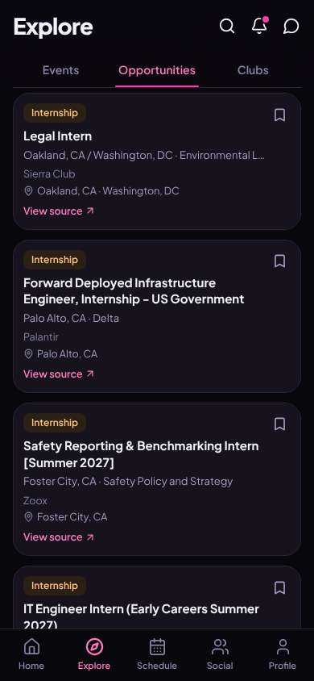</a> |
| 27 | scroll down | `/explore/opportunities` | 1319 |  | <a href="shots/027-scroll-som.jpg">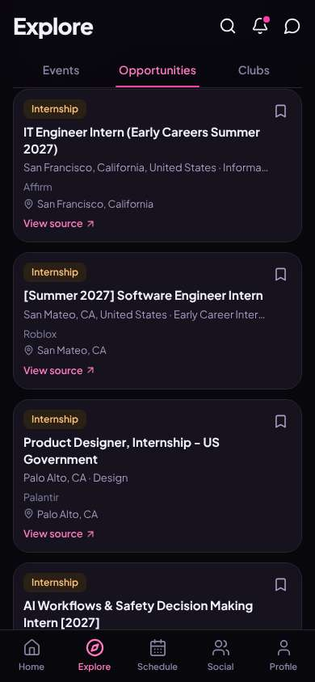</a> |
| 28 | scroll down | `/explore/opportunities` | 1308 | _bored_: “Software engineer, software engineer, software engineer... I'm a History major. There's no way to say 'non-tech' and none of the cards say if they pay.” → f8 | <a href="shots/028-scroll-som.jpg">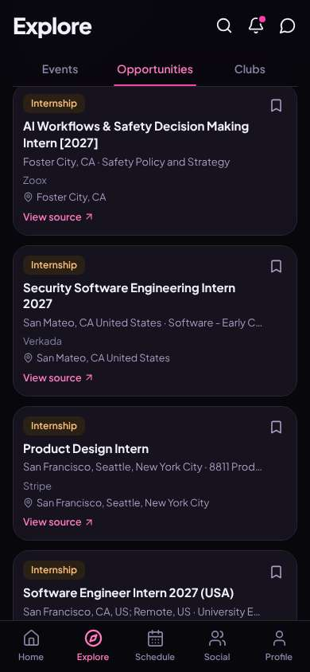</a> |
| 30 | scroll down | `/explore/opportunities` | 1311 |  | <a href="shots/030-scroll-som.jpg">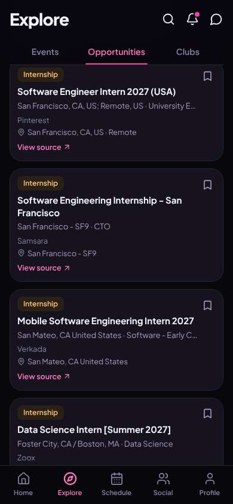</a> |
| 31 | scroll down | `/explore/opportunities` | 1323 |  | <a href="shots/031-scroll-som.jpg">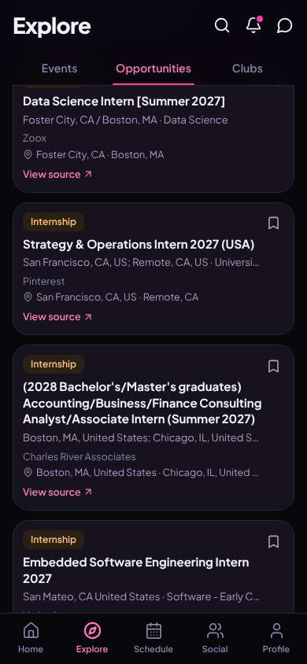</a> |
| 32 | click “Internship Strategy & Operations Intern ” | `/opportunities/:id` | 847 | expects: “Pinterest internship details, hopefully with pay” (0.5) **mismatch**: Pinterest Strategy & Operations internship in SF, 'Source verified', last checked today, 'Apply at Source' button. Again no pay or deadline shown. ⚑ mismatch _neutral_: “Pinterest, San Francisco, not engineering, and it says verified and checked today. A company like that pays interns, I'd guess, but the app never actually told me. I'll hit Apply at Source on the real site. Good enough for today.” → f9 |  |
| 34 | finish | `/opportunities/:id` |  |  | <a href="shots/034-finish-som.jpg">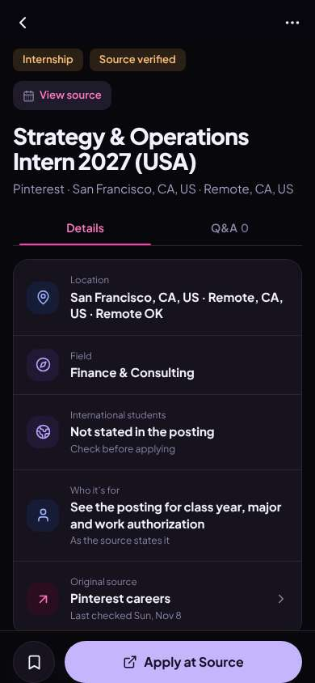</a> |

## Automatic checks (harness, not persona)

| screen | tap targets < 44px | sideways overflow | broken images |
|---|---|---|---|
| `/` | 6 (Search 40×40, Notifications 40×40, Messages 40×40, See all 55×20, Save 36×36) | — | — |
| `/explore/opportunities` | 22 (Search 40×40, Notifications 40×40, Messages 40×40, Search opportunities 295×23, Filters 87×36) | — | — |
| `/opportunities/:id` | 3 (Back 40×40, More 40×40, View source 77×20) | — | — |

## Timing (harness)

- Full page load (navigation timing): 292 ms
