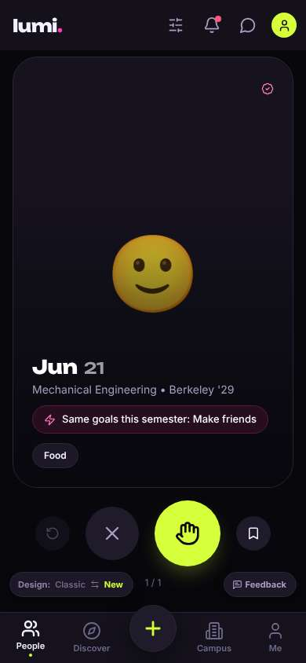
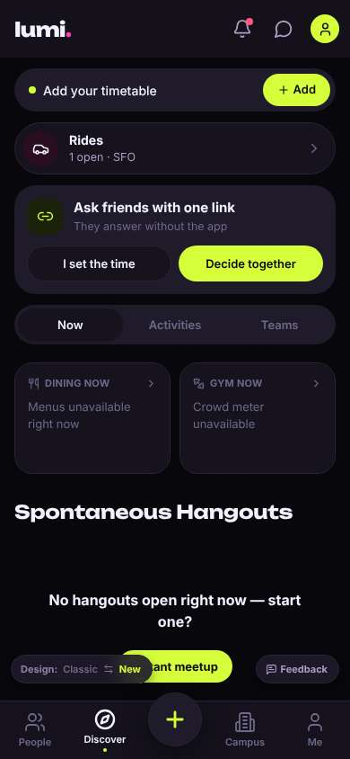
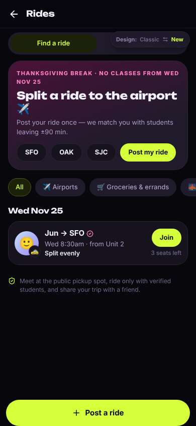
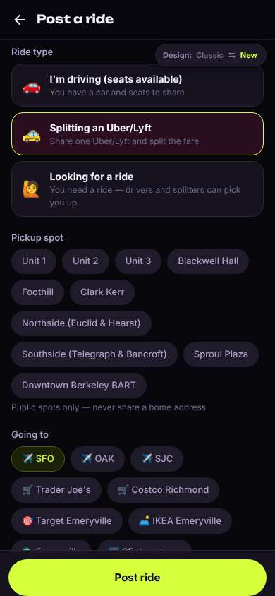
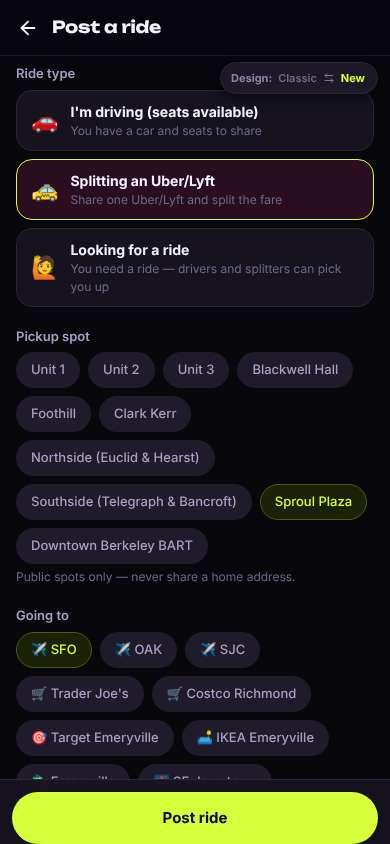
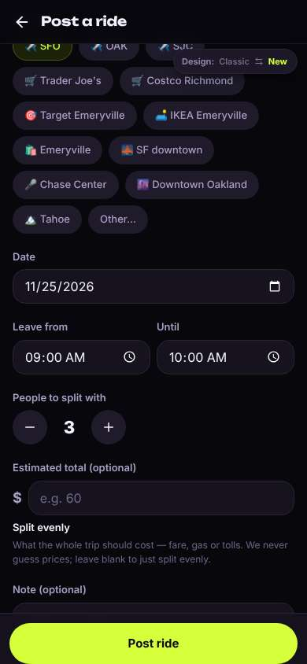
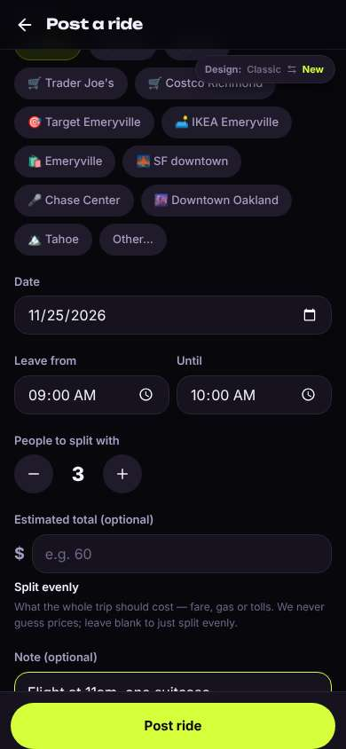
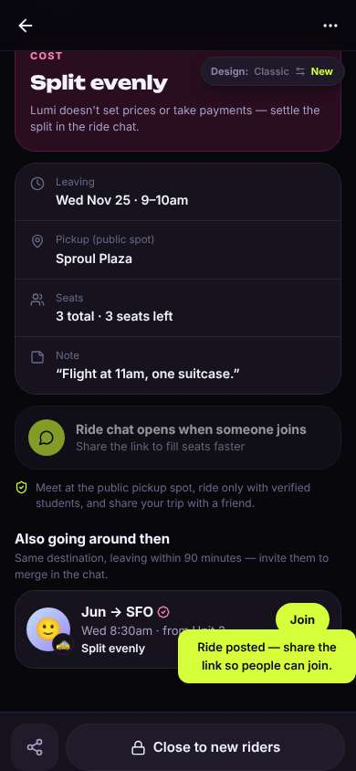

# ux-sim run `smoke-20261102-0713-fresh-ride`

> **AI simulation — hypotheses, not measured user behaviour.** One simulated persona; nothing here is a rate or a measurement of real students.

| | |
|---|---|
| Persona | **Seoyeon**, 20 — Exchange student (one semester, from Yonsei) · phone 390×844 · prefers ko · tech medium (`seoyeon-exchange-korean`) |
| Scenario | **Share a ride to SFO for Thanksgiving** — You fly out of SFO the Wednesday before Thanksgiving (Nov 25) in the morning. Find other students to split a ride to the airport with — join one, or post yours so others can find you. (`ride-sfo-thanksgiving`) |
| Target | local · http://localhost:37831 · worktree commit `931b47fe4a05` |
| Outcome | **success** · ended by persona |
| Account | fresh real account `seoyeon.rideahzg@berkeley.edu` (Seoyeon, Business Administration, born 2006; sample: false) · peers seeded: Jun |
| Goal check (fixed, by harness) | met at step 8 after 8 action(s) — evidence: posted a ride to SFO on Nov 25 — _During the run the persona posted an SFO ride on Nov 25, or joined/requested someone's SFO ride (server-side)._ |
| Persona's reason | “scripted smoke run” |
| Effort | 8/45 actions · objective frustration 1.00/5 · 0 confused note(s) · ~84s simulated |
| Drop-off risk | **low** _(AI hypothesis, harness heuristic)_ — Harness heuristic, not a measurement: goal reached without serious friction. · basis: steps 4 |

Known environment limits (not UX findings)

- Dining menus and RSF gym crowd levels need live campus sources (the local stack runs with CAMPUS_LIVE=0) — empty or missing data there is not a UX bug.
- AI features (Ask Lumi, AI profile draft on /start, conversation starters) need an OpenAI key; none is configured locally.
- Course catalog is the real Berkeley Class Schedule (6588 courses, Fall 2026 + Spring 2027), fetched 2026-11-02 with the worker's adapter. Seat counts and very recent changes may differ from live.
- Opportunities are only the CSV rows in server/data (deadline calendar). Live also has worker-fetched internships (Greenhouse/Lever/Ashby), Devpost hackathons and CalLink/campus events.
- No e-mail is sent: the sign-up / sign-in code is shown on screen in the hint (live sends a real e-mail).
- Real-time updates (SSE) work locally; other people never reply unless the stack was started with --autoreply.
- Signed in as a brand-new real (non-sample, e-mail-verified) account made for this run. Other students exist only if the scenario seeds peers (local fixtures); sample profiles are hidden from real accounts, as on live.

## Friction

_No friction events were logged._

## Timeline

| step | what | screen | ms | signals / notes | shot |
|---|---|---|---|---|---|
| 0 | start | `/` | 1319 |  |  |
| 1 | click “Discover” | `/discover` | 1077 |  |  |
| 2 | click “Rides 1 open · SFO” | `/rides` | 886 |  |  |
| 3 | click “Post my ride” | `/rides/new` | 852 |  |  |
| 4 | click “🚕 Splitting an Uber/Lyft Share one Uber” | `/rides/new` | 852 | ⚑ no_effect |  |
| 5 | click “Sproul Plaza” | `/rides/new` | 849 |  |  |
| 6 | scroll down | `/rides/new` | 1312 |  |  |
| 7 | type “Flight at 1:30pm, one big suitcase” ← “Flight at 11am, one suitcase.” | `/rides/new` | 867 |  |  |
| 8 | click “Post ride” | `/rides/:id` | 853 |  |  |
| 9 | finish | `/rides/:id` |  |  |  |

## Automatic checks (harness, not persona)

| screen | tap targets < 44px | sideways overflow | broken images |
|---|---|---|---|
| `/` | 6 (Filters 40×40, Notifications 40×40, Messages 40×40, Me 32×32, Feedback 93×32) | — | — |
| `/discover` | 12 (Notifications 40×40, Messages 40×40, Me 32×32, Add 75×36, I set the time 161×40) | — | — |
| `/rides` | 12 (Back 40×40, Find a ride 173×36, My rides 173×36, SFO 60×36, OAK 63×36) | — | — |
| `/rides/new` | 21 (Back 40×40, Unit 1 64×36, Unit 2 67×36, Unit 3 67×36, Blackwell Hall 116×36) | — | — |
| `/rides/:id` | 3 (Back 40×40, More 40×40, Switch to the classic design 158×32) | — | — |

## Timing (harness)

- Full page load (navigation timing): 294 ms
