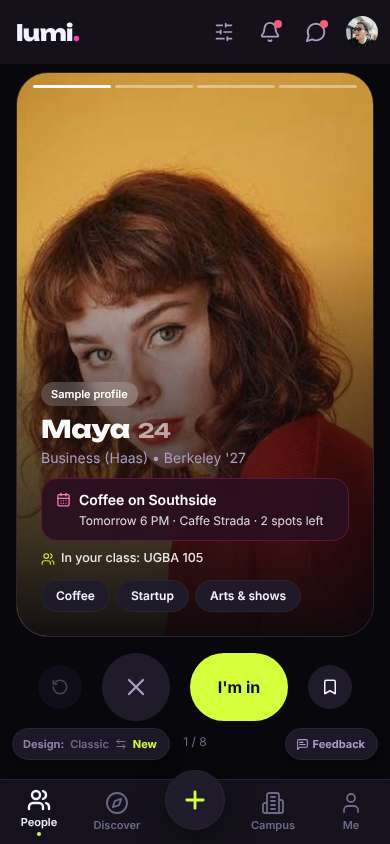
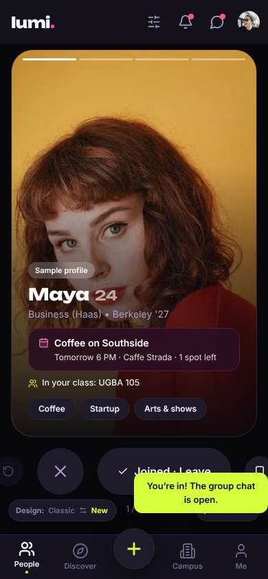
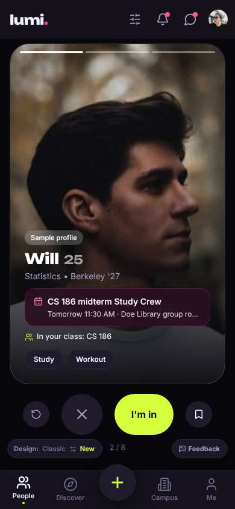
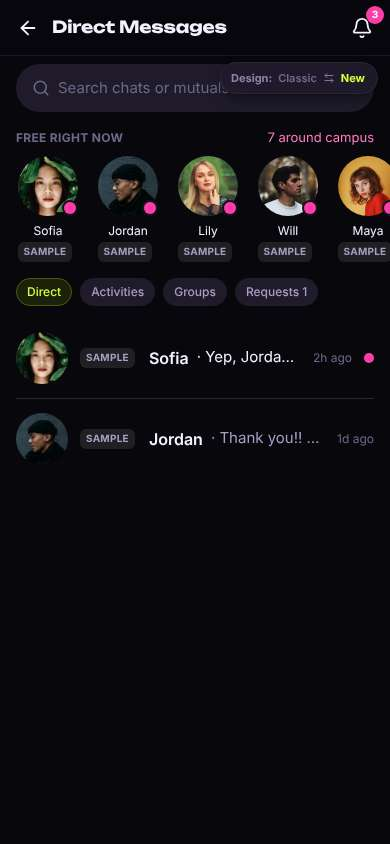
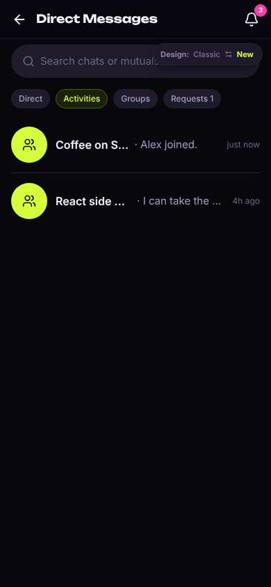
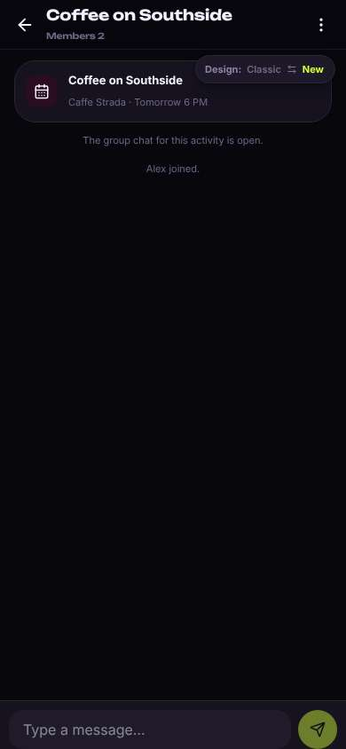

# ux-sim run `smoke-minji-lunch-today`

> **AI simulation — hypotheses, not measured user behaviour.** One simulated persona; nothing here is a rate or a measurement of real students.

| | |
|---|---|
| Persona | **Minji**, 17 — First-year (started college a year early) · phone 390×844 · prefers ko · tech high (`minji-freshman-17`) |
| Scenario | **Find someone to get lunch with today** — It's a weekday and you'd rather not eat lunch alone again. Use the app to find someone (or a group) to get lunch with today, and let them know you're in. (`lunch-today`) |
| Target | local · http://localhost:32979 · worktree commit `f1e3d87f2f23-dirty-1f8877b9` |
| Outcome | **success** · ended by persona |
| Account | shared demo account (sample profile with someone else's data) |
| Goal check (fixed, by harness) | met at step 2 after 1 action(s) — _Joined or requested to join a meal plan / sent a lunch invite: the button now reads as joined/requested, or a chat with the plan opened._ |
| Persona's reason | “I joined a coffee plan and found the group chat. Not lunch today but close enough.” |
| Effort | 5/40 actions · objective frustration 0.50/4.5 · 2 confused note(s) · ~15s simulated |
| Drop-off risk | **medium** _(AI hypothesis, harness heuristic)_ — Harness heuristic, not a measurement: 1 severity≥3 event(s), objective frustration 0.50/4.5, 2 confused note(s). · basis: steps 0, 2 |

Known environment limits (not UX findings)

- Dining menus and RSF gym crowd levels need live campus sources (the local stack runs with CAMPUS_LIVE=0) — empty or missing data there is not a UX bug.
- AI features (Ask Lumi, AI profile draft on /start, conversation starters) need an OpenAI key; none is configured locally.
- Course catalog is the built-in sample list (~210 courses, typical times). Live has the real Berkeley Class Schedule from the data worker.
- Opportunities are only the CSV rows in server/data (deadline calendar). Live also has worker-fetched internships (Greenhouse/Lever/Ashby), Devpost hackathons and CalLink/campus events.
- No e-mail is sent: the sign-up / sign-in code is shown on screen in the hint (live sends a real e-mail).
- Real-time updates (SSE) work locally; other people never reply unless the stack was started with --autoreply.

## Friction

| # | step | type | sev | persona says | screen | element | env-limited | evidence |
|---|---|---|---|---|---|---|---|---|
| f1 | 0 | Confusing UI | 3 | “헐 big face photo… is this a dating app? And 'I'm in' — in what, coffee with Maya or matching with her?” _wish: say what I'm joining, like 'Join coffee'_ | `/` | I'm in | no | [shot](shots/000-start.jpg) [marked](shots/000-start-som.jpg) |
| f2 | 2 | Confusing UI | 2 | “뭐지… where is the group chat? and the button now says 'Joined · Leave' — if I tap it again do I leave??” | `/` | Joined · Leave | no | [shot](shots/002-click.jpg) [marked](shots/002-click-som.jpg) |
| f3 | 6 | Hard to find | 2 | “oh there it is, under Activities. took me a while” | `/chats?tab=activity` | Activities | no | [shot](shots/006-click.jpg) [marked](shots/006-click-som.jpg) |
| f4 | 8 | Missing / empty content | 2 | “ok I'm in the chat. but it's coffee tomorrow, not lunch today… nobody for lunch today?” | `/chats/:id` |  | no | [shot](shots/008-click.jpg) [marked](shots/008-click-som.jpg) |

Severity: 1 = Minor — noticed it, cosmetic or a small annoyance; did not slow me down. · 2 = Moderate — slowed me down or made me hesitate; I recovered on my own. · 3 = Major — real confusion, a wrong path or many extra steps; I nearly gave up or only got through by guessing. · 4 = Blocker — I could not continue, gave up, or would stop using the app here.

## Timeline

| step | what | screen | ms | signals / notes | shot |
|---|---|---|---|---|---|
| 0 | start | `/` | 918 | _confused_: “헐 big face photo… is this a dating app? And 'I'm in' — in what, coffee with Maya or matching with her?” → f1 |  |
| 2 | click “I'm in” | `/` | 920 | expects: “I'd join Maya's coffee plan, maybe a chat opens” (0.5) **mismatch**: It says the group chat is open but I'm still on the card. And it's coffee tomorrow, not lunch today. ⚑ mismatch _confused_: “뭐지… where is the group chat? and the button now says 'Joined · Leave' — if I tap it again do I leave??” → f2 |  |
| 4 | swipe left | `/` | 1388 | expects: “next person” (0.8) |  |
| 5 | click “Messages” | `/chats` | 848 | expects: “messages, maybe the coffee group chat” (0.6) |  |
| 6 | click “Activities” | `/chats?tab=activity` | 866 | expects: “the coffee group chat” (0.6) as expected _curious_: “oh there it is, under Activities. took me a while” → f3 |  |
| 8 | click “Coffee on Southside · Alex joined. just ” | `/chats/:id` | 870 | _neutral_: “ok I'm in the chat. but it's coffee tomorrow, not lunch today… nobody for lunch today?” → f4 |  |
| 10 | finish | `/chats/:id` |  |  |  |

## Automatic checks (harness, not persona)

| screen | tap targets < 44px | sideways overflow | broken images |
|---|---|---|---|
| `/` | 6 (Filters 40×40, Notifications 40×40, Messages 40×40, Me 32×32, Feedback 93×32) | — | — |
| `/chats` | 7 (Back 40×40, Notifications 40×40, Direct 56×28, Activities 75×28, Groups 64×28) | — | — |
| `/chats?tab=activity` | 7 (Back 40×40, Notifications 40×40, Direct 56×28, Activities 75×28, Groups 64×28) | — | — |
| `/chats/:id` | 3 (Back 40×40, Menu 40×40, Switch to the classic design 158×32) | — | — |

## Timing (harness)

- Full page load (navigation timing): 109 ms
